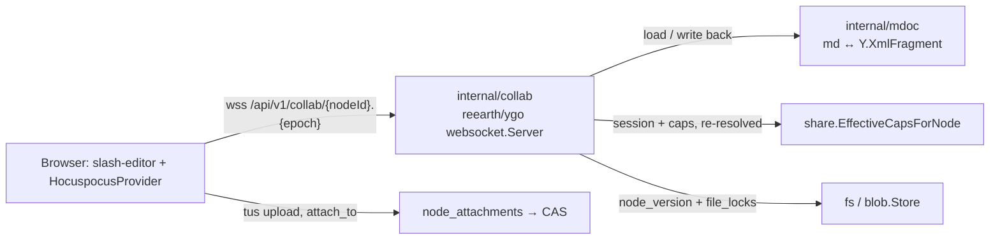

# Block Documents (Markdown + slash-editor)

> **Status: shipped — M39 ✅** ([milestones.md](milestones.md),
> [detail](milestones/M39.md)). This describes what is built. It began as the
> design written before the code; where the build departed from it, the text
> below says what shipped and why.

## The problem

Every document pp-hub could author was an office file, edited through
OnlyOffice ([office-integration.md](office-integration.md)). What a team reaches
for when it writes a spec, a runbook or meeting notes is a block editor — Lark
Docs, Notion — and pp-hub had none. A `.md` file could be uploaded and
previewed as a text snippet, and that was all.

## Decisions

| Question                                           | Decision                                                                                         |
| -------------------------------------------------- | ------------------------------------------------------------------------------------------------ |
| Editor                                             | [slash-editor](https://slasheditor.dev) (Tiptap/ProseMirror, shadcn UI we own)                   |
| What is stored                                     | A plain `.md` file node — CAS blob, `node_versions`, shares, trash, previews unchanged           |
| Collaboration                                      | Realtime Yjs from v1: remote carets and presence avatars                                         |
| Sync server                                        | [reearth/ygo](https://github.com/reearth/ygo), a patched copy embedded in `apps/server`          |
| Markdown ↔ document                                | Go (`internal/mdoc`), held to slash-editor's JS serializer by golden fixtures                    |
| Embedded images and files                          | Attachments owned by the document (`node_attachments`), not files in the folder listing          |
| Version cadence                                    | Coalesced: after 30 s quiet, at most every 5 min under continuous typing, and on server shutdown |
| Structure                                          | Drive folders; no sub-pages, no page tree                                                        |
| Imported `.md` that would not survive a round trip | Opens read-only; **Edit** warns first                                                            |
| Crash window                                       | Up to ~5 min of unflushed edits may be lost on a crash; graceful shutdown flushes                |

**Not in v1:** comments (they are M29's, and slash-editor's comment anchors do
not survive markdown anyway), @mentions, the AI block, sub-pages and databases,
editing through a share link, offline editing, more than one collaboration
instance.

## Architecture

The shape is the one OnlyOffice already has for `.docx`: while anyone has the
document open, the live copy is held by a collaboration service, and that
service writes it back as ordinary versions. The difference is that the
service is inside `apps/server` and the stored format is markdown.



1. `/edit/$nodeId` picks the editor by type: a markdown document (stored MIME
   `text/markdown`, or a `.md` name) opens the block editor, anything else
   OnlyOffice.
2. The client asks `GET /api/v1/nodes/{id}/collab` for the room — named
   `<nodeId>.<epoch>` — and connects to it. The first peer to join makes the
   server take the file's lock, load the current version, `mdoc.Parse` it and
   seed the Y.Doc.
3. Edits are written back when the room has been quiet for 30 s, at most 5 min
   apart under continuous typing, and on shutdown. Each write-back renders the
   room to markdown and writes a version **only when the bytes differ** from
   the current one.
4. After its last peer leaves, the room stays resident for `RoomIdleTimeout`
   (2 min), still holding the lock, so a reload rejoins the same epoch; ygo
   then unloads it, which releases the lock.
5. **New → Document** is `POST /spaces/{id}/documents` (M31) with
   `kind=markdown`, writing an empty `.md` under the given name into the M19
   write target.

### API surface

| Route                                        | What it does                                                                                                       |
| -------------------------------------------- | ------------------------------------------------------------------------------------------------------------------ |
| `GET /api/v1/nodes/{id}/collab`              | `{room, can_write, lossy}`. Needs `CapDownload` and a markdown file; 413 for a document over 16 MiB                |
| `GET /api/v1/collab/{room}`                  | The room's WebSocket (Hocuspocus protocol). Wrapped in `socketOrigin`; the room authorizes node, epoch and mode    |
| `GET /api/v1/nodes/{id}/attachments/{hash}`  | An attachment's bytes, needing `CapDownload` on the document; images inline, anything else as a download           |
| `POST /api/v1/uploads` with `attach_to=<id>` | The tus upload, addressed to a document; needs `CapEdit` on it. The commit answers the hash in `Upload-Attachment` |
| `POST /api/v1/spaces/{id}/documents`         | `kind=markdown` creates an empty `.md`                                                                             |

The 16 MiB ceiling (`maxDocumentBytes`) exists because a live Y.Doc costs a
multiple of its markdown, and nobody writes a document that size by hand.

### Why Go, and not a Hocuspocus sidecar

Hocuspocus under Bun was the first candidate: it runs slash-editor's own
serializer, so the stored markdown could never drift from the client's
schema. It was rejected because it adds a second server runtime to a stack
whose whole backend is one Go binary, when the CRDT half is now available in
Go — reearth/ygo and Deln0r/ygo are both byte-compatible with `yjs@13` and
speak the Hocuspocus protocol. The markdown half is the part only JS has, and
it is bounded: v1 serializes a fixed block set, and golden fixtures make any
drift a CI failure rather than silent formatting loss.

Two Go shapes were rejected with it. **Client-side serialization** (the server
relays Yjs and a browser writes the markdown) leaves the stored file stale
whenever the last tab closes before its next save, and needs a hand-built
protocol to decide which client seeds an empty room. **y-webrtc** is a full
mesh that restrictive networks block, with the same persistence problem.

### Why reearth/ygo over Deln0r/ygo

Deln0r/ygo is the officially listed port with the stronger stability signal,
and its core would serve. Its server, though, is built around its own update
log and versioning — both of which pp-hub already has in `node_versions`.
reearth/ygo has the three things this design leans on: `Server.Apply` (seed
and reseed a room from the server), coalesced persistence with a window and a
maximum wait, and `Authorize` returning a read-only connection. Clients speak
the standard Hocuspocus protocol either way, so switching libraries later
costs the server adapter and nothing in the browser.

### The patched copy

`apps/server/third_party/ygo` is `reearth/ygo v1.50.0` cut down to the
packages `provider/websocket` and `crdt` need, wired in by a `replace` in
`apps/server/go.mod`; `PATCHES.md` lists three patches, each marked
`pp-hub patch` in the source:

1. **Connection origin** — `ConnectionConfig.Origin` and `ConnectionOrigin`.
   ygo uses its unexported `*peer` as the transaction origin and offers no way
   to map it back to a request; the patch lets `Authorize` attach the user, so
   a version is attributed to its writer. Reflecting into ygo's internals,
   which the spike proved possible, was not an option.
2. **SyncStatus acknowledgements.** `HocuspocusProvider` counts its unsynced
   changes down only on Hocuspocus's SyncStatus message, which ygo never sent,
   so `hasUnsyncedChanges` never cleared and the header could not say "Saved".
   ygo now answers every SyncStep2 and Update the way `@hocuspocus/server`
   does, a read-only peer's dropped writes included.
3. **Server Ping** (`Server.PingInterval`, 15 s in pp-hub). The provider
   reconnects after 30 s without a message, and a peer alone in a room got
   none — ygo does not echo a peer's own awareness back to it the way
   Hocuspocus does.

The Dockerfile copies `third_party/` into the build context for the same
`replace`. The directory goes once upstream carries equivalent APIs.

## `internal/mdoc`

Pure Go, no I/O. `Parse` follows how slash-editor parses (marked): at every
block start the slash-editor tokenizers — `<!-- slash:… -->` markers, media
lines, callouts, toggles, columns, task and ordered lists — are tried first,
and anything else is read from goldmark's GFM tree. `Seed` and `Fill` write
the resulting ProseMirror-shaped tree into the room's `XmlFragment` named
**`content`** (slash-editor's `collaboration()` overrides Tiptap's `default`)
the way `@tiptap/y-tiptap` does:

- an element per node, `nodeName` the node type; each non-null attr is set with
  its JSON type kept (`level` is a number);
- text as `XmlText` whose format attributes are the marks, keyed by mark name
  with `mark.attrs` as the value — `{"bold":{}}`, `{"link":{"href":…}}`.
  Inserting with `nil` attributes inherits the formatting to the left, as in
  Yjs, so every mark run is closed explicitly (`{"bold": nil}`).

`Read` walks the fragment back into that tree and `Render` writes it as
markdown, frontmatter in front.

The v1 block set, in slash-editor's schema names:

- **Nodes:** `paragraph`, `heading`, `bulletList`/`orderedList`/`listItem`,
  `taskList`/`taskItem`, `blockquote`, `codeBlock`, `horizontalRule`,
  `table`/`tableRow`/`tableCell`/`tableHeader`, `callout`,
  `details`/`detailsSummary`/`detailsContent` (toggle), `columns`/`column`,
  `mermaid`, `image`, `file`, `hardBreak`.
- **Marks:** `bold`, `italic`, `strike`, `code`, `link`.

The web editor turns off what `createBlockKit()` ships beyond that — `video`,
`embed`, `comment`, and StarterKit's `underline` (it serializes as
`++text++`). Those options live once, in `apps/web/src/lib/collab/mdoc-kit.ts`
(`createMdocKit`), used by the editor and by the fixture script alike, so the
schema a browser can write is exactly the schema `mdoc` can store.

**Block ids are written by `Parse`.** Every block carries an `id` attr
(`data-block-id`); `parseMarkdown` emits none, and an editor mounting an
id-less document assigns them and writes that into the shared doc — two
editors mounting together also each append Tiptap's trailing empty paragraph.
Seeding every block with an id and ending the document with an empty
paragraph makes a mount write nothing (spike, below). `Render` omits ids and
the trailing empty paragraph, so neither ever reaches the markdown. The editor
also mounts only after the first sync: mounted on an empty document it would
write its own paragraph into the room ahead of the content.

### Golden fixtures

`bun apps/web/scripts/mdoc-fixtures.ts`, run against the same
`@slash-editor/core` as `apps/web` and the same `createMdocKit()`, writes 121
fixtures to `internal/mdoc/testdata/fixtures/` — the input, its frontmatter,
slash-editor's `parseMarkdown` JSON, its `serializeMarkdown` output, a Y
update built by `@tiptap/y-tiptap`, and whether `Parse` must flag it lossy —
plus `schema.json` (attribute defaults, id-bearing types, mark order), which
the Go schema table is checked against. Go tests assert `Parse` yields that
JSON and `Render` that markdown. The other direction is checked too:
`go test ./internal/mdoc -run TestGoUpdates -update` writes the Go-built seed
for each fixture to `testdata/go-updates/`, and
`apps/web/tests/mdoc-go-updates.test.ts` decodes it with
`yXmlFragmentToProsemirrorJSON` and requires the document slash-editor parses
and the markdown it writes back (bytes differ by client id, so they are not
compared). Bumping slash-editor means regenerating the fixtures; any
difference fails CI. The root `vite.config.ts` keeps `vp fmt` off the testdata,
which the script writes byte for byte.

### Markdown that does not survive

An uploaded `.md` may hold what the block set cannot represent. The spike
measured slash-editor's own round trip: raw HTML is escaped to text (and drifts
further on a second pass), footnotes turn into links, `H~2~O` becomes
strikethrough. Byte comparison is the wrong test — a hand-padded table
round-trips with different padding and loses nothing — so `Parse` flags the
document **lossy** when it meets a construct outside the block set: HTML other
than slash markers and `<details>`, footnotes, and extension syntax it does not
map. A lossy document opens read-only and **Edit** warns that saving will
rewrite the file, with the untouched original one restore away in version
history.

YAML frontmatter is not lossy: `Parse` strips it before parsing (slash-editor
would turn it into a rule and a heading), the room keeps it outside the
fragment, and `Render` writes it back unchanged. It cannot be edited in the
block editor.

### Which files are markdown

A version's MIME comes from its name (`mime.TypeByExtension`), and Go's builtin
table has no `.md`: it fell back to the host's `mime.types`, which says
`text/markdown`, `text/x-markdown` or nothing depending on the distribution.
`internal/fs/markdown.go` now registers `.md` itself, so it is stored as
`text/markdown; charset=utf-8`, and `fs.IsMarkdown` compares the base type.
Migration `0014_markdown_mime.sql` backfills that type onto `.md` versions
stored before as `application/octet-stream` or `text/x-markdown` — without it,
every document uploaded before M39 would refuse to open.

## `internal/collab`

`GET /api/v1/collab/{room}` is mounted inside the authenticated `/api/v1`
group, so the session cookie authenticates the upgrade like any other request.
`Hub.ServeSocket` wraps `websocket.Server.ServeHTTP`: it sets
`r.SetPathValue("room", …)` (ygo names the room from that path value), derives
a cancellable request context, and registers the connection with the user and
session behind it.

- **Origin is checked in the wrapper, before ygo sees the request.**
  `Server.sameOrigin` wraps mutations and a WebSocket upgrade is a `GET`;
  without a check, a page on another origin could open a socket with the
  victim's cookie. ygo's own `AllowedOrigins` is not enough: `Authorize` runs
  (and loads the room) before it, and it admits a request with no `Origin` at
  all. `socketOrigin` therefore requires an `Origin` and compares it against
  `PP_EXTERNAL_URL`; `TestCollabSocketRefusesForeignOrigins` holds the route
  to it. (`AllowedOrigins` is still set to the same origin.)
- **Authorization** is ygo's `Authorize`, returning
  `ConnectionConfig{ReadOnly, Origin}`. It requires `CapDownload`, the line
  `edit-session` draws for OnlyOffice and for the same reason: sync hands the
  complete document to the browser. `ReadOnly = !CapEdit`: a reader receives
  edits while its own updates and awareness are dropped server-side. The node
  must be a live file whose current version is markdown, and the room must be
  the one currently loaded or handed out. **`OnTokenAuth` stays nil** — when
  set, it overrides `Authorize`'s read-only decision with whatever the client's
  token says (the spike made a reader writable with another user's token). The
  editor therefore learns it is read-only from `can_write` over REST, not from
  the provider, and calls `setEditable(false)`; a dropped edit would otherwise
  stay in the reader's local copy.
- **Access is re-resolved** (M21). Every 60 s `Recheck` asks again, for each
  peer, whether its session is still active — not revoked, within its idle
  expiry and the 90-day absolute cap (`auth.SessionAbsoluteTTL`), account not
  suspended — and whether its capabilities still admit it in the same mode.
  ygo has no per-peer close, so the wrapper cancels that connection's request
  context, which closes the socket and leaves the room and every other peer
  alone. The provider reconnects on its own and `Authorize` decides again: a
  downgrade comes back read-only, a revocation gets 401. A document trashed,
  purged or no longer markdown closes every socket. A lookup that fails keeps
  the socket: a database hiccup is not a revocation. The client sees 1006
  either way — ygo sends no close frame — so on every close it re-reads
  `/collab` and destroys the provider on a 4xx, instead of retrying 401s
  forever.
- **Epochs.** The Y.Doc exists only in memory and is regenerated from markdown
  whenever a room loads, with fresh client ids. A client still holding the
  previous generation — a laptop that slept past the room's unload — would
  merge it into the new one and duplicate the whole document. The room name
  therefore carries an epoch (`<nodeId>.<epoch>`), minted by `/collab` when no
  room is resident or pending; an epoch handed out and never joined expires
  after 2 min. Any other epoch is refused, and the client, seeing a different
  room in `/collab`, discards its Y.Doc and rejoins. Edits made while
  disconnected past an unload are lost, which is the offline-editing non-goal
  stated plainly.
- **The file is locked** while the room is resident: a `file_locks` row whose
  token is `collab:<room>`, taken before the seed and refreshed by `Recheck`,
  so a REST replacement is answered 423 exactly as it is while OnlyOffice
  holds a `.docx` (M24). The prefix is how the edge tells a room's lock apart:
  restoring a version is let through it (below). Unloading releases the lock,
  and `Hub.Start` clears every `collab:` lock a previous process left — with
  one instance, no room can be resident before it serves.
- **Reseed.** A version restored while no room is loaded is simply what the
  next load parses. Restoring while a room is open goes through
  `Hub.Reseed`: the room's unwritten edits are written first, as a version of
  their own, so the restore is one step from undoing; then the fragment is
  replaced through `Server.Apply` (delete everything, insert the parsed
  document, one transaction), so every peer sees the restored document at once
  and the epoch is kept. A room with nobody in it is closed instead, and the
  next join loads the new version.
- **Persistence** uses `PersistenceAdapter` only as the flush signal:
  `PersistCoalesceWindow = 30s`, `PersistCoalesceMaxWait = 5m`, and a flush on
  `Server.Shutdown`, which `cmd/server` runs through `srv.RegisterOnShutdown`
  once the HTTP server stops accepting. `StoreUpdate`'s batch is not stored;
  the handler renders the whole room, skips the empty two-byte updates a join
  and an unload produce, and writes a version only when the markdown differs.
  Deltas are never replayed against a regenerated seed — the spike reproduced
  that losing content. A failed write-back is returned to ygo, which keeps the
  batch and the room, so the edits stay in memory for the next attempt.
- **Versions** go through `fs.PutFile` like any other: a claimed blob (M37),
  quota, `version_retention_count` pruning (M35), preview. `created_by` is the
  user behind the latest change, mapped from the transaction origin by the
  patched `ConnectionOrigin`. A transaction counts as a change only if it
  inserts content or deletes something not already deleted: ygo hands
  observers the document's whole delete set, so once anything has been
  deleted, the empty sync a joining peer answers with would otherwise make
  whoever opened the document the author of somebody else's edits. A reseed
  has no user behind it and writes nothing on its own — a version "by" anybody
  would record an edit nobody made; the next real edit writes the result with
  its author.
- **Limits.** ygo's caps are set well above any real document and well below
  what would hurt the process: 256 resident rooms, 64 peers per room, 4096
  connections, 32 MiB messages, 100 messages/s per peer (burst 400).

Everything here assumes one server instance: the rooms, their epochs and the
locks they hold are the process's.

## Attachments

Images and files dropped into a document belong to it, not to the folder
(migration `0013_block_documents.sql`):

```sql
node_attachments(node_id, blob_hash, name, mime, size, created_by, created_at,
                 PRIMARY KEY (node_id, blob_hash))  -- node_id ON DELETE CASCADE
```

- Triggers count the rows into `blobs.ref_count` like version, preview and
  avatar references, cascades included, and GC's SQL guard checks the table
  too. Attachment bytes count toward the space's usage and quota.
- Upload is the existing tus endpoint with `attach_to=<nodeId>` in its
  metadata (exclusive with `node_id`); it requires `CapEdit` on a markdown
  document, checked at creation and again at commit, with the usual quota and
  size checks. The room's lock does not refuse it: an attachment changes no
  byte of the markdown. The commit answers `Upload-Attachment: <hash>`, and a
  client that lost that answer gets it from `HEAD` (`uploads.attachment_hash`).
  The same bytes attached to the same document twice are one row.
- Reading is `GET /api/v1/nodes/{id}/attachments/{hash}`, requiring
  `CapDownload` on the document — whoever can open it sees its images. A hash
  the document does not hold is 404 whether or not another document holds it.
  Only images render inline (not SVG); anything else downloads.
- The markdown stores `attachment:<hash>`. slash-editor has no `src` resolver
  hook, so the image and file node views (`components/nodes/`, ours) resolve
  it against the current document; the editor passes `image: false` and
  `file: false` to `createMdocKit` and installs ours through `extend`. Copying a
  document copies its rows (`CopyAttachments`), and no markdown needs
  rewriting. The image view resizes by dragging and stores `width` in the
  slash marker.
- Paths that bypass the node views — `getHTML()`, clipboard and drag HTML —
  carry the raw scheme. An image pasted into a different document resolves
  against a document with no such row and shows broken; v1 accepts that.
- An attachment lives as long as its document, because older versions may
  still reference it.

A `.md` downloaded out of pp-hub keeps `attachment:` references that resolve
nowhere else; exporting a document with its assets is not in v1.

## Web

- Dependencies: `@slash-editor/core`, `@slash-editor/react`,
  `@hocuspocus/provider`, `yjs`, `@tiptap/y-tiptap`. The UI pieces come from
  the slash-editor shadcn registry — slash menu, bubble toolbar, block handle,
  link editor, presence avatars, media and mermaid node views — and are ours
  to style.
- `components/doc-editor/doc-editor.tsx` mounts `createMdocKit` with
  `collaboration: { document, provider, user }`. `/edit/$nodeId` branches on
  type; the header carries presence avatars, a Saved/Syncing/Offline state
  from the provider (which the SyncStatus patch makes truthful) and a
  Read-only badge; the lossy warning is a better-modal dialog
  (`lossy-edit-modal.tsx`).
- `lib/collab/use-collab-room.ts` owns the connection. Read-only comes from
  `can_write`, not from the provider. On every close it re-reads `/collab`: a
  4xx destroys the provider, a different room rebuilds the Y.Doc and provider,
  the same room lets the provider reconnect.
- **The provider is closed on `pagehide`** and reopened when a page comes back
  from the back/forward cache (`pageshow` with `persisted`). Chrome keeps a
  page with an open WebSocket in that cache, so a tab navigated away stayed
  joined — holding the room, its lock and a presence avatar — until the cache
  evicted it. The browser smoke test found it.
- UI strings go through Lingui and `i18n:extract`.

## Deployment

- nginx proxies `/api/v1/collab/` in a location of its own, passing
  `Upgrade`/`Connection` with a 1 h read/send timeout and buffering off; the
  server pings every 15 s, so a silent hour is a dead peer.
- CSP `connect-src` names the socket origin (`wss://` and `ws://` of the
  requested host): CSP3 lets `'self'` cover it, older WebKit does not.
- Metrics: `pphub_collab_rooms`, `pphub_collab_peers`,
  `pphub_collab_flush_duration_seconds`, `pphub_collab_flush_failures_total`.
- One server instance hosts every room. Several instances would need ygo's
  cluster relay and are out of scope, as they are for the rate limiter.

See [deployment.md](../deployment.md#block-document-collaboration).

## Testing

- **Unit:** `mdoc` against the 121 golden fixtures and `schema.json`, including
  block ids and the trailing paragraph, frontmatter, and the lossy flag; the
  Go-built seeds decoded by slash-editor in `mdoc-go-updates.test.ts`.
- **Database-backed** (`httpapi/collab_db_test.go`, real router, hub,
  websocket client and Postgres): the authorization matrix; a read-only peer's
  edits dropped; `Recheck` closing only the affected peers; write-back of
  changed markdown as its writer, none when unchanged; shutdown writing pending
  edits as their authors; the lock while resident; reseed on restore; stale
  room locks released at start. `attachments_db_test.go`: attachment access
  follows the document's, and reference counting through copy and purge.
- **Structural:** the collab route is authenticated, and refuses a foreign or
  missing `Origin` before ygo loads the room.
- **Smoke (browser):** two users in separate browser contexts co-edited one
  document live, with presence avatars and remote carets; versions were written
  per author; the downloaded `.md` was GFM, with a `> [!TIP]` callout and
  ``; an uploaded image rendered through the attachments
  endpoint; a lossy upload opened read-only behind the **Edit** warning.

## Spike (Phase 0)

Run against `github.com/reearth/ygo v1.50.0`, `@slash-editor/core 0.4.0`,
`@hocuspocus/provider 4.7.0`, `yjs 13.6.33` and `@tiptap/y-tiptap 3.0.9`
(the binding Tiptap v3 Collaboration uses), with a chi server and bun clients.
Every row was executed, before the build; the sections above reflect each
finding.

| Question                     | Result                                                                                                       |
| ---------------------------- | ------------------------------------------------------------------------------------------------------------ |
| Mount under chi, cookie auth | Works. Room name via `r.SetPathValue("room", …)`; `Authorize` → 401 before upgrade; read-only writes dropped |
| Origin                       | ygo checks it after `Authorize` and admits a missing `Origin` — so pp-hub checks first                       |
| `OnTokenAuth`                | Overrides `Authorize`'s read-only flag; a reader became writable with another token — kept nil               |
| Close one peer               | No API. Cancelling that request's context closes only it; provider reconnects and is re-authorized           |
| Server-side reseed           | `Server.Apply` replaced the fragment; the client saw one transaction                                         |
| Go-built doc → JS            | `yXmlFragmentToProsemirrorJSON` output passed slash-editor's `schema.nodeFromJSON().check()`                 |
| JS edits → Go                | A real headless editor's edits walked in Go with attrs and marks                                             |
| Coalescing 30 s / 5 min      | Nothing stored while connected; flushed on last leave and on `Shutdown` (the 5 min cap was not waited out)   |
| Seed persistence             | A seed replayed against later deltas lost content — hence regenerate-and-epoch, never replay                 |
| Update attribution           | No public hook; origin is an unexported `*peer` — upstream `ConnectionConfig.Origin` needed                  |
| Block ids on mount           | Id-less seed: editor writes ids, two mounts add two trailing paragraphs. Full-id seed: no writes             |
| Markdown round trip          | Block set survives; frontmatter, raw HTML, footnotes, `~sub~` do not                                         |
| `attachment:` src            | Stored verbatim end to end; resolution needs our own node view                                               |

**Upstream items:** `ConnectionConfig.Origin` is carried as patch 1 of the
vendored copy, alongside the SyncStatus and Ping patches the build found it
needed. A per-peer close with a close code (so a revoked client gets 4403
instead of 1006) is still absent; the client's re-read of `/collab` on every
close stands in for it.
