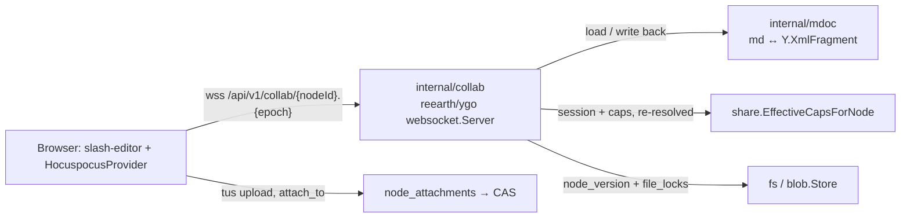

# Block Documents (Markdown + slash-editor)

> **Status: shipped — M39 ✅, completed by M40 ✅** ([milestones.md](milestones.md),
> [M39](milestones/M39.md), [M40](milestones/M40.md)). This describes what is
> built. It began as the design written before the code; where the build
> departed from it, the text below says what shipped and why. M39 delivered the
> editor and live co-editing; M40 the rest of a document's life — templates,
> read-only rendering (signed in and through a link), export, link bookmarks,
> video, @mentions and comment anchors, the last two carried by M29's comments
> and notifications.

## The problem

Every document pp-hub could author was an office file, edited through
OnlyOffice ([office-integration.md](office-integration.md)). What a team reaches
for when it writes a spec, a runbook or meeting notes is a block editor — Lark
Docs, Notion — and pp-hub had none. A `.md` file could be uploaded and
previewed as a text snippet, and that was all.

## Decisions

| Question                                           | Decision                                                                                                |
| -------------------------------------------------- | ------------------------------------------------------------------------------------------------------- |
| Editor                                             | [slash-editor](https://slasheditor.dev) (Tiptap/ProseMirror, shadcn UI we own)                          |
| What is stored                                     | A plain `.md` file node — CAS blob, `node_versions`, shares, trash, previews unchanged                  |
| Collaboration                                      | Realtime Yjs from v1: remote carets and presence avatars                                                |
| Sync server                                        | [reearth/ygo](https://github.com/reearth/ygo), a patched copy embedded in `apps/server`                 |
| Markdown ↔ document                                | Go (`internal/mdoc`), held to slash-editor's JS serializer by golden fixtures                           |
| Embedded images and files                          | Attachments owned by the document (`node_attachments`), not files in the folder listing                 |
| Version cadence                                    | Coalesced: after 30 s quiet, at most every 5 min under continuous typing, and on server shutdown        |
| Structure                                          | Sub-pages in the node tree: a `.md` whose parent is a `.md` ([M43](milestones/M43.md), [Pages](#pages)) |
| Imported `.md` that would not survive a round trip | Opens read-only; **Edit** warns first                                                                   |
| Crash window                                       | Up to ~5 min of unflushed edits may be lost on a crash; graceful shutdown flushes                       |

**Not built:** the AI block, databases or collection views, non-markdown
sub-pages, drag-and-drop re-parenting in the page tree, realtime push of page
titles, editing through a share link (a link renders the document read-only),
offline editing, more than one collaboration instance, and email for comments
or mentions (notifications are in-app only).

## Architecture

The shape is the one OnlyOffice already has for `.docx`: while anyone has the
document open, the live copy is held by a collaboration service, and that
service writes it back as ordinary versions. The difference is that the
service is inside `apps/server` and the stored format is markdown.



1. `/edit/$nodeId` picks the editor by type: a markdown document (stored MIME
   `text/markdown`, or a `.md` name) opens the block editor, anything else
   OnlyOffice.
2. The client asks `GET /api/v1/nodes/{id}/collab` for the room — named
   `<nodeId>.<epoch>` — and connects to it. The first peer to join makes the
   server take the file's lock, load the current version, `mdoc.Parse` it and
   seed the Y.Doc.
3. Edits are written back when the room has been quiet for 30 s, at most 5 min
   apart under continuous typing, and on shutdown. Each write-back renders the
   room to markdown and writes a version **only when the bytes differ** from
   the current one.
4. After its last peer leaves, the room stays resident for `RoomIdleTimeout`
   (2 min), still holding the lock, so a reload rejoins the same epoch; ygo
   then unloads it, which releases the lock.
5. **New → Document** is `POST /spaces/{id}/documents` (M31) with
   `kind=markdown`, writing an empty `.md` under the given name into the M19
   write target.

### API surface

| Route                                         | What it does                                                                                                                                                 |
| --------------------------------------------- | ------------------------------------------------------------------------------------------------------------------------------------------------------------ |
| `GET /api/v1/nodes/{id}/collab`               | `{room, can_write, lossy}`. Needs `CapDownload` and a markdown file; 413 for a document over 16 MiB                                                          |
| `GET /api/v1/collab/{room}`                   | The room's WebSocket (Hocuspocus protocol). Wrapped in `socketOrigin`; the room authorizes node, epoch and mode                                              |
| `GET /api/v1/nodes/{id}/attachments/{hash}`   | An attachment's bytes, needing `CapView` on the document; images and video inline (with `Range`), anything else as a download                                |
| `POST /api/v1/uploads` with `attach_to=<id>`  | The tus upload, addressed to a document; needs `CapEdit` on it. The commit answers the hash in `Upload-Attachment`                                           |
| `POST /api/v1/spaces/{id}/documents`          | `kind=markdown` creates an `.md`, empty or from `"template": "<id>"` (M40); `parent_id` may be a document (a sub-page), and `name` defaults to `Untitled.md` |
| `GET /api/v1/templates/markdown`              | `[{id, name, description}]` in `?locale=` or the caller's saved language (en, vi)                                                                            |
| `GET /api/v1/nodes/{id}/document`             | `{doc, lossy, version}`: the current version, or `?version=<id>`, as a ProseMirror tree. `CapView`; 400 if not markdown; 404 for another node's version      |
| `GET /api/v1/nodes/{id}/export`               | `application/zip`: the markdown with attachments rewritten to `assets/…`, and those files. `CapDownload`; audited as a download                              |
| `POST /api/v1/nodes/{id}/unfurl`              | `{url}` → `{url, title, description, thumbnail?}` for a link bookmark. `CapEdit` on the document                                                             |
| `GET /s/{token}/document?node=<id>`           | The same tree through a public link, which always grants view and must cover the node                                                                        |
| `GET /s/{token}/attachments/{hash}?node=<id>` | An attachment through a link, on the same terms                                                                                                              |
| `GET /api/v1/nodes/{id}/page`                 | M43: `{page, ancestors}` — the page's `PageMeta` and its viewable document ancestors, root first. 404 unless viewable markdown                               |
| `GET /api/v1/nodes/{id}/pages`                | M43: direct live sub-pages as `PageMeta[]`, by `created_at` then name. View on the parent; 404 otherwise                                                     |
| `GET /api/v1/nodes/{id}/backlinks`            | M43: live pages that link to or hold this one, filtered by what the caller can view; 404 unless viewable                                                     |
| `GET /s/{token}/page?node=`, `/pages?node=`   | M43: the same through a public link, chain cut at the link root                                                                                              |

Comments and notifications have routes of their own, listed under
[Comments](#comments).

The 16 MiB ceiling (`maxDocumentBytes`) exists because a live Y.Doc costs a
multiple of its markdown, and nobody writes a document that size by hand.

### Why Go, and not a Hocuspocus sidecar

Hocuspocus under Bun was the first candidate: it runs slash-editor's own
serializer, so the stored markdown could never drift from the client's
schema. It was rejected because it adds a second server runtime to a stack
whose whole backend is one Go binary, when the CRDT half is now available in
Go — reearth/ygo and Deln0r/ygo are both byte-compatible with `yjs@13` and
speak the Hocuspocus protocol. The markdown half is the part only JS has, and
it is bounded: v1 serializes a fixed block set, and golden fixtures make any
drift a CI failure rather than silent formatting loss.

Two Go shapes were rejected with it. **Client-side serialization** (the server
relays Yjs and a browser writes the markdown) leaves the stored file stale
whenever the last tab closes before its next save, and needs a hand-built
protocol to decide which client seeds an empty room. **y-webrtc** is a full
mesh that restrictive networks block, with the same persistence problem.

### Why reearth/ygo over Deln0r/ygo

Deln0r/ygo is the officially listed port with the stronger stability signal,
and its core would serve. Its server, though, is built around its own update
log and versioning — both of which pp-hub already has in `node_versions`.
reearth/ygo has the three things this design leans on: `Server.Apply` (seed
and reseed a room from the server), coalesced persistence with a window and a
maximum wait, and `Authorize` returning a read-only connection. Clients speak
the standard Hocuspocus protocol either way, so switching libraries later
costs the server adapter and nothing in the browser.

### The patched copy

`apps/server/third_party/ygo` is `reearth/ygo v1.50.0` cut down to the
packages `provider/websocket` and `crdt` need, wired in by a `replace` in
`apps/server/go.mod`; `PATCHES.md` lists three patches, each marked
`pp-hub patch` in the source:

1. **Connection origin** — `ConnectionConfig.Origin` and `ConnectionOrigin`.
   ygo uses its unexported `*peer` as the transaction origin and offers no way
   to map it back to a request; the patch lets `Authorize` attach the user, so
   a version is attributed to its writer. Reflecting into ygo's internals,
   which the spike proved possible, was not an option.
2. **SyncStatus acknowledgements.** `HocuspocusProvider` counts its unsynced
   changes down only on Hocuspocus's SyncStatus message, which ygo never sent,
   so `hasUnsyncedChanges` never cleared and the header could not say "Saved".
   ygo now answers every SyncStep2 and Update the way `@hocuspocus/server`
   does, a read-only peer's dropped writes included.
3. **Server Ping** (`Server.PingInterval`, 15 s in pp-hub). The provider
   reconnects after 30 s without a message, and a peer alone in a room got
   none — ygo does not echo a peer's own awareness back to it the way
   Hocuspocus does.

The Dockerfile copies `third_party/` into the build context for the same
`replace`. The directory goes once upstream carries equivalent APIs.

## `internal/mdoc`

Pure Go, no I/O. `Parse` follows how slash-editor parses (marked): at every
block start the slash-editor tokenizers — `<!-- slash:… -->` markers, media
lines, callouts, toggles, columns, task and ordered lists — are tried first,
and anything else is read from goldmark's GFM tree. `Seed` and `Fill` write
the resulting ProseMirror-shaped tree into the room's `XmlFragment` named
**`content`** (slash-editor's `collaboration()` overrides Tiptap's `default`)
the way `@tiptap/y-tiptap` does:

- an element per node, `nodeName` the node type; each non-null attr is set with
  its JSON type kept (`level` is a number);
- text as `XmlText` whose format attributes are the marks, keyed by mark name
  with `mark.attrs` as the value — `{"bold":{}}`, `{"link":{"href":…}}`.
  Inserting with `nil` attributes inherits the formatting to the left, as in
  Yjs, so every mark run is closed explicitly (`{"bold": nil}`).

`Read` walks the fragment back into that tree and `Render` writes it as
markdown, frontmatter in front (`RenderWith` when page titles are known —
[Pages](#pages)).

The block set, in slash-editor's schema names:

- **Nodes:** `paragraph`, `heading`, `bulletList`/`orderedList`/`listItem`,
  `taskList`/`taskItem`, `blockquote`, `codeBlock`, `horizontalRule`,
  `table`/`tableRow`/`tableCell`/`tableHeader`, `callout`,
  `details`/`detailsSummary`/`detailsContent` (toggle), `columns`/`column`,
  `mermaid`, `image`, `file`, `video`, `embed` (a link bookmark: `url`,
  `title`, `description`, `thumbnail`), `mention` (inline, `{id, label}`),
  `emoji` (inline, `{name}`), `subPage` (block, `{id, pageId}`), `pageLink`
  (inline, `{pageId}`), `hardBreak`. `video`, `embed` and `mention` joined in
  M40, `emoji`, `subPage` and `pageLink` in M43 ([Pages](#pages)).
- **Marks:** `bold`, `italic`, `strike`, `code`, `link`, and `comment`
  (`{threadId}`, M40), which only Go persists — [below](#comment-anchors).

The web editor turns off only StarterKit's `underline` (it serializes as
`++text++`), through `createBlockKit`'s `starterKit` option. Those options live
once, in `apps/web/src/lib/collab/mdoc-kit.ts` (`createMdocKit`), used by the
editor, the read-only renderer and the fixture script alike, so the schema a
browser can write is exactly the schema `mdoc` can store; `mention: {items}`
and `comment: {store}` pass through to slash-editor.

**Block ids are written by `Parse`.** Every block carries an `id` attr
(`data-block-id`); `parseMarkdown` emits none, and an editor mounting an
id-less document assigns them and writes that into the shared doc — two
editors mounting together also each append Tiptap's trailing empty paragraph.
Seeding every block with an id and ending the document with an empty
paragraph makes a mount write nothing (spike, below). `Render` omits ids and
the trailing empty paragraph, so neither ever reaches the markdown. The editor
also mounts only after the first sync: mounted on an empty document it would
write its own paragraph into the room ahead of the content.

`mdoc` also exposes the pure helpers the rest of the server needs from a
document: `Attachments` (hashes referenced by image, file, video and embed
thumbnail), `Mentions` (mention ids in document order, deduplicated),
`PlainText` (the searchable text, for [M27](preview-pipeline.md); page nodes
are skipped), `MapAttachments` (rewrite every `attachment:<hash>` src, for
export), and since M43 `PageRefs`, `MapPageIDs`, `FrontmatterMeta` and
`SetFrontmatterMeta` ([Pages](#pages)).

### Mentions

A mention is slash-editor's own inline marker pair,
`<!-- slash:mention {"id":"user:<uuid>","label":"Ann"} -->@Ann<!-- /slash:mention -->`,
written byte for byte as its serializer does. Ids are `user:<uuid>`: a space
member, and the chip is the person. A `doc:<uuid>` mention — the pre-M43 way
to name a document — is read by `Parse` as a `pageLink` and written in that
form by the next real edit ([Pages](#pages)); an empty `doc:` id stays a
mention. `Parse` reads a line that starts with a mention as paragraph text,
where slash-editor's own parser misreads it.

### Emoji

An emoji is `:shortcode:`, GitHub's form, and the `:` menu (`EmojiMenu`) or a
typed `:name:` inserts one. Whether `:name:` is an emoji depends on the
dataset, so the fixture script also writes `internal/mdoc/emoji.json` (every
shortcode the kit knows → its glyph), which `mdoc` embeds. slash-editor's
tokenizer consumes every `:[a-zA-Z0-9_+-]+:` and only then turns an unknown
one back into text; `mdoc` does the same, inside `linkify`, because the
consuming decides autolinks both ways — `x:https://e.x` is not a link
(`:https:` was read first), and `www.a.example:smile:` links through the
shortcode (the URL started first). An emoji is an atom: marks around it do
not reach it. `PlainText` writes the glyph.

Tiptap's glyph-to-node conversion is removed from the kit's emoji node: it
rewrites glyphs in every changed range, including the ranges a Yjs sync or a
reseed changes, so every peer joining a room would convert the same glyphs
at once and a document's `🎉` would become `:tada:` under whoever opened it. A
typed or pasted glyph stays text, as the markdown wrote it.

### Comment anchors

slash-editor's serializer drops the comment mark, and its anchors do not
survive markdown, so `mdoc` persists the mark itself as an HTML-comment pair
GitHub and other renderers hide:

```md
Hello <!-- slash:comment {"threadId":"T"} -->world<!-- /slash:comment {"threadId":"T"} -->!
```

An open marker and the next close of the same thread enclose the text; pairs of
different threads interleave, so overlapping and nested threads need nothing
more. Markers sit outside emphasis, link and code delimiters, and removing them
leaves exactly slash-editor's markdown (table cells are padded as if they were
absent). A marker never starts a line — CommonMark would open an HTML block and
show the line raw — nor sits inside a code span: it moves right to the next safe
boundary and records `"back":n`, the UTF-16 units it moved past. Pairs stay
inside one textblock; a thread spanning blocks has a pair in each. Malformed or
unpaired markers are dropped without flagging the document lossy. The full
format is the package documentation in `internal/mdoc/mdoc.go`.

The thread itself — its comments, who resolved it — is a database row
([Comments](#comments)); the markdown carries only its id. That is why a thread
survives a room reload, a version restore and a download: the anchor lives in
the file.

### Golden fixtures

`bun apps/web/scripts/mdoc-fixtures.ts`, run against the same
`@slash-editor/core` as `apps/web` and the same `createMdocKit()`, writes 260
fixtures to `internal/mdoc/testdata/fixtures/` — the input, its frontmatter,
slash-editor's `parseMarkdown` JSON, its `serializeMarkdown` output, a Y
update built by `@tiptap/y-tiptap`, and whether `Parse` must flag it lossy —
plus `schema.json` (attribute defaults, id-bearing types, mark order), which
the Go schema table is checked against, and `page_titles.json`, the page
titles both sides render with. A fixture whose slash-editor parse holds a
`doc:` mention also carries `go_json` (that JSON with the mention turned into
a `pageLink`) and `go_output` (slash-editor's serialization of it): the checks
that start from Go's `Parse` compare against those, the rest against
`json`/`output`, and `TestFixtures` checks `go_json` is exactly the rewrite.
Go tests assert `Parse` yields that
JSON and `Render` that markdown. The other direction is checked too:
`go test ./internal/mdoc -run TestGoUpdates -update` writes the Go-built seed
for each fixture to `testdata/go-updates/`, and
`apps/web/tests/mdoc-go-updates.test.ts` decodes it with
`yXmlFragmentToProsemirrorJSON` and requires the document slash-editor parses
and the markdown it writes back (bytes differ by client id, so they are not
compared). Bumping slash-editor means regenerating the fixtures; any
difference fails CI. The root `vite.config.ts` keeps `vp fmt` off the testdata,
which the script writes byte for byte.

### Markdown that does not survive

An uploaded `.md` may hold what the block set cannot represent. The spike
measured slash-editor's own round trip: raw HTML is escaped to text (and drifts
further on a second pass), footnotes turn into links, `H~2~O` becomes
strikethrough. Byte comparison is the wrong test — a hand-padded table
round-trips with different padding and loses nothing — so `Parse` flags the
document **lossy** when it meets a construct outside the block set: HTML other
than slash markers and `<details>`, footnotes, and extension syntax it does not
map. A lossy document opens read-only and **Edit** warns that saving will
rewrite the file, with the untouched original one restore away in version
history.

YAML frontmatter is not lossy: `Parse` strips it before parsing (slash-editor
would turn it into a rule and a heading), the room keeps it outside the
fragment, and `Render` writes it back unchanged. It cannot be edited in the
block editor.

### Which files are markdown

A version's MIME comes from its name (`mime.TypeByExtension`), and Go's builtin
table has no `.md`: it fell back to the host's `mime.types`, which says
`text/markdown`, `text/x-markdown` or nothing depending on the distribution.
`internal/fs/markdown.go` now registers `.md` itself, so it is stored as
`text/markdown; charset=utf-8`, and `fs.IsMarkdown` compares the base type.
Migration `0014_markdown_mime.sql` backfills that type onto `.md` versions
stored before as `application/octet-stream` or `text/x-markdown` — without it,
every document uploaded before M39 would refuse to open.

## `internal/collab`

`GET /api/v1/collab/{room}` is mounted inside the authenticated `/api/v1`
group, so the session cookie authenticates the upgrade like any other request.
`Hub.ServeSocket` wraps `websocket.Server.ServeHTTP`: it sets
`r.SetPathValue("room", …)` (ygo names the room from that path value), derives
a cancellable request context, and registers the connection with the user and
session behind it.

- **Origin is checked in the wrapper, before ygo sees the request.**
  `Server.sameOrigin` wraps mutations and a WebSocket upgrade is a `GET`;
  without a check, a page on another origin could open a socket with the
  victim's cookie. ygo's own `AllowedOrigins` is not enough: `Authorize` runs
  (and loads the room) before it, and it admits a request with no `Origin` at
  all. `socketOrigin` therefore requires an `Origin` and compares it against
  `PP_EXTERNAL_URL`; `TestCollabSocketRefusesForeignOrigins` holds the route
  to it. (`AllowedOrigins` is still set to the same origin.)
- **Authorization** is ygo's `Authorize`, returning
  `ConnectionConfig{ReadOnly, Origin}`. It requires `CapDownload`, the line
  `edit-session` draws for OnlyOffice and for the same reason: sync hands the
  complete document to the browser. `ReadOnly = !CapEdit`: a reader receives
  edits while its own updates and awareness are dropped server-side. The node
  must be a live file whose current version is markdown, and the room must be
  the one currently loaded or handed out. **`OnTokenAuth` stays nil** — when
  set, it overrides `Authorize`'s read-only decision with whatever the client's
  token says (the spike made a reader writable with another user's token). The
  editor therefore learns it is read-only from `can_write` over REST, not from
  the provider, and calls `setEditable(false)`; a dropped edit would otherwise
  stay in the reader's local copy.
- **Access is re-resolved** (M21). Every 60 s `Recheck` asks again, for each
  peer, whether its session is still active — not revoked, within its idle
  expiry and the 90-day absolute cap (`auth.SessionAbsoluteTTL`), account not
  suspended — and whether its capabilities still admit it in the same mode.
  ygo has no per-peer close, so the wrapper cancels that connection's request
  context, which closes the socket and leaves the room and every other peer
  alone. The provider reconnects on its own and `Authorize` decides again: a
  downgrade comes back read-only, a revocation gets 401. A document trashed,
  purged or no longer markdown closes every socket. A lookup that fails keeps
  the socket: a database hiccup is not a revocation. The client sees 1006
  either way — ygo sends no close frame — so on every close it re-reads
  `/collab` and destroys the provider on a 4xx, instead of retrying 401s
  forever.
- **Epochs.** The Y.Doc exists only in memory and is regenerated from markdown
  whenever a room loads, with fresh client ids. A client still holding the
  previous generation — a laptop that slept past the room's unload — would
  merge it into the new one and duplicate the whole document. The room name
  therefore carries an epoch (`<nodeId>.<epoch>`), minted by `/collab` when no
  room is resident or pending; an epoch handed out and never joined expires
  after 2 min. Any other epoch is refused, and the client, seeing a different
  room in `/collab`, discards its Y.Doc and rejoins. Edits made while
  disconnected past an unload are lost, which is the offline-editing non-goal
  stated plainly.
- **The file is locked** while the room is resident: a `file_locks` row whose
  token is `collab:<room>`, taken before the seed and refreshed by `Recheck`,
  so a REST replacement is answered 423 exactly as it is while OnlyOffice
  holds a `.docx` (M24). The prefix is how the edge tells a room's lock apart:
  restoring a version is let through it (below). Unloading releases the lock,
  and `Hub.Start` clears every `collab:` lock a previous process left — with
  one instance, no room can be resident before it serves. `cmd/server` runs
  `Hub.Start` only after the HTTP listener is bound (`listenThenStart`): a
  failed bind means another process is serving on the address — a second copy
  started by mistake, or a restart racing the old one's drain — and clearing
  first would strip its rooms of their locks before this process exited.
- **Reseed.** A version restored while no room is loaded is simply what the
  next load parses. Restoring while a room is open goes through
  `Hub.Reseed`: the room's unwritten edits are written first, as a version of
  their own, so the restore is one step from undoing; then the fragment is
  replaced through `Server.Apply` (delete everything, insert the parsed
  document, one transaction), so every peer sees the restored document at once
  and the epoch is kept. A room with nobody in it is closed instead, and the
  next join loads the new version.
- **Persistence** uses `PersistenceAdapter` only as the flush signal:
  `PersistCoalesceWindow = 30s`, `PersistCoalesceMaxWait = 5m`, and a flush on
  `Server.Shutdown`, which `cmd/server` runs through `srv.RegisterOnShutdown`
  once the HTTP server stops accepting. `StoreUpdate`'s batch is not stored;
  the handler renders the whole room, skips the empty two-byte updates a join
  and an unload produce, and writes a version only when the room has taken an
  attributed edit since the last write **and** the markdown differs (M43:
  `room.edits` against `room.persisted` — a linked page renamed or a
  normalizing render does not become a version by itself).
  Deltas are never replayed against a regenerated seed — the spike reproduced
  that losing content. A failed write-back is returned to ygo, which keeps the
  batch and the room, so the edits stay in memory for the next attempt.
- **Versions** go through `fs.PutFile` like any other: a claimed blob (M37),
  quota, `version_retention_count` pruning (M35), preview. `created_by` is the
  user behind the latest change, mapped from the transaction origin by the
  patched `ConnectionOrigin`. A transaction counts as a change only if it
  inserts content or deletes something not already deleted: ygo hands
  observers the document's whole delete set, so once anything has been
  deleted, the empty sync a joining peer answers with would otherwise make
  whoever opened the document the author of somebody else's edits. A reseed
  has no user behind it and writes nothing on its own — a version "by" anybody
  would record an edit nobody made; the next real edit writes the result with
  its author.
- **Limits.** ygo's caps are set well above any real document and well below
  what would hurt the process: 256 resident rooms, 64 peers per room, 4096
  connections, 32 MiB messages, 100 messages/s per peer (burst 400).

Everything here assumes one server instance: the rooms, their epochs and the
locks they hold are the process's.

## Attachments

Images and files dropped into a document belong to it, not to the folder
(migration `0013_block_documents.sql`):

```sql
node_attachments(node_id, blob_hash, name, mime, size, created_by, created_at,
                 PRIMARY KEY (node_id, blob_hash))  -- node_id ON DELETE CASCADE
```

- Triggers count the rows into `blobs.ref_count` like version, preview and
  avatar references, cascades included, and GC's SQL guard checks the table
  too. Attachment bytes count toward the space's usage and quota.
- Upload is the existing tus endpoint with `attach_to=<nodeId>` in its
  metadata (exclusive with `node_id`); it requires `CapEdit` on a markdown
  document, checked at creation and again at commit, with the usual quota and
  size checks. The room's lock does not refuse it: an attachment changes no
  byte of the markdown. The commit answers `Upload-Attachment: <hash>`, and a
  client that lost that answer gets it from `HEAD` (`uploads.attachment_hash`).
  The same bytes attached to the same document twice are one row.
- Reading is `GET /api/v1/nodes/{id}/attachments/{hash}`, requiring
  `CapView` on the document — whoever can read it sees its images. A hash
  the document does not hold is 404 whether or not another document holds it.
  Images and videos render inline (not SVG); anything else downloads. `Range`
  is served — a `<video>` needs it to seek — even from an S3 body that cannot
  seek backwards (`forwardSeeker`).
- The markdown stores `attachment:<hash>`. The image, file, video and embed
  nodes get a `resolveSrc` (`attachmentResolver` in `lib/collab/attachments.ts`)
  that maps it to the current rendering's route — the document's, a share
  link's — and our node views (`components/nodes/`) read it through
  `useResolvedSrc`, video posters and bookmark thumbnails included; the stored
  value never changes. An upload's `toAttrs` records an image's alt text from
  its file name and a file's name, size and type. The editor passes
  `image: false` and the rest to `createMdocKit` and installs ours through
  `extend`. Copying a document copies its rows (`CopyAttachments`), and no
  markdown needs rewriting. The image view resizes by dragging and stores
  `width` in the slash marker.
- Paths that bypass the node views — `getHTML()`, clipboard and drag HTML —
  carry the raw scheme. **Write-back adopts** what arrives that way (M40):
  each write-back compares `mdoc.Attachments` with the document's rows and
  copies a missing one from a live document that holds it, provided the writer
  may download that document. Holding a hash is not access to its bytes, so a
  hash pasted by someone who can read no holder stays broken, as it was.
  Adoption is best effort (quota, a failed lookup) and never fails the
  write-back.
- An attachment lives as long as its document, because older versions may
  still reference it.

A plain `.md` download keeps `attachment:` references that resolve nowhere
else; [export](#export) is the way out with the images.

## Templates

`internal/blockdoc/templates/<lang>/<id>.md`, embedded: meeting notes,
outline, project spec, runbook and weekly report, in English and Vietnamese.
`GET /api/v1/templates/markdown` lists them in `?locale=` or the caller's saved
language (any `vi` tag is Vietnamese, everything else English — the rule office
templates use), and `POST /spaces/{id}/documents` takes `"template": "<id>"`
with `kind:"markdown"` (400 for an unknown id, or with any other kind). The
templates are written in the block set and in the form `mdoc.Render` writes,
so a document made from one opens editable, is not lossy, and is not
rewritten by its first save — `templates_test.go` holds that. The web picker
is in the new-document dialog.

## Read-only rendering

`GET /api/v1/nodes/{id}/document` answers a version — the current one, or
`?version=` — as the ProseMirror tree `mdoc.Parse` produces, with `lossy` and
the version number. It takes `CapView`: rendering a document is reading it. It
is audited as a view.

The web renders it with one component, `components/markdown-document-view`
(`MarkdownDocumentView({doc, attachmentUrl})`), a non-editable Tiptap on
`createMdocKit` with the editor's own node views in read-only mode — so a
document looks the same read as edited. Its callers are the preview panel for
markdown, the version preview modal (`version-preview-modal.tsx`, with a
**Restore** action), and the share page. The read-only kit enables
`tableOfContents`; a caller that hands it a scroll container — the share page
does, for a link's rendered document — also gets `OutlinePanel` in the text's
right margin, following that scroll and hidden below `lg` where there is no room.

**Through a link**, `/s/{token}/document?node=<id>` and
`/s/{token}/attachments/{hash}?node=<id>` answer the same tree and bytes on the
terms of the link's other read routes: the link must cover the node (the link's
own node when `?node=` is absent), and a link always grants view. Editing
through a link is not built.

## Export

`GET /api/v1/nodes/{id}/export` (`internal/blockdoc/export.go`) writes
`<base>.zip`: `<name>.md` with every `attachment:<hash>` the document holds
rewritten (`mdoc.MapAttachments`) to `assets/<unique filename>`, and those
files under `assets/` — a document that still renders once it leaves pp-hub.
Since M43 the document's sub-pages come with it, and the folder zip uses the
same planner ([Pages](#pages)).
A reference to an attachment the document does not hold is left as it is: it
resolves nowhere, in pp-hub or out of it. Everything that can fail with a
status fails before the response is committed. It takes `CapDownload` and is
audited as a download. The web offers it as **Export with images (.zip)** in
node actions and the editor header's download menu.

## Pages

M43 ([detail](milestones/M43.md)) gave documents slash-editor's pages: a
`subPage` block that holds a child page, an inline `pageLink` chip, `/page`,
`/link to page`, page results in the `@` menu, backlinks, a page tree, a
breadcrumb, an icon and a cover.

**A sub-page is a node, not a document fragment.** It is a `.md` whose
`parent_id` is its parent document, so the page tree is the node tree and
sharing, trash and purge already follow it
([permissions](permissions.md#sub-pages)). `fs.CanContain` is the one rule —
a folder holds anything, a document holds only documents — and every path that
sets a parent applies it ([data model](data-model.md#invariants)). The Drive
listing shows only top-level documents, with a `child_page_count` badge; the
tree lives in the editor. A page's title is the node's name without `.md`;
editing it renames the node.

**Markers.** Both nodes are slash-editor's own markers, written byte for byte:

```md
<!-- slash:subPage {"pageId":"<uuid>"} -->

[Title](/edit/<uuid>)

See <!-- slash:pageLink {"pageId":"<uuid>"} -->[Title](/edit/<uuid>)<!-- /slash:pageLink -->.
```

Import keeps only `pageId`: the title in the file is whatever it was when last
written, and changes nothing on load. A `subPage` needs a blank line or the end
of the file after its link line, or it is a stray marker (lossy). The places Go
deliberately differs from slash-editor's parser are listed in
[M43](milestones/M43.md#markdown).

**Titles are the caller's.** `mdoc.RenderWith(doc, frontmatter,
RenderOptions{PageTitle, PageHref})` writes each page's title and href from
callbacks: blank or unknown is `Untitled`, the default href `/edit/<id>`.
`Render` is `RenderWith` with neither. The room looks titles up with one
`fs.PageTitles` query per write-back, only when `mdoc.PageRefs` finds any; the
export uses archive names and relative paths. `PageRefs(doc)` returns the
sub-page and link ids; `MapPageIDs` deep-copies a tree with ids remapped.

**`doc:` mentions become page links.** `Parse` reads a `doc:<uuid>` mention as
`pageLink{pageId}`, so old chips show live titles at once and the next real
edit writes the new form; there is no bulk rewrite of stored markdown.

**Icon and cover are frontmatter.** The top-level keys `icon` (an emoji) and
`cover` (`attachment:<hash>`) — versioned, and present in a download.
`mdoc.FrontmatterMeta` and `SetFrontmatterMeta` are a line editor, not a YAML
parser: only those two lines are read or written, everything else stays byte
for byte, and a value it cannot read as one string (block scalar, flow
collection, alias, tag) counts as unset. In the room they are a `Y.Map` named
**`meta`**, seeded with the fragment in the same unattributed transaction and
re-set on reseed; write-back merges it into the frontmatter. Changing the icon
or cover is an attributed edit like any other.

**Write-back writes only after an edit.** Rendering a room can differ from
its file with nobody having typed — a linked page renamed since, a serializer
that normalizes. `persist` writes only when the room has taken an attributed
edit the file does not hold yet (`room.edits` ≠ `room.persisted`), so a new
title reaches the markdown with the next real edit and never as a version
nobody made.

**Projections.** The `extract:text` job also writes `page_meta` (icon, cover)
and `page_refs` (sub and link edges) from the same parse, under the same
current-version guard, and `preview.BackfillPages` fills them at startup
([data model](data-model.md#pages)). They back the page routes in the
[API table](#api-surface) and `child_page_count` on listings.

**Delete and undo.** Deleting a `subPage` block trashes the page
(`onSubPagesDetached`); undo or paste restores it (`onSubPagesAttached`), and
the page store restores only a page it saw trashed itself. Restoring under a
parent that can no longer hold it relocates the page to the space root. A
co-editor who cannot trash the page gets a 403 toast and the page stays.
Pasting a `subPage` into another document gives a `pageLink`: a page has one
parent.

**Export and copy.** The export zip and the folder zip share one planner:
`<Doc>.md`, sub-pages under `<Doc>/<Sub>.md` recursively, one `assets/` per
directory shared by its pages, links into the archive rewritten to relative
paths and any other page to `${PP_EXTERNAL_URL}/edit/<id>`, the cover exported
and rewritten; a lossy document keeps its bytes with targets byte-replaced.
Copying a document or a folder copies sub-pages recursively in one
transaction and re-renders only the documents whose page ids point into the
copied set; the rest share their blob.

**Web.** `lib/collab/page-store.ts` is the host `PageStore` over TanStack
Query (keys `['pages', scope, kind, id]`, `scope` `node` or `share:<token>`);
`nodes/page-node-views.tsx`, `doc-editor/page-header.tsx`,
`doc-editor/page-tree-panel.tsx`, `doc-editor/page-backlinks.tsx`,
`components/page-trail.tsx` and `components/sub-page-count.tsx` draw it.
Titles and the tree refetch on focus and staleness; nothing pushes them.

## Link bookmarks (unfurl)

The `embed` block in bookmark mode shows a link's title, description and
preview image. The browser cannot fetch another origin's page (and CSP
`img-src` is `'self'`, so an image is never hotlinked), so the server does:
`POST /api/v1/nodes/{docId}/unfurl {"url"}`, `CapEdit` on the document.

A server-side fetch of a URL a user typed is a server-side request forgery
surface, so `internal/unfurl` is built against it:

- the address is checked **when the connection is dialled** — after DNS, on
  every attempt and every redirect — and private, loopback, link-local,
  metadata and otherwise non-public addresses are refused, so neither a
  hostname resolving to `127.0.0.1`, a redirect to `169.254.169.254` nor DNS
  rebinding gets through;
- proxies from the environment are ignored (a proxy would dial on our behalf,
  unchecked);
- only absolute `http`/`https` URLs without credentials, at most 5 redirects;
- 5 s per fetch end to end, the first 1 MiB of HTML parsed (the metadata is in
  the head), a preview image sniffed as PNG, JPEG, GIF or WebP and at most
  5 MiB.

The preview image is stored as an attachment of the document under the upload
cap and the space's quota, named after the site it came from, and the
bookmark's `thumbnail` is its `attachment:<hash>`. An image that cannot be had
leaves the bookmark without one rather than failing it.

## Comments

Comments are M29's ([milestone](milestones/M29.md)), and block documents are
the only thing they attach to. `internal/comments` owns threads and comments;
`internal/notifications` tells people about them. The anchor is the
[comment marker](#comment-anchors) in the markdown; the rows are
`comment_threads` and `comments` (migration `0015`,
[data-model.md](data-model.md)), which cascade when the document is purged
— a trashed document keeps its threads, so restoring it restores the
conversation.

| Route                                                | What it does                                                                                        |
| ---------------------------------------------------- | --------------------------------------------------------------------------------------------------- |
| `GET /api/v1/nodes/{id}/comments`                    | `{threads: [...]}`, each with its comments, oldest first                                            |
| `POST /api/v1/nodes/{id}/comment-threads`            | `{body, mentions?}` opens a thread; the server generates the id the editor then marks the text with |
| `POST /api/v1/comment-threads/{id}/comments`         | `{body, mentions?}` replies, reopening a resolved thread                                            |
| `PATCH /api/v1/comments/{id}`                        | `{body}` — the author only                                                                          |
| `DELETE /api/v1/comments/{id}`                       | The author, or `CapEdit` on the document; the thread goes with its last comment                     |
| `POST /api/v1/comment-threads/{id}/resolve`/`reopen` | The thread's opener, or `CapEdit`; idempotent                                                       |

**Reading and writing take `CapView`**, not `CapEdit`: whoever can read
the document can take part in its discussion, which is how a reviewer with
read-only access leaves a remark. A body is at most 10 000 characters and names
at most 50 people.

**Who is told.** A new thread notifies the document's owner (`comment`); a
reply notifies the thread's participants and the owner (`reply`); anyone
named in `mentions` gets a `mention` instead — each person once, a mention
winning, never the actor, and nobody who cannot currently open the document.
The rows are written in the comment's own transaction and pushed to open tabs
once it commits.

**Mentions in the document** notify too. The version hook enqueues a
`notify:mentions` job per markdown version; it diffs `mdoc.Mentions` against
the previous version and notifies each `user:<uuid>` newly mentioned who can
view the node, recording the version so a retried job cannot notify twice. It
runs in `cmd/server`, never in the worker, because the broker holding the open
streams is that process's.

On the web, `lib/comments.ts` is the thread store over REST — polled every
10 s while the document is open and refetched on focus and after a mutation —
and `components/comments/` the panel and composer (with @mention of space
members), both mounted by `doc-editor.tsx`: the composer comments the current
selection, and the panel toggles from the editor header. `/edit/<id>?thread=`
opens the document on a thread, which is where a notification leads.

Notifications themselves — the bell, the list, the SSE stream — are described
in [M29](milestones/M29.md) and [data-model.md](data-model.md#comments-and-notifications).

## Web

- Dependencies: `@slash-editor/core`, `@slash-editor/react`,
  `@hocuspocus/provider`, `yjs`, `@tiptap/y-tiptap`. The UI pieces come from
  the slash-editor shadcn registry — slash menu, bubble toolbar, block handle,
  link editor, presence avatars, media and mermaid node views — and are ours
  to style.
- `components/doc-editor/doc-editor.tsx` mounts `createMdocKit` with
  `collaboration: { document, provider, user }`. `/edit/$nodeId` branches on
  type; the header carries presence avatars, a Saved/Syncing/Offline state
  from the provider (which the SyncStatus patch makes truthful) and a
  Read-only badge; the lossy warning is a better-modal dialog
  (`lossy-edit-modal.tsx`).
- Presence: each collaborator gets a colour and initials, stable per user id
  and derived from the display name (`lib/collab/presence.ts`).
- Editing aids (M40): table controls (add or delete a row or column, toggle
  the header row, delete the table — `components/table-controls.tsx`); an
  outline panel of the top-level `h1`–`h3` headings from slash-editor's
  `tableOfContents` extension (`useTableOfContents`, `maxLevel: 3`), whose
  active row follows the caret while typing and the scroll position otherwise,
  click to jump, toggled from the editor header (`doc-editor/outline-panel.tsx`).
  It takes turns with the comments panel in the right-hand slot, in the same
  frame (width, header, rule), so switching swaps the content without moving
  the document; showing the outline closes the comments and opening the
  comments puts the outline away. Below `md` either lies over the document's
  edge. Whether the page tree (open by
  default) and the outline are open is a per-browser preference in
  `ui-store` (`docPanels`, persisted), so moving between pages — each remounts
  the editor — and reloading keep the layout; below `md` both start closed
  per page because they would cover the text;
  `@` mentions of space members (`lib/collab/mentions.ts`,
  `nodes/mention-node-view.tsx`; pages join the `@` menu as page links since
  M43); a video node view and an embed node view
  whose slash item asks for a URL and unfurls it (`nodes/embed-link-modal.tsx`);
  an uploaded image's alt text taken from its file name (`q3-roadmap.png`
  reads "q3 roadmap", `altFromFileName`); and a narrow-screen layout where
  the padding shrinks, the block handle is hidden and side panels overlay the
  document below `md`.
- A markdown document's versions are written by the server with no event to
  the page, so `routes/edit/$nodeId.tsx` refetches the node every 30 s and the
  header's version number does not go stale.
- `lib/collab/use-collab-room.ts` owns the connection. Read-only comes from
  `can_write`, not from the provider. On every close it re-reads `/collab`: a
  4xx destroys the provider, a different room rebuilds the Y.Doc and provider,
  the same room lets the provider reconnect.
- **The provider is closed on `pagehide`** and reopened when a page comes back
  from the back/forward cache (`pageshow` with `persisted`). Chrome keeps a
  page with an open WebSocket in that cache, so a tab navigated away stayed
  joined — holding the room, its lock and a presence avatar — until the cache
  evicted it. The browser smoke test found it.
- UI strings go through Lingui and `i18n:extract`.

## Deployment

- nginx proxies `/api/v1/collab/` in a location of its own, passing
  `Upgrade`/`Connection` with a 1 h read/send timeout and buffering off; the
  server pings every 15 s, so a silent hour is a dead peer.
- CSP `connect-src` names the socket origin (`wss://` and `ws://` of the
  requested host): CSP3 lets `'self'` cover it, older WebKit does not.
- Metrics: `pphub_collab_rooms`, `pphub_collab_peers`,
  `pphub_collab_flush_duration_seconds`, `pphub_collab_flush_failures_total`.
- nginx proxies `/api/v1/notifications/stream` (Server-Sent Events) unbuffered
  with a 1 h timeout; the server writes a heartbeat every 25 s.
- **Outbound HTTP.** Link bookmarks make the server fetch public web pages; an
  install with no egress simply gets bookmarks without a title or image.
- One server instance hosts every room and every notification stream. Several
  instances would need ygo's cluster relay and a shared broker, and are out of
  scope, as they are for the rate limiter.

See [deployment.md](../deployment.md#block-document-collaboration).

## Testing

- **Unit:** `mdoc` against the 260 golden fixtures and `schema.json`, including
  block ids and the trailing paragraph, frontmatter, and the lossy flag; the
  comment-marker cases in `testdata/comments/` and the helpers
  (`comment_test.go`, `helpers_test.go`); the Go-built seeds, comment cases
  included, decoded by slash-editor in `mdoc-go-updates.test.ts`;
  `blockdoc/templates_test.go`; `unfurl_test.go` (refused addresses,
  redirects, limits).
- **Database-backed** (`httpapi/collab_db_test.go`, real router, hub,
  websocket client and Postgres): the authorization matrix; a read-only peer's
  edits dropped; `Recheck` closing only the affected peers; write-back of
  changed markdown as its writer, none when unchanged; shutdown writing pending
  edits as their authors; the lock while resident; reseed on restore; stale
  room locks released at start. `attachments_db_test.go`: attachment access
  follows the document's, and reference counting through copy and purge.
  `documents_db_test.go` (M40): the document tree follows download and
  versions, the share-link tree and attachments, the export zip with its
  assets, creation from a template, unfurl storing the preview image, video
  `Range`, write-back adopting only readable attachments, and a mark-only
  change (a comment anchor) still writing a version. `comments_db_test.go`
  (M29): the comment permission matrix, resolve rules, threads going with
  their document, notification recipients, unread and mark-read, the stream
  delivering to the recipient only, and document mentions notifying readers.
- **Structural:** the collab route is authenticated, and refuses a foreign or
  missing `Origin` before ygo loads the room. `cmd/server/main_test.go`: the
  listener is bound before the hub starts.
- **Smoke (browser):** two users in separate browser contexts co-edited one
  document live, with presence avatars and remote carets; versions were written
  per author; the downloaded `.md` was GFM, with a `> [!TIP]` callout and
  ``; an uploaded image rendered through the attachments
  endpoint; a lossy upload opened read-only behind the **Edit** warning.
- **Smoke (browser, M40, on a cloned database):** a document created from a
  template; a comment with an @mention raised the other user's badge live over
  SSE (Vietnamese UI) and its deep link opened the thread; an @mention in the
  document notified after write-back; outline and table controls; the
  share-link read-only render; the export zip; a content-search snippet.

## Spike (Phase 0)

Run against `github.com/reearth/ygo v1.50.0`, `@slash-editor/core 0.4.0`,
`@hocuspocus/provider 4.7.0`, `yjs 13.6.33` and `@tiptap/y-tiptap 3.0.9`
(the binding Tiptap v3 Collaboration uses), with a chi server and bun clients.
Every row was executed, before the build; the sections above reflect each
finding.

| Question                     | Result                                                                                                       |
| ---------------------------- | ------------------------------------------------------------------------------------------------------------ |
| Mount under chi, cookie auth | Works. Room name via `r.SetPathValue("room", …)`; `Authorize` → 401 before upgrade; read-only writes dropped |
| Origin                       | ygo checks it after `Authorize` and admits a missing `Origin` — so pp-hub checks first                       |
| `OnTokenAuth`                | Overrides `Authorize`'s read-only flag; a reader became writable with another token — kept nil               |
| Close one peer               | No API. Cancelling that request's context closes only it; provider reconnects and is re-authorized           |
| Server-side reseed           | `Server.Apply` replaced the fragment; the client saw one transaction                                         |
| Go-built doc → JS            | `yXmlFragmentToProsemirrorJSON` output passed slash-editor's `schema.nodeFromJSON().check()`                 |
| JS edits → Go                | A real headless editor's edits walked in Go with attrs and marks                                             |
| Coalescing 30 s / 5 min      | Nothing stored while connected; flushed on last leave and on `Shutdown` (the 5 min cap was not waited out)   |
| Seed persistence             | A seed replayed against later deltas lost content — hence regenerate-and-epoch, never replay                 |
| Update attribution           | No public hook; origin is an unexported `*peer` — upstream `ConnectionConfig.Origin` needed                  |
| Block ids on mount           | Id-less seed: editor writes ids, two mounts add two trailing paragraphs. Full-id seed: no writes             |
| Markdown round trip          | Block set survives; frontmatter, raw HTML, footnotes, `~sub~` do not                                         |
| `attachment:` src            | Stored verbatim end to end; resolution needs our own node view                                               |

**Upstream items:** `ConnectionConfig.Origin` is carried as patch 1 of the
vendored copy, alongside the SyncStatus and Ping patches the build found it
needed. A per-peer close with a close code (so a revoked client gets 4403
instead of 1006) is still absent; the client's re-read of `/collab` on every
close stands in for it.
