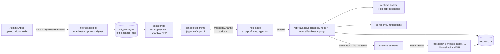

# Extensions — Design

> **Status: implemented, M44–M46 and M51** ([M44](milestones/M44.md) the host,
> [M45](milestones/M45.md) kanban core, [M46](milestones/M46.md) kanban
> collaboration, [M51](milestones/M51.md) packaged apps). M44–M46 built
> extensions as modules compiled into the server and the SPA; that mechanism
> has been removed, and every app — Kanban and Checklist included — is now a
> packaged app an administrator uploads
> ([M51](milestones/M51.md#built-in-extensions-removed)). Where the build
> departed from an earlier design the departure is stated where it applies
> (_was:_ …).

pp-hub grows by **extensions** — small apps switched on per instance and per
space. Every app is a **packaged app**: an instance administrator uploads it as
a `.zip` and it works at once, with no rebuild and no uploaded code in the
server process — see [Packaged apps](#packaged-apps-m51). Kanban and Checklist
are first-party packaged apps whose source lives in this repository
(`examples/apps/kanban`, `examples/apps/checklist`); they are not preinstalled
([Kanban and Checklist](#kanban-and-checklist)). "App" is the product word in
the UI; the code says `ext` so it is never confused with the monorepo's
`apps/`.

## The decision

| Option                                                                 | Outcome                                                                                                                                                                                                                                                                                                                                                       |
| ---------------------------------------------------------------------- | ------------------------------------------------------------------------------------------------------------------------------------------------------------------------------------------------------------------------------------------------------------------------------------------------------------------------------------------------------------- |
| **Sandboxed UI + host record store + optional external backend (M51)** | **Chosen.** Static web files in a sandboxed `<iframe>` that reaches pp-hub only through a `MessageChannel`; data in one host-owned table guarded by the node's capabilities; any server logic in the author's own service, called through a proxy with a signed token. Installs at runtime from Admin › Apps and runs no uploaded code in the server process. |
| Compile-time SDK, runtime enable/disable                               | _Was:_ chosen in M44 (a Go package and a web package per app, picked per build, behind `extsdk`). **Removed** once Kanban and Checklist were ported to packaged apps: one path for every app, and no app code with the server's privileges.                                                                                                                   |
| Out-of-process apps (sidecar container, Nextcloud ExApp)               | _Was:_ deferred. **Superseded in part by M51**: runtime install, an iframe UI and a scoped API exist, with the backend a service the author runs rather than a container pp-hub manages.                                                                                                                                                                      |
| WASM in-process (Extism/wazero)                                        | Rejected. Sandboxed, but every DB and realtime touch becomes a hand-written host function, the UI is still separate, and the ecosystem is young.                                                                                                                                                                                                              |
| Go `plugin` package                                                    | Rejected. Same toolchain, same dependency versions, Linux only — it breaks on any mismatch.                                                                                                                                                                                                                                                                   |

**Trust.** An app's code runs only in the viewer's browser, under a sandbox,
and reaches data only through routes that ask the node's capabilities (see
[Access](#access)). Nothing an app ships runs in the server process.

**Third parties.** A third party ships a `.zip` and an administrator uploads
it, against the bridge protocol (v1) and `@pp-hub/app-sdk` — the same path the
first-party apps take.

## Core

What every app shares, whatever it does (`internal/exthost`,
`apps/web/src/ext`):

- **One registry, filled at runtime.** `exthost.New` builds it;
  `loadPackages` adds the installed packages at `Start`, and `Install` and
  `Remove` change it while the server runs.
- **Node kinds.** An app declares kinds `<id>.<name>`; a node of one is
  `nodes.kind = 'ext'` with `ext_kind` set. `OnCreate` writes the kind's `seed`
  records in the node's transaction, `OnCopy` copies its records, and
  `ValidSubject` accepts `record:<uuid>` subjects of records the node holds.
- **Switches.** An app ships **off**: an instance administrator switches it on
  (Admin › Apps), a space administrator can switch it off for a space
  (Settings › Apps). A request to an app that is off is answered 403 before
  anything else runs.
- **Discussion and the bell** (`discussion.go`): comment counts per subject,
  notifications of kind `ext:<id>:<verb>` sent only to somebody who can open
  the node, people search among those who hold `view`, and drive links
  re-resolved per viewer.
- **The web side is dynamic only.** The SPA learns the installed apps from
  `GET /api/v1/extensions` and builds its registry from that listing
  (`ext/registry.ts`); no app code is in the SPA's bundle.

An open file (`components/file-view.tsx`, a tab in the drive shell) chooses
the editor by kind: a markdown document opens the block editor, an extension
node opens its app's frame, an office file OnlyOffice, anything else the
viewer. `NodeIcon`, the New menu and `node-actions` consult the same registry;
actions that need bytes (download, open with OnlyOffice, versions) are hidden
on extension nodes.

## Data model

### Core changes

```sql
nodes.kind                -- 'dir' | 'file' | 'ext'
nodes.ext_kind TEXT       -- 'kanban.board'
  CHECK ((kind = 'ext') = (ext_kind IS NOT NULL))
  -- an ext node has no current_version_id: its content is its app's records

ext_state(ext_id, space_id NULL, enabled)
  -- space_id NULL = the instance switch (no row = off); a space row can only
  -- turn an instance-enabled extension off, and turning it back on deletes it

notifications.kind
  -- CHECK widened: IN ('comment','reply','mention') OR kind LIKE 'ext:%'

comment_threads.subject TEXT NULL   -- M46, 0024
notifications.subject TEXT NULL     -- M46, 0024
  -- 'record:<uuid>'; a thread with a subject has no markdown anchor
```

An app's data is rows of `ext_records` ([Packaged apps › Data
model](#data-model-1)), which reference `nodes` with `ON DELETE CASCADE`, so
purging a node takes its data with it. `pg_dump` covers them, so backup
([deployment.md](../deployment.md)) needs no change.

## Kanban and Checklist

Two first-party packaged apps, written against `@pp-hub/app-sdk` like any
other: React + Vite builds in `examples/apps/kanban` (app id `kanban`, kind
`kanban.board`) and `examples/apps/checklist` (app id `checklist`, kind
`checklist.list`), manifest version 2.0.0. `bun run apps:build` builds both
and packs `examples/apps/{kanban,checklist}/dist-pack/<id>-2.0.0.zip`. **They are not
preinstalled**: an administrator uploads the two zips in Admin › Apps and
switches them on. Until then a board or checklist shows "not part of this
installation".

A board or list is a node listed under Apps in the sidebar and shared, copied
and trashed like a file; its records are the source of truth.

| App       | Collection | Record `data`                                                                                |
| --------- | ---------- | -------------------------------------------------------------------------------------------- |
| kanban    | `columns`  | `{title, position, wip_limit}`                                                               |
| kanban    | `labels`   | `{name, color}` (`#rrggbb`)                                                                  |
| kanban    | `cards`    | `{column_id, title, description_md, position, due_at, assignees[], label_ids[], link_ids[]}` |
| checklist | `items`    | `{text, done}`, in creation order                                                            |

- A new board is seeded by its manifest with columns To do / In progress /
  Done at positions `11i`, `12i`, `13i`.
- `position` is a fractional index (a string between its neighbours, ordered
  bytewise), so moving a card rewrites one record; the scheme is
  `examples/apps/kanban/src/position.ts`, checked against golden values
  (`tests/position-golden.json`).
- A card write carries `if_rev`; a stale one is 409 and the app reloads.
- **Validation runs in the app**: 30 columns, 50 labels, 5000 cards and 20
  links per card, trimmed titles. The host enforces only the generic record
  limits (64 KiB per record, 10 000 per node) — whoever can edit a board can
  write any record ([Access](#access)).
- Kanban sends `assigned` to people newly put on a card (subject
  `record:<id>`); a card's comments open the host's discussion panel through
  `comments.open("record:<id>")`. The assignee picker lists only people with
  `view`; a card link to a drive file is resolved per viewer through `links`,
  so someone without access sees a "no access" chip, never the name.

| Board operation           | Capability needed                                                |
| ------------------------- | ---------------------------------------------------------------- |
| Open, read, subscribe     | `view`                                                           |
| Create/edit/move cards    | `edit`                                                           |
| Comment on a card         | `view`, as on block documents ([permissions.md](permissions.md)) |
| Rename, move, trash board | as for any node                                                  |

_Was:_ M45–M46 built both as compiled-in extensions with schemas of their own
(`ext_kanban`, `ext_checklist`) and routes under `/api/v1/ext/<id>`. Migration
`0032_builtin_apps_to_records.sql` converted their rows into `ext_records`
under the same ids (so links, threads and notices still name them), renamed
board subjects `card:<id>` → `record:<id>`, dropped the schemas and
`ext_migrations`, and kept `ext_state`, so uploading the zip restores the
earlier switches.

## Realtime and concurrency

- Mutations are REST. After commit the host publishes an event on topic
  `app:<id>:<node>`; the host page subscribes through
  `GET /api/v1/apps/<id>/nodes/<node>/events` (SSE, the transport the
  notification stream already uses) and forwards it to the frame.
- A record `PATCH` may carry `if_rev`; a mismatch is 409. Concurrent moves of
  different cards never collide, because each move writes one record.
- The stream re-resolves access periodically, as `collab.Recheck` does for
  rooms, and closes on revocation, suspension or trash.
- Every open item is one SSE connection beside the notification stream; over
  HTTP/1.1 a browser allows six per origin, so several tabs starve ordinary
  requests — the edge should speak HTTP/2
  ([deployment.md](../deployment.md#notification-stream)).
- The broker is in-process, under the same single-instance assumption as
  collaboration rooms. Several replicas would move it to Postgres
  `LISTEN/NOTIFY` without changing the contract.

Yjs is not used: a board is a set of small records, not a text.

## How extension nodes meet the rest of the drive

| Where it is listed | **Under Apps in the sidebar, never in the drive.** An app's nodes would mix with files and folders and be hard to organize, so folder, top-level, tree and "Shared with me" listings leave `kind = 'ext'` out (SQL), and `GET /spaces/{id}/extensions/{extID}/nodes` lists the ones the caller can open, wherever they hang. A new node is made from the app's entry in the sidebar, with no parent: top level, private to its creator until shared. Starred, Recent, search, Trash and "Shared from outside" still show them — they have no Apps list to be found in. No hidden folder holds them: access inherits down folders and every item is private to its creator by default, so one shared folder per space would either show every board to everyone or undo that rule. |

| Situation                                            | Behaviour                                                                                                                                                                                                                                                             |
| ---------------------------------------------------- | --------------------------------------------------------------------------------------------------------------------------------------------------------------------------------------------------------------------------------------------------------------------- |
| Download, folder zip, preview, versions, upload over | Not offered. A folder zip skips extension nodes.                                                                                                                                                                                                                      |
| Copy (node or containing folder)                     | `OnCopy` copies the node's records under the same ids (kanban: columns, labels, cards with their links); comments are not copied.                                                                                                                                     |
| Trash / restore / purge                              | Node soft delete as for any file; purge cascades into `ext_records`.                                                                                                                                                                                                  |
| Move, share, activity, name search                   | Unchanged — they act on the node.                                                                                                                                                                                                                                     |
| Extension disabled                                   | The app's Apps entry disappears and its list answers 403; the node still shows, badged "app disabled", in Starred, Recent, search and Trash; opening and every route answer 403; data is kept.                                                                        |
| App not installed                                    | An unclaimed `ext_kind` shows (in Starred, Recent, search, Trash) with a generic icon, opens "not part of this installation" (`ExtUnavailable`) and can be trashed; its records are kept unless a removal purged them. Copying it is refused (`OnCopy` has no owner). |
| Share link                                           | Not supported: a link to an app item answers 422 and a shared folder's listing leaves them out.                                                                                                                                                                       |
| Quota                                                | Records are not counted in `used_bytes`.                                                                                                                                                                                                                              |
| i18n                                                 | An app carries its own `translations` in its manifest; Kanban and Checklist also carry their UI catalogs inside their builds (`src/locales`).                                                                                                                         |

**Largest risk, handled:** core code branches on `nodes.kind` in many
places — download, zip, copy, preview, MIME, search, MCP tools. They were
audited before `'ext'` was added: queries that read versions already used
`LEFT JOIN` or filtered `kind = 'file'`; the zip walk, copy, the share-link
views, the listing DTOs and the agent's web link needed an explicit case.

## Rollout

Every app ships **disabled**; an instance admin uploads it and turns it on
(Admin › Apps), and a space admin can turn it off for a space (Settings ›
Apps). Operators who put a proxy in front must give
`/api/v1/apps/<id>/nodes/<node>/events` the notification stream's treatment
(no buffering, long read timeout); the server itself needs nothing.

**Upgrading from a release with built-in Kanban/Checklist:** migration `0032`
converts their data automatically; afterwards an administrator uploads
`kanban-2.0.0.zip` and `checklist-2.0.0.zip` (built by `bun run apps:build`)
in Admin › Apps. The earlier on/off switches come back with the upload.

## Packaged apps (M51)

An instance administrator uploads a `.zip` (or a folder, zipped in the
browser) under Admin › Apps and the app works at once, with no rebuild. The
one rule that shapes it: **no uploaded code runs in the server process.** An
app is therefore three parts, each placed where an untrusted author can do no
more than the people using it:

- **UI** — static web files, served under a sandboxing CSP (the M50 opaque
  origin, [publishing.md](publishing.md)) and shown in an `<iframe>`. The
  frame has no session and no cookies; it talks to the host page only through
  a `MessageChannel` (the _bridge_, protocol v1), and the host page calls
  pp-hub on its behalf.
- **Data** — a record store the host owns (`ext_records`): JSON objects in
  named collections, per node, read with `view` and written with `edit` on the
  node. No app has a schema, a migration or a query of its own.
- **Server logic, optional** — in the author's own service (`backend.url`).
  The host proxies to it with a short-lived signed token naming the caller,
  the node and the caller's capabilities, and the backend may call back into
  the record store, broadcasts and notifications with that same token.

Every app shares the node kind (`kind = 'ext'`, `ext_kind` `<id>.<name>`),
`ext_state` and its two switches, the Apps list in the sidebar, comments and
the bell ([Core](#core)). How to write one is in
[extension-authoring.md](extension-authoring.md#packaged-apps).

### Architecture



- **The registry is dynamic.** `internal/exthost` holds the packages in one
  registry behind an `RWMutex`; `Install` and `Remove` change it at runtime,
  and `loadPackages` adds the installed packages at `Start`. A package this
  server can no longer read is skipped with a log line rather than refusing to
  start.
- **The SPA learns packages from the listing.** `GET /api/v1/extensions` items
  always carry `package`:
  `digest`, `entry_url`, `icon_url`, `kinds[]` (`kind`, `label`, `new_label`,
  `default_name`, `new_hint`, `icon_url`), `notifications`, `translations`,
  `has_backend`, `connect`. `registerPackagedApps` (`apps/web/src/ext/registry.ts`)
  runs on every listing fetch, so an upload shows up without a reload.
  `ext/packaged.tsx` turns the listing into an `ExtManifest`: manifest strings
  become catalog ids `pp-app:<id>:<English>` loaded into Lingui's active
  catalog from the manifest's `translations` (reloaded on every catalog
  change), icons are CSS masks tinted `currentColor` (SVG) or `` (PNG),
  and the editor is a lazy `AppFrame`.
- **The frame.** `ext/app-frame.tsx` first asks the server whether the item
  can be opened (`probeApp`: one `records?limit=1`, never cached across
  openings); an app switched off for the space shows the same "This app is
  turned off" state (`ExtUnavailable`) and none of its code
  loads. Then it renders the iframe with a `sandbox` attribute matching the
  CSP; `ext/app-host.ts` (`attachFrame`) posts the port once, on the first
  `load`, and holds the method table; `ext/app-bridge.ts` (`serveBridge`)
  checks every request's params before a call leaves the page.
  A second `load` — the frame navigated away — closes the bridge and shows
  "left its page"; 15 s without `hello` shows "did not start". The host
  forwards the node's event stream, pushes theme variables (and follows them
  with a `MutationObserver`), opens its own comment sheet with the app's
  `ThreadList` (automatically when a comment notification's link carries a
  subject and thread), answers `ui.confirm` with `ConfirmDialog`, and labels
  toasts with the app's name.

### Manifest and package

The packaged `pp-app.json` has a `web.entry` and is strict: an unknown field
at any level is an error. The field
table is in [extension-authoring.md](extension-authoring.md#the-packaged-manifest).
`internal/apppkg` (`ParseManifest`, `Read`) is the server's validator;
`tools/pp-apps/src/package-manifest.ts` mirrors it so `pp-apps pack` refuses
what an upload would.

A package is a zip with `pp-app.json` at its root or inside exactly one
top-level directory (a GitHub "Download ZIP"), which is stripped. Directory
entries, `__MACOSX/…` and any segment starting with `.` are skipped; absolute
paths, `..`, backslashes, NUL, symlinks and duplicate paths are refused. The
upload is at most 20 MiB, at most 2000 files, each at most 10 MiB and 50 MiB in
all uncompressed — counted while inflating, never trusted from the headers.
The content type comes from the extension. The **digest** is the sha256 over,
for each file sorted by path, `path + "\x00" + hex(sha256(body)) + "\n"`; it
names the asset URL, so an upgrade is a new URL and every file can be cached
forever.

### Data model

Migration `0031_app_packages.sql`; queries in
`internal/store/queries/ext_packages.sql` (`InsertExtPackageFiles` is sqlc
`:copyfrom`, which added `CopyFrom` to `store.DBTX`).

```sql
ext_packages(ext_id PK, manifest JSONB, version, digest, size,
             backend_url NULL,      -- the administrator's override; NULL follows the manifest
             backend_secret NULL,   -- AES-GCM under DeriveKey("exthost/backend-secret")
             installed_by, installed_at, updated_by, updated_at)

ext_package_files(ext_id → ext_packages ON DELETE CASCADE, path,
                  content_type, sha256, body BYTEA)
  PRIMARY KEY (ext_id, path)

ext_records(node_id → nodes ON DELETE CASCADE, id, collection, data JSONB, rev,
            created_by, updated_by, created_at, updated_at)
  PRIMARY KEY (node_id, id)          -- a copy keeps record ids, and the references between them
  CHECK (collection ~ '^[a-z][a-z0-9_]{0,31}$')
  CHECK (jsonb_typeof(data) = 'object' AND octet_length(data::text) <= 131072)
```

- **Files live in Postgres, not the CAS.** A package is small, is replaced
  whole in one transaction on upgrade (files written with `COPY`), and
  `pg_dump` already carries it; blob reference counting would buy nothing.
- **64 KiB per record** is enforced by the API on what is sent; the 128 KiB
  `CHECK`, measured on jsonb's wider text, is the backstop for a merge that
  grows a record. A node holds at most 10 000 records.

### Runtime routes

One set of routes, under `/api/v1/apps/{appID}/nodes/{nodeID}`, answers for
whichever app the URL names (`internal/exthost/apps.go`). It is mounted inside
the authenticated `/api/v1` group, so the session,
same-origin and audit middleware apply. The frame never calls it — it has an
opaque origin and no session; the host page does.

| Route                          | Needs  | Does                                                                                                                                                                                    |
| ------------------------------ | ------ | --------------------------------------------------------------------------------------------------------------------------------------------------------------------------------------- |
| `GET records`                  | `view` | `?collection=&after=&limit=` → `{records, next}`: a page in creation order (`created_at`, `id`), at most 1000; `next` is an opaque cursor, `""` at the end                              |
| `GET records/{id}`             | `view` | one record                                                                                                                                                                              |
| `POST records`                 | `edit` | `{collection, data}`; 409 past 10 000 records                                                                                                                                           |
| `PATCH records/{id}`           | `edit` | exactly one of `data` (replace) and `merge` (one-level JSON merge patch, `null` removes a key); optional `if_rev`, 409 when stale                                                       |
| `DELETE records/{id}`          | `edit` | also forgets the record's comment threads                                                                                                                                               |
| `GET events`                   | `view` | SSE, event `app`, topic `app:<id>:<node>`: `record.upsert`, `record.delete`, `broadcast`; re-authorized every `StreamRecheck`                                                           |
| `POST broadcast`               | `view` | `{event, data}`, at most 16 KiB, not stored — presence, cursors, "typing"                                                                                                               |
| `GET people`                   | `view` | `?q=&limit=`: people who can open the node                                                                                                                                              |
| `GET users`                    | `view` | `?ids=` (at most 100): only members of the node's space and the node's record authors, so an id cannot be turned into a stranger's name                                                 |
| `GET links`                    | `view` | `?ids=` (at most 100): the drive nodes this viewer can open; the rest are absent                                                                                                        |
| `GET comments/counts`          | `view` | comments per subject                                                                                                                                                                    |
| `POST notify`                  | `edit` | `{to, verb, excerpt?, subject?}`; the verb must match the pattern and the subject be `record:<uuid>` of this node's record; sent through the host's notifier, so kind `ext:<id>:<verb>` |
| `ANY backend`, `ANY backend/*` | `view` | the proxy to the app's backend (below); the backend decides what its own routes need from the token's `caps`                                                                            |

Comment threads hang on `record:<uuid>` subjects: `ValidSubject` accepts the
subject of a record the node holds, and `comments.open` over the bridge opens
the host's own panel. The bell words an app's notification with the
manifest's template for the verb (`{actor}`, `{excerpt}`). `OnCreate` writes a
kind's `seed` records in the new node's transaction, as its creator; `OnCopy`
copies every record under the same id.

The administration routes (`internal/httpapi/apps.go`) take an instance
administrator:

| Route                                          | Does                                                                                                                                                                               |
| ---------------------------------------------- | ---------------------------------------------------------------------------------------------------------------------------------------------------------------------------------- |
| `POST /api/v1/admin/apps[?upgrade=true][&id=]` | multipart field `package`; 201 installed, 200 upgraded; 409 when the id is taken and `upgrade` is not set; 400 with the validator's message; `id` pins which app an update must be |
| `GET /api/v1/admin/apps/{id}`                  | the installed package                                                                                                                                                              |
| `PATCH /api/v1/admin/apps/{id}`                | `{backend_url}`: the backend address, overriding the manifest's (`""` returns to it)                                                                                               |
| `DELETE /api/v1/admin/apps/{id}[?purge=true]`  | remove; `purge` deletes the records too                                                                                                                                            |
| `POST /api/v1/admin/apps/{id}/backend-secret`  | a new backend secret → `{secret, app}`, shown this once                                                                                                                            |

They are not mounted on the MCP agent dispatcher, and they write the audit
kinds `app_installed`, `app_upgraded`, `app_configured` (address or secret) and
`app_removed`, labelled in the security log.

### Access

Every runtime route and the stream ask one question (`authorizeApp`): the app
is installed, the node is live and of one of that app's kinds, the app is on
for the node's space (the instance and space switches), and
the caller holds the route's capability from `share.EffectiveCapsForNode`.
Reads, the stream, broadcasts, the people/users/links lookups and the backend
proxy need `view`; record writes and `notify` need `edit`. A node of another
app is a 404; an app switched off is a 403.

There is **no server-side validation of record contents** beyond shape and
size: whoever can edit the item can write any record in any collection. A rule
that must hold whatever the client sends belongs in the app's backend.

### The asset origin and its CSP

`appAssetSwitch` is the router's first middleware, ahead of `artifactSwitch`
and for the same reason: the app's own headers (`X-Frame-Options: DENY`) would
stop the frame. It serves `GET`/`HEAD /x/<id>/<digest>/<path>` (a trailing `/`
means `index.html`) on `PP_ARTIFACT_URL`'s host when it is set — the main host
then answers `/x/` with a 404 — and on `PP_EXTERNAL_URL` otherwise. The base is
handed to `exthost` by `appAssetBase` in `cmd/server/main.go`. `/x` is in
`apiPrefixes` (`web.go`), so an unmatched path there is never the SPA shell.
Every response carries:

```
Content-Security-Policy: sandbox allow-scripts allow-forms allow-popups
  allow-popups-to-escape-sandbox allow-modals allow-downloads;
  default-src 'none';
  script-src <base>/x/<id>/ 'unsafe-inline' 'unsafe-eval' <CDN allow-list>;
  style-src <base>/x/<id>/ 'unsafe-inline' <CDN allow-list>;
  img-src <base>/x/<id>/ data: blob: <CDN allow-list>;
  font-src <base>/x/<id>/ data: <CDN allow-list>;
  media-src <base>/x/<id>/ data: blob:;
  connect-src <web.connect, or 'none'>; form-action 'none';
  base-uri <base>/x/<id>/; frame-src 'none'; worker-src <base>/x/<id>/ blob:;
  frame-ancestors <PP_EXTERNAL_URL origin>
Access-Control-Allow-Origin: *
Cross-Origin-Resource-Policy: cross-origin
X-Content-Type-Options: nosniff
Referrer-Policy: no-referrer
Cache-Control: public, max-age=31536000, immutable
```

- **`sandbox` without `allow-same-origin`** gives the frame an opaque origin:
  `document.cookie` and `localStorage` throw, and nothing it does is the
  user's session. The iframe's `sandbox` attribute says the same, so inside
  pp-hub the frame stays sandboxed even if a proxy drops the header.
- **CORS `*` and CORP `cross-origin`** because an opaque-origin frame loading
  its own module scripts and fonts makes cross-origin requests.
- **`connect-src 'none'`** unless the manifest declares origins in
  `web.connect`; pp-hub itself is reached through the bridge, never by
  `fetch`. The CDN allow-list is publishing's (`artifact_cdn_allowlist`).
- **Immutable caching**, since the digest pins the version; after an upgrade
  the old digest is a 404. A per-IP limiter (600/min, burst 200) guards the
  route.
- **The files are public by URL.** They are code, not data: the asset route
  checks no session, only that the app is installed, and the digest makes a
  URL hard to guess but not secret.
- **A file opened directly**, as a top-level page rather than in the frame,
  has only the header to sandbox it. On the app's origin (no
  `PP_ARTIFACT_URL`) that is the tradeoff published pages make; a separate
  origin is the hardening
  ([deployment.md](../deployment.md#publishing-the-artifact-host)). The main
  CSP's `img-src` names `PP_ARTIFACT_URL` for app icons, beside the
  `frame-src` entry publishing already added.

### Backend: token and callback

`internal/exthost/backend.go`. The address is the manifest's `backend.url`,
or the administrator's override. The proxy (`backend/*` →
`<backend url>/<path>?<query>`) answers 404 when the app has no backend and
503 until an administrator has generated a secret. It allows 30 s per call,
follows no redirect (the frame gets the 3xx, so a token never travels
somewhere the administrator did not name), carries at most 1 MiB up and 10 MiB
down, forwards an allowlist of request headers (`Content-Type`, `Accept`,
`Accept-Language`, conditional headers) and response headers, never forwards a
cookie and never returns `Set-Cookie`. An unreachable backend is a 502.

The request carries `Authorization: Bearer <jwt>`, `X-PP-App`, `X-PP-Node` and
`X-PP-User`. The token is HS256 (`SignToken`/`VerifyToken`), keyed by the
secret's text, with `iss` = `PP_EXTERNAL_URL`, `aud` = `pp-app:<id>`, `sub` =
the user, `iat`, `exp` five minutes later, `jti`, and `node`, `space`, `kind`,
`caps`, `name`, `email`, `locale`. The secret is 32 random bytes, base64url,
returned once by `RotateBackendSecret` and stored sealed; rotating it ends the
previous one. `@pp-hub/app-sdk/server` (`verifyToken`, `tokenFromRequest`)
verifies it in Node.

With the same token, while it is valid, the backend calls back into
`${PP_EXTERNAL_URL}/api/apps/{appID}/nodes/{nodeID}/` — `records` (GET, POST),
`records/{id}` (GET, PATCH, DELETE), `broadcast` and `notify` (POST), the same
handlers as the session routes. These sit outside `/api/v1`, as `/mcp` does,
because the caller is a server with a bearer token: no cookie, no same-origin
check; they share the API rate-limit bucket. `MountBackendAPI`'s guard
re-authorizes live on every call: the token must verify against the app's
current secret and name this node, its subject must exist, not be suspended
and still hold the capability, and the app must still be on. A token minted
for a viewer reads but cannot write.

### Lifecycle

- **Install** starts the app **off**, like every app: an instance
  administrator switches it on, and a space administrator may switch it off
  for a space.
- **Upgrade** (`?upgrade=true`; Admin › Apps offers it when an install answers 409) replaces the files in one transaction under a new digest. The switches,
  the records, the backend address and the secret are kept.
- **Remove** deletes the package and its `ext_state` rows. The nodes stay,
  shown as items of an app this installation does not carry, until somebody
  trashes them; a reinstall without purge brings them back whole (switched off,
  since the switches went with the removal).
- **Purge** (`?purge=true`) also deletes the `ext_records` of every node whose
  `ext_kind` is `<id>.%`.

The Admin › Apps page (`routes/admin.apps.tsx`) offers "Upload app" and, per
app, "Upload new version…", "Backend…" and "Remove…" — better-modal dialogs in
`components/apps/` (`upload-app-modal.tsx`, which zips a picked folder in the
browser with fflate through `lib/app-package.ts`; `app-backend-modal.tsx`;
`remove-app-modal.tsx`).

### Limits and honest notes

- **One process.** The event broker and the registry are per process — the
  single-instance assumption collaboration rooms already make. A second replica would neither see another's installs nor deliver its
  events.
- **No record validation** beyond shape and size (see [Access](#access)).
- **No share links** to app items.
- **One page per frame.** The bridge belongs to the page the frame was opened
  on; an app routes inside it (hash or history routing).
- **No network** but the declared `web.connect` origins and the CDN
  allow-list.
- **Asset files are public by URL** (above).
- **Not built:** a catalog or signed packages, review of what an app does,
  share links, MCP tools from apps, server-side record schemas.

### Testing

- **Go:** `internal/apppkg/apppkg_test.go` (valid and full manifests, the
  stripped top directory, every rejection, the validators);
  `internal/httpapi/apps_db_test.go` — `TestAppPackageLifecycle` (upload,
  listing, asset headers, off until switched on, seeds, access none → view →
  edit, validation, the live stream, `if_rev` and merge, notify, copy with the
  same ids, upgrade keeping data and switches, remove with purge) and
  `TestAppBackendProxyAndCallback` (503 without a secret, the token and
  headers the backend sees and no cookie, callback writes appearing live, a
  token refused for another node, a viewer's token unable to write).
- **Web:** `apps/web/tests/packaged-apps.test.ts` (the registry from a
  listing, in the manifest's words and language; `serveBridge`;
  `zipFolder`); `examples/apps/kanban/tests` and `examples/apps/checklist/tests`
  (board and list state, record shapes, positions against the golden file).
- **SDK and tooling:** `packages/app-sdk/tests/bridge.test.ts` and
  `server.test.ts`; `tools/pp-apps/tests/package.test.ts` (the validator, the
  JSON Schema agreeing with it, `init` and `pack`).
- **Smoke**, in a browser: upload a `.zip`, switch it on, create an item from
  the sidebar (manifest strings in the New dialog); the frame's origin is
  `null`, cookies and `localStorage` throw, a direct `fetch` is blocked; add
  and tick tasks, see them live in another client, comment on a task; upgrade
  1.0.0 → 1.1.0 through the offered update; set a backend address and secret
  and verify a proxied call with `@pp-hub/app-sdk/server`, its callback record
  appearing live; remove (the item shows "not part of this installation") and
  reinstall (its data is back).

## Later (phase 2)

Not built, recorded so they are found rather than rediscovered:

- `@pp-hub/app-sdk` published with a semver promise; a catalog host and
  signing, an `engines.pp-hub` range check
  ([extension-authoring.md](extension-authoring.md#third-party-apps-and-a-marketplace)).
- Share links to extension nodes.
- MCP tools contributed by extensions.
- Kanban: a cross-board "assigned to me" view and due-date reminders.

_Was:_ "out-of-process extensions, as one extension proxying to sidecars" —
M51 delivered the runtime half differently: packaged apps with an optional
backend the author runs, reached through the host's proxy.
