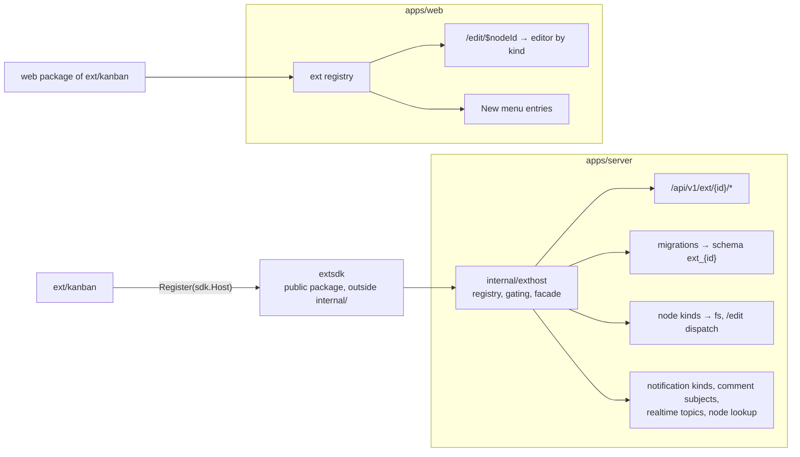

# Extensions — Design

> **Status: implemented, M44–M46** ([M44](milestones/M44.md) the host,
> [M45](milestones/M45.md) kanban core, [M46](milestones/M46.md) kanban
> collaboration). The first extension is a kanban board for project management.
> This page was the design; where the build departed from it the departure is
> stated where it applies (_was:_ …).

pp-hub grows by **extensions** — small apps compiled into the server and the
SPA, switched on per instance and per space. "App" is the product word in the
UI; the code says `ext` so it is never confused with the monorepo's `apps/`.

## The decision

Extensions are **compile-time modules behind a public SDK**, the model Caddy
(`xcaddy`) and Grafana use: an extension is a Go package plus a web package,
the operator picks which ones a build includes, and an admin switches the
included ones on or off at runtime.

| Option                                                   | Outcome                                                                                                                                                                                                                                                                                                 |
| -------------------------------------------------------- | ------------------------------------------------------------------------------------------------------------------------------------------------------------------------------------------------------------------------------------------------------------------------------------------------------- |
| **Compile-time SDK, runtime enable/disable**             | **Chosen.** One binary stays one binary ([system-design.md](system-design.md)); an extension reuses permissions, comments, notifications, activity and the job queue instead of rebuilding them; type-checked end to end.                                                                               |
| Out-of-process apps (sidecar container, Nextcloud ExApp) | Deferred. The only way to run untrusted code or install at runtime, but it needs a versioned, scoped public API for everything, an iframe UI, and collaboration across a process boundary. It can arrive later as one extension that proxies to sidecars — the host facade below is shaped so it could. |
| WASM in-process (Extism/wazero)                          | Rejected. Sandboxed, but every DB and realtime touch becomes a hand-written host function, the UI is still separate, and the ecosystem is young.                                                                                                                                                        |
| Go `plugin` package                                      | Rejected. Same toolchain, same dependency versions, Linux only — it breaks on any mismatch.                                                                                                                                                                                                             |

**Trust.** An extension runs inside the server process with its privileges.
Including one in a build is the operator trusting its code, as with a
WordPress plugin. There is no sandbox, and nothing here claims one.

**Third parties come later.** Phase 1 builds the contract in-tree and writes
kanban against it. The SDK is published with a semver promise only after a
second extension has been written against the contract alone: freezing an API
that one consumer has exercised freezes it wrong.

## Architecture



- **`extsdk` lives outside `internal/`.** Go forbids importing another module's
  `internal`, so a package that must one day be imported by third-party modules
  cannot start there.
- **A facade, not the internals.** An extension receives narrow interfaces —
  never the store or a module (it does get the connection pool for its own
  schema). This is the rule
  [agent-access.md](agent-access.md) already follows for tools: one access rule,
  enforced in one place. Go cannot stop an import by itself, so a test does
  (see [Testing](#testing)).
- **Wiring is by hand in phase 1**: a `[]extsdk.Ext{kanban.New()}` in
  `cmd/server` and the matching array in the SPA. A generator reading
  `pp-apps.yaml` arrives with the first out-of-tree extension.

## The contract

### Server — `extsdk`

```go
type Ext interface {
    Manifest() Manifest // ID, Name, NodeKinds, Migrations (fs.FS of NNNN_name.sql)
    Register(h Host) error
}

type Host interface {
    Router() chi.Router // mounted at /api/v1/ext/{id}
    DB() DB             // the pool; tables are qualified, ext_{id}.cards
    // Guard: middleware for a route naming {nodeID}: live node of the kind,
    // extension on for its space, capability held (404/403 otherwise); stores
    // node, caller and caps for RequestFrom.
    Guard(kind string, need Cap) func(http.Handler) http.Handler
    Allowed(ctx, node, user pgtype.UUID, kind string, need Cap) bool // the same decision, for a stream
    Caps(ctx, node Node, user pgtype.UUID) (Caps, error)             // share.EffectiveCapsForNode
    SearchPeople(ctx, node Node, query string, limit int) ([]User, error) // who holds view
    Users(ctx, ids []pgtype.UUID) (map[pgtype.UUID]User, error)
    Resolve(ctx, viewer pgtype.UUID, ids []pgtype.UUID) (map[pgtype.UUID]LinkTarget, error)
    Realtime() Realtime // Publish(topic, event, data); Stream(w, r, topic, stillAllowed)
    Comments() Comments // Counts(node) by subject; Forget(node, subject)
    Notify() Notify     // Send: kind "ext:{id}:{verb}", to somebody who can open the node
}

type NodeKind struct {
    Kind         string // "kanban.board"
    OnCreate     func(ctx, tx Querier, node Node) error      // same transaction as the node
    OnCopy       func(ctx, tx Querier, src, dst Node) error  // same transaction as the copy
    ValidSubject func(ctx, q Querier, node Node, subject string) (bool, error)
}
```

_Was:_ the design listed `Nodes()`, `Activity()`, `Enabled()` and a
schema-scoped `DB()`. Nothing used `Activity`; `Enabled` is decided by
`Guard`; and `search_path` is session state a pool cannot hold, so
migrations run with it set and the rest of the code qualifies its tables.

- `Router()` is mounted inside the authenticated `/api/v1` group, so the
  session, origin and audit middleware apply with no opt-in, and the existing
  router walks (`TestEveryAPIRouteIsAuthenticated`,
  `TestEveryAPIMutationChecksOrigin`) cover every extension route.
- `Caps` is `share.EffectiveCapsForNode`. An extension never decides
  access on its own; it maps the node's capabilities to its own verbs.
- A request to a disabled extension — instance or space — is answered 403
  before the handler runs.

### Web

An app's web half is the npm package `@pp-hub/ext-<id>` (`packages/ext-<id>`); its
default export is the manifest below, built with `defineExtension` from
`@pp-hub/ext-sdk`. The build's list is `apps/web/src/ext/registry.gen.ts`, written by
`pp-apps gen` from `pp-apps.json`.

```ts
interface ExtManifest {
  id: string;
  name: MessageDescriptor;
  nodeKinds: {
    kind: string; // "kanban.board"
    label: MessageDescriptor;
    icon: LucideIcon | IconComponent;
    newLabel: MessageDescriptor; // the New-menu entry
    defaultName: MessageDescriptor;
    // opened by /edit/$nodeId; `subject` is ?subject=card:<id> from a notification
    editor: LazyExoticComponent<ComponentType<{ nodeId: string; subject?: string }>>;
  }[];
  // how the bell words this extension's notifications, by verb
  notifications?: Record<string, (p: { actor: string; excerpt: string }) => MessageDescriptor>;
}
```

`/edit/$nodeId` chooses the editor by kind: a markdown document opens the
block editor, an extension node opens the editor its extension registered,
anything else opens OnlyOffice. `NodeIcon`, the New menu and `node-actions`
consult the same registry; actions that need bytes (download, open with
OnlyOffice, versions) are hidden on extension nodes.

## Data model

### Core changes

```sql
nodes.kind                -- 'dir' | 'file' | 'ext'
nodes.ext_kind TEXT       -- 'kanban.board'
  CHECK ((kind = 'ext') = (ext_kind IS NOT NULL))
  -- an ext node has no current_version_id: its content is its extension's rows

ext_state(ext_id, space_id NULL, enabled)
  -- space_id NULL = the instance switch (no row = off); a space row can only
  -- turn an instance-enabled extension off, and turning it back on deletes it

ext_migrations(ext_id, version)
  -- cmd/server applies each extension's migrations after core's

notifications.kind
  -- CHECK widened: IN ('comment','reply','mention') OR kind LIKE 'ext:%'

comment_threads.subject TEXT NULL   -- M46, 0024
notifications.subject TEXT NULL     -- M46, 0024
  -- 'card:<uuid>'; a thread with a subject has no markdown anchor
```

Every extension owns a Postgres schema `ext_{id}`. Its tables may reference
`public.nodes` with `ON DELETE CASCADE`, so purging a node takes the
extension's data with it. `pg_dump` already covers every schema, so backup
([deployment.md](../deployment.md)) needs no change.

### Kanban — `ext_kanban`

A board is a node (`kind = 'ext'`, `ext_kind = 'kanban.board'`), listed under
Apps in the sidebar and shared, copied and trashed like a file. Its rows are the source of truth; there is no file, no
version and no blob.

```sql
columns(id, board_id → nodes ON DELETE CASCADE, title, position, wip_limit)
cards(id, board_id → nodes ON DELETE CASCADE, column_id, title, description_md,
      position, due_at, created_by, created_at, updated_at, rev)
card_assignees(card_id, user_id)          -- INDEX (user_id): for "my cards"
labels(id, board_id, name, color)
card_labels(card_id, label_id)
card_links(card_id, node_id → nodes ON DELETE CASCADE)
```

- `position` is a fractional index (a string between its neighbours, ordered
  bytewise), so moving a card rewrites one row. Appending uses a counter key,
  and a key past 48 letters renumbers its list (event `reload`).
- `rev` increments on every write to a card. _Was:_ the design also had
  `archived_at`; nothing needed it and it was left out.
- Limits per board: 30 columns, 50 labels, 5000 cards; 20 links per card.
- Cards are relational from the start so a cross-board view ("assigned to me",
  due-date reminders) needs a query, not a migration.

| Board operation           | Capability needed                                                |
| ------------------------- | ---------------------------------------------------------------- |
| Open, read, subscribe     | `view`                                                           |
| Create/edit/move cards    | `edit`                                                           |
| Comment on a card         | `view`, as on block documents ([permissions.md](permissions.md)) |
| Rename, move, trash board | as for any node                                                  |

## Realtime and concurrency

- Mutations are REST. After commit the handler publishes an event on topic
  `board:<nodeId>`; clients subscribe through
  `GET /api/v1/ext/kanban/boards/{id}/events` (SSE, the transport the
  notification stream already uses) and apply it to the TanStack Query cache.
- A card `PATCH` carries `if_rev`; a mismatch is 409 and the client refetches.
  Concurrent moves of different cards never collide, because each move writes
  one row; two moves of the same card resolve last-writer-wins.
- The stream re-resolves access every 60 s, as `collab.Recheck` does for
  rooms, and closes on revocation, suspension or trash.
- Every open board is one SSE connection beside the notification stream; over
  HTTP/1.1 a browser allows six per origin, so several tabs starve ordinary
  requests (met in the smoke test) — the edge should speak HTTP/2
  ([deployment.md](../deployment.md#notification-stream)).
- The broker is in-process, under the same single-instance assumption as
  collaboration rooms. Several replicas would move it to Postgres
  `LISTEN/NOTIFY` without changing the contract.

Yjs is not used: a board is a set of small records, not a text, and a CRDT
document would hide the rows a cross-board query needs.

## How extension nodes meet the rest of the drive

| Where it is listed | **Under Apps in the sidebar, never in the drive.** An app's nodes would mix with files and folders and be hard to organize, so folder, top-level, tree and "Shared with me" listings leave `kind = 'ext'` out (SQL), and `GET /spaces/{id}/extensions/{extID}/nodes` lists the ones the caller can open, wherever they hang. A new node is made from the app's entry in the sidebar, with no parent: top level, private to its creator until shared. Starred, Recent, search, Trash and "Shared from outside" still show them — they have no Apps list to be found in. No hidden folder holds them: access inherits down folders and every item is private to its creator by default, so one shared folder per space would either show every board to everyone or undo that rule. |

| Situation                                            | Behaviour                                                                                                                                                                                                                                                                                   |
| ---------------------------------------------------- | ------------------------------------------------------------------------------------------------------------------------------------------------------------------------------------------------------------------------------------------------------------------------------------------- |
| Download, folder zip, preview, versions, upload over | Not offered. A folder zip skips extension nodes.                                                                                                                                                                                                                                            |
| Copy (node or containing folder)                     | `NodeKind.OnCopy` copies the extension's rows — kanban copies columns, cards, labels and links, not assignees or comments.                                                                                                                                                                  |
| Trash / restore / purge                              | Node soft delete as for any file; purge cascades into `ext_{id}`.                                                                                                                                                                                                                           |
| Move, share, activity, name search                   | Unchanged — they act on the node.                                                                                                                                                                                                                                                           |
| Extension disabled                                   | The app's Apps entry disappears and its list answers 403; the node still shows, badged "app disabled", in Starred, Recent, search and Trash; opening and every route answer 403; data is kept.                                                                                              |
| Extension no longer in the build                     | An unclaimed `ext_kind` shows (in Starred, Recent, search, Trash) with a generic icon, opens "not part of this installation" and can be trashed; its schema is left in place. Copying it is refused (`OnCopy` has no owner).                                                                |
| Share link                                           | Not supported in phase 1: a link to a board answers 422 and a shared folder's listing leaves boards out. It needs a no-user context in the SDK.                                                                                                                                             |
| Quota                                                | Extension rows are not counted in `used_bytes`.                                                                                                                                                                                                                                             |
| Assignee / @mention                                  | The picker lists only people with `view` on the board.                                                                                                                                                                                                                                      |
| Card link to a Drive file                            | In the board's space, openable by the writer. Access to the target is re-resolved per viewer on every REST read (`Host.Resolve`); someone without it sees a "no access" chip, never the name. The broadcast event carries `link_ids` only, so one viewer's resolution cannot reach another. |
| i18n                                                 | Phase 1: kanban strings live in the web catalog. Per-extension catalogs are a phase 2 problem.                                                                                                                                                                                              |

**Largest risk, handled:** core code branches on `nodes.kind` in many
places — download, zip, copy, preview, MIME, search, MCP tools. They were
audited before `'ext'` was added: queries that read versions already used
`LEFT JOIN` or filtered `kind = 'file'`; the zip walk, copy, the share-link
views, the listing DTOs and the agent's web link needed an explicit case.

## Testing

- **Structural:** the existing router walks cover `/api/v1/ext/*`.
  `TestExtImportsOnlySDK` walks the import graph of `ext/...` and fails on any
  `internal/*` import — the boundary is a test, not a convention.
- **Database-backed:** the `nodes.kind`/`ext_kind` check; extension migrations
  re-run cleanly; purge cascades into `ext_kanban`; board access inherited from
  a grant on an ancestor folder; disabled extension → 403; an assignee without
  access refused; a card link to an unreachable file hides its name; stale
  `rev` → 409; the event stream closes on revocation.
- **Unit:** fractional positions (ordering, key growth, `Spread`).
- **Smoke:** two browsers, two users — a card moved in one appears in the
  other; revoking the share closes the second user's stream.

The `TestExt*` database tests are in `internal/httpapi/ext_db_test.go`; the
route walks build a server with the kanban routes registered
(`routerWithExtensions`), because the routes exist only once an extension has
registered.

## Rollout

Core migrations are additive. Kanban ships in the image **disabled**; an
instance admin turns it on (Admin › Apps), and a space admin can turn it off
for a space (Settings › Apps). Operators who put a proxy in front must give
`/api/v1/ext/<id>/…/events` the notification stream's treatment (no
buffering, long read timeout); the server itself needs nothing.

## What the second extension showed

`ext/checklist` (a node kind `checklist.list`, items with a done flag, live over
SSE) was written after kanban against `extsdk` and the web `ExtManifest` alone,
to find out whether the contract stands without kanban beside it. It did, with
no change to the core: the server compiled on its first build, and the New menu
entry, the listing icon, the `/edit` route with its header, Share and bell, the
Admin/Space switches, copy, trash and purge, and the kind check on every route
(a checklist id on a kanban route is a 404 and back) all came from the
registration. `TestExtSecondExtensionSharesTheHost` holds that line.

What it cost, and what it exposed:

- **Fixed:** the New dialog named kanban's kind to show its "columns are added"
  hint — a core file knew an extension. The hint is now `newHint` on the node
  kind.
- **Duplicated, then moved into the SDKs** ([extension-authoring.md](extension-authoring.md)).
  Server: `rq`, `fail`, `conflict`, trimmed-text validation are now
  `extsdk.MustRequest`, `Fail`, `Conflict`, `Trim`. Web: the query key and retry
  policy, the SSE hook with its probe-then-reconnect, `isAppOff` and the "turned
  off / could not be opened" state are `extQueryKey`, `extRetry`, `useExtEvents`,
  `isAppOff`, `ExtUnavailable` in `@pp-hub/ext-sdk`.
- **Two registrations by hand, with the kind string spelled three times** — now
  one `pp-app.json` per app and `pp-apps.json` for the build; `pp-apps gen`
  writes both registries and `pp-apps check` (also a test) fails on drift.
- **The web side imported the app** (`@/components`, `@/lib/api`,
  `@/lib/event-stream`) — now each app is an npm package that may import only
  the SDK, `@workspace/ui` and a short allow-list, enforced by
  `ext-boundary.test.ts`; the app hands the SDK its implementation at boot
  (`ExtHost`).

No `extsdk` change was needed to build the checklist, which is the evidence for
freezing the server contract. The SDKs are still not frozen: a promise waits
for an app written by someone other than their authors.

## Later (phase 2)

Not built in M44–M46, recorded so they are found rather than rediscovered:

- `extsdk` and `@pp-hub/ext-sdk` published with a semver promise; a catalog
  host and signing, an `engines.pp-hub` range check
  ([extension-authoring.md](extension-authoring.md#third-party-apps-and-a-marketplace)).
  The generator (`pp-apps`) and the manifest exist.
- Per-extension translation catalogs.
- Share links to extension nodes.
- MCP tools contributed by extensions.
- Kanban: a cross-board "assigned to me" view and due-date reminders.
- Out-of-process extensions, as one extension proxying to sidecars.
