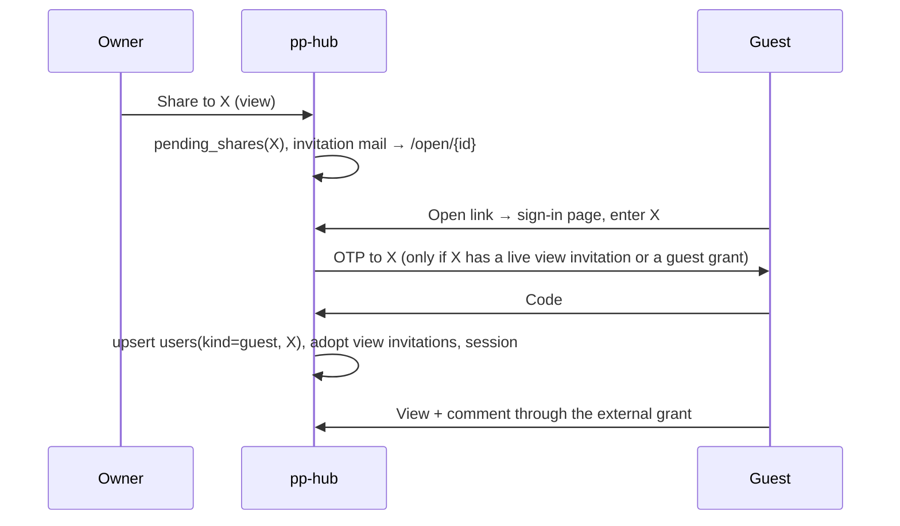

# Guest Access: sharing to an exact email, no account

**Status: shipped (M49).** Off by default: an instance turns it on in
Admin › Settings › Sharing. Extends [personal-spaces.md](personal-spaces.md) (M42).

## Problem

M42 shares by email, but the recipient must hold a Logto account whose
**verified** address matches (`pending_shares` are adopted at a verified
sign-in). An outsider who only needs to read a document and comment on it has to
sign up with an identity provider first.

## Goals

- Share a file or folder to an address; the recipient proves they own that exact
  address with a one-time code and gets **view + comment**. No account, no
  password, no Logto user.
- Works for organization spaces (`spaces.external_sharing`) and personal spaces.
- The address is the credential: a forwarded mail or link gets nobody in.

## Non-goals

- Edit, re-share, group grants, or any route outside the allowlist below.
- Guests in the member list, the admin console, search, MCP or WebDAV.
- Notification mail to guests: they have no preferences to opt out with.

## Decisions

| Question                   | Chosen                                                                                                   | Rejected                                                                                                                                                           |
| :------------------------- | :------------------------------------------------------------------------------------------------------- | :----------------------------------------------------------------------------------------------------------------------------------------------------------------- |
| Identity of a guest        | A `users` row, `kind = 'guest'`, `email_verified = true`, no OIDC identity                               | Email stored on the comment with no `users` row: every `JOIN users` over comments, notifications and audit changes, and the resolver grows a second principal type |
| Proof of the address       | Emailed OTP, 6 digits, 10 min, 5 tries                                                                   | The link token as the credential: forwardable, so "exact email" would be false                                                                                     |
| Grant shape                | M42's external direct share (`is_external`, `level = 'view'`), resolver **unchanged**                    | A new access path beside the resolver                                                                                                                              |
| Comment permission         | Comments already take `CapView` ([block-documents.md](block-documents.md#comments)); no new level or cap | A `comment` level: widens the permission model for something a view grant already allows                                                                           |
| Guest later signs in       | The guest row is re-pointed in place by the verified-email adoption (`resolveUser`, orgsync)             | A second account: `users_tenant_email_hash` is unique per address, so the real sign-in would fail                                                                  |
| Where guests are forbidden | Allowlist in the `authenticated` middleware: a guest session reaches only listed routes                  | A denylist: a new route would be open to guests until someone remembered                                                                                           |

## Flow

The reply to "send me a code" is `204` whether or not `X` holds a grant, so the
form is not an oracle for who was shared with; the audit row records what
happened (`detail.sent`).

## Configuration

| Key            | Type    | Default | Effect                                                                                                                                                                                                                                   |
| :------------- | :------ | :------ | :--------------------------------------------------------------------------------------------------------------------------------------------------------------------------------------------------------------------------------------- |
| `guest_access` | boolean | `false` | Instance gate. Guests are honoured only while this **and** `external_sharing_enabled` hold; either off makes every guest request 403 at once (rows stay). The space's `external_sharing` is enforced by the resolver as for any outsider |

The OTP is mailed through pp-hub's own SMTP (Admin › Settings), not
Logto's; without it no code can be sent and guests cannot sign in.

## Data model

`migrations/0029_guest_access.sql`:

- `users.kind` `member | guest`, default `member` (`users_kind_ck`). A guest
  carries `oidc_iss = ''` and `oidc_sub = 'guest:<id>'`, which keeps
  `UNIQUE (oidc_iss, oidc_sub)` without loosening the `NOT NULL`;
  `users_guest_ck` requires `kind <> 'guest' OR (oidc_iss = '' AND email <> ''
AND email_verified)`. A guest is stored under the lower-cased address.
- `guest_otps(email_norm PK, code_hash, attempts, sends, window_start,
expires_at, created_at)`: one live code per address, SHA-256 of
  `email:code`. `sends`/`window_start` cap mail per address per hour,
  `attempts` caps guesses against the code.
- `AdoptUserIdentity` also sets `kind = 'member'`.
- No change to `sessions`: whether a session is a guest's is read from its
  user's `kind`, so a promoted account is an ordinary one on its next request.

## Server

- `GET /auth/guest` → `{enabled}`, public: whether the sign-in page offers a
  code.
- `POST /auth/guest/code {email}` → `204` always. `internal/guest` sends a code
  only when guests are on, no real account (`kind = 'member'`) already uses the
  address, and the address has a live **view** invitation or a guest who still
  holds a grant; at most `SendsPerHour` (3) per address per hour. The mail is
  sent at once and bilingual (`notify.GuestCode`), not queued.
- `POST /auth/guest/verify {email, code}` → `204` and the `pp_session` cookie,
  or `422` for every failure (unknown address, none outstanding, expired, burnt,
  wrong — one answer; not `401`, which the web client treats as "session gone").
  A code works once; `MaxAttempts` (5) wrong guesses burn it. It upserts the
  guest user (never for an address a real account holds), runs
  `personal.Adopt(…, viewOnly)` — view invitations only; an edit invitation
  stays pending for the address's own sign-in — and issues a session with a
  7-day idle window that slides with use (`IssueGuestSession`; the 90-day
  absolute cap still applies).
- Both routes sit outside `/api/v1` (no session yet), behind `sameOrigin` and a
  per-IP limit (`guestCodeLimit` 1/min burst 10, `guestVerifyLimit` 10/min burst
  20, in-process like the others). The per-address allowance is the real bound.
- **Allowlist** (`guestRoutes` in `guest_routes.go`, matched by chi pattern
  against the path as chi routes it): `GET /users/me`, `GET /spaces/` (answers
  `[]` for a guest — no space, nothing to reconcile at the provider),
  `GET /shared`, `GET /users/{id}/avatar`, node reads (`/nodes/{id}`,
  `children`, `path`, `people`, `download`, `content`, `preview`, `document`,
  `attachments/{hash}`, `relative[/meta]`, `page`, `pages`, `backlinks`,
  `export`, `collab`, `POST edit-session`), comments (`GET/POST` threads,
  replies, resolve/reopen, edit/delete own), `GET /collab/{room}`, and the
  notification routes. Everything else is 403 before its handler runs. Whether
  a guest may use a listed route on a node is still the capability resolver's
  decision.
- **Not in the admin or member surfaces.** The member, people and group
  queries join `space_members`, which a guest has no row in; `ListUsers`,
  `CountUsers` and `AdminStats` filter `kind = 'member'`;
  `personal.Provision` refuses a guest, whatever `personal_spaces` says. The
  guest does appear where a direct grantee does: the share list (marked
  `grantee_guest`, "Guest" in the dialog) and `/nodes/{id}/people`, so they can
  be mentioned in what they can open.
- **Sharing to a guest.** `shareByEmail` finds a guest like any verified
  account and makes an ordinary external grant, but refuses anything above view
  (422): the session cannot edit. A view invitation's mail says "enter this
  address and we will send a code" instead of "create an account" when guests
  are on (`notify.Invite.Guest`).
- **Becoming a member.** A verified Logto sign-in (`resolveUser`) or an org
  sync (`resolveMember`) with the same address, in any case, adopts the guest
  row (`GetGuestByEmailNorm`) rather than creating a second account, so
  grants and comments stay with the person.
- **Sign-out** of a guest does not visit the provider (`end_session_url` is
  empty).
- **Audit:** `guest_code_requested` (with `sent`), `guest_verified`,
  `guest_verify_failed`; reads and comments carry the guest as actor.
- **Sweep:** `PruneGuestOTPs` with the 5-minute housekeeping. A guest row stays
  once made: it can own comments, and with no grant it reaches nothing.

## Web

- The sign-in page (`/login`, reached by `/open/{id}` for a visitor with no
  session) offers **Open something shared with your email** under SSO when
  `GET /auth/guest` says so: email → code → a full navigation to the original
  address (`components/guest-sign-in.tsx`).
- A guest's shell is the drive rail reduced to the brand, "Shared from
  outside" and the account menu (sign out only): no space switcher, storage,
  search, settings or version history. `useActiveSpaceId` is `undefined` for a
  guest, and a bare `/drive` redirects to `/drive/shared`.
- Admin › Settings › Sharing carries the `guest_access` switch.

## Risks

1. **Promotion on sign-in** is the one place a guest can break a real account;
   `TestGuestBecomesAMemberAtFirstSignIn` holds that the row, grants and
   comments survive and that the allowlist stops applying.
2. **Allowlist drift.** A route added later is 403 for guests by default;
   `TestEveryRouteRefusesGuestsUnlessListed` walks the router with a live guest
   session, and `TestGuestRoutesAreRoutes` rejects a stale entry.
3. **Account enumeration** is closed on the code form but still open through the
   share dialog's exact-email behaviour (M42, accepted).
4. **Mail abuse**: a code is mail to an address someone else chose; bounded by
   the per-address and per-IP caps and by sending only when a grant or view
   invitation exists.

## Verification

- `internal/httpapi/guest_db_test.go` (real router, real cookies, real Postgres):
  the whole proof end to end; a guest opens what was shared and nothing else
  (a table of 403s, an empty `/spaces/`, a sibling page nobody shared, absent
  from members and the admin user list); a code is sent only for a reason and at
  most three times an hour, with the same answer each time; a code is single
  use, burns on guessing and expires; a guest holds nothing wider than view and
  an edit invitation stays pending; each switch cuts and restores a live
  session; promotion keeps the row; no personal space; the route walk and the
  allowlist matcher.
- `internal/notify/messages_test.go`: a guest invitation asks for no account.
- Smoke (browser, throwaway database, local SMTP sink): share → invitation mail
  → `/open/{id}` → code form → wrong code refused → right code opens the
  document in the reduced shell.
