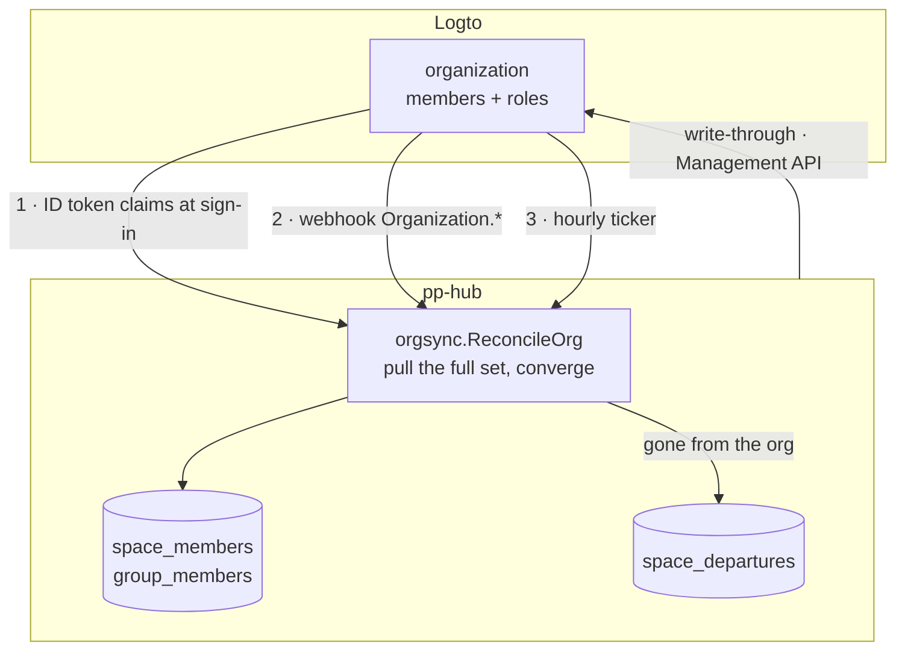

# Logto Organization Sync — Design

> **Status: implemented.** This is the design in force, delivered as
> **M33** and made two-way by **M38** ([milestones.md](milestones.md)): spaces
> are created, renamed and linked through Logto, accounts are Logto's, and
> Logto is the only identity provider. The membership model it replaced —
> local `space_invitations`, `POST /invitations/accept` and an SMTP transport
> for the invitation email — is gone; [permissions.md](permissions.md)
> describes the model this document specifies.

## The problem

Membership is defined twice. An operator creates the person in Logto so they
can sign in, then invites the same person into a space in pp-hub so they can
see anything. Two consoles, two mental models, two lists that drift apart.

The decision taken: **a Logto organization is the source of truth for who
belongs to a company.** pp-hub stops being a second place where that is
decided, and becomes a place where it is applied.

## Ownership boundary

This is the only line that matters. Everything below follows from it.

| Logto owns                        | pp-hub owns                                                                |
| :-------------------------------- | :------------------------------------------------------------------------- |
| identity, email, name, suspension | `users` (mirror), plus user-editable profile                               |
| organization and its name         | `spaces.idp_org_id` — one organization, one space                          |
| organization membership           | `space_members` — **a projection, never a record**                         |
| organization role `admin`         | membership of the automatic `Admin` group                                  |
| organization invitations + email  | —                                                                          |
| —                                 | user-created groups, grants, ownership, quota, Archive, departure teardown |

Two consequences worth stating plainly, because both are easy to get wrong:

**`space_members` stays.** It is not a leaf table. Ten SQL sites join it
directly — `activity.sql:26,48,84`, `nodes.sql:137,224,265`, `shares.sql:50`,
`groups.sql:181`, `users.sql:71`, `spaces.sql:11` (an eleventh,
`invitations.sql:56`, left with the invitation queries) — and
thirteen Go guards call through `RequireMember` / `IsSpaceMember`. Consulting an
external service per request would rewrite every one of them and destroy the
single-query scoping the codebase is built on (`reachability.go:12-16`,
`search.go:112-144`). The table remains; what changes is that no human writes
to it.

**Groups and grants are untouched.** Logto's organization template enforces one
role set across every organization and cannot express a per-space, user-created
group. The `Admin` group is the one group that maps onto an organization role;
the rest of the permission system is unaffected by this design.

## Synchronisation



**Every signal means only 'organization X changed'.** No path applies a delta.
The job re-reads the organization — `GET /api/organizations/{id}` for its
name, `GET /api/organizations/{id}/users` for its members — and converges the
local space against it. Webhook deliveries carry `addedUserIds` /
`removedUserIds`, and it is tempting to apply them directly — but they arrive
unordered, so applying them incrementally is a correctness bug waiting for
concurrency. Converging is idempotent and order-free, and costs two API calls.

**Sign-in reconciliation is the backbone**, not the optimisation. Requesting
`urn:logto:scope:organizations` and `urn:logto:scope:organization_roles` puts
`organizations` and `organization_roles` in the ID token, so a returning user's
membership is corrected with no network call at all. A lost webhook heals itself
the next time the person signs in; the hourly ticker heals the people who do
not.

pp-hub always requests both scopes, so **an empty claim and an absent one are
different answers.** `organizations: []` is Logto saying the person belongs to
no organization, and it is read as exactly that: every linked space they were
in becomes a departure through the ordinary path. A token with no
`organizations` claim at all means the sign-in application was never granted
the scopes — a deployment mistake — and `auth.reconcileOrgs` skips the
reconcile with a warning rather than evicting everybody at their next sign-in.

A space missing from the token can also mean its organization was deleted.
Before a claims-driven departure, `orgGone` looks the organization up: a 404
unlinks the space instead (see [Deletion does not travel](#deletion-does-not-travel)),
and a failed lookup skips the departure and leaves it to the sweep.

### Members who have never signed in

Reconciliation pre-creates the `users` row from the Management API response,
keyed on `(oidc_iss, oidc_sub)` where `oidc_sub` is the Logto user id. For
every member, new or not, it also mirrors the IdP-owned profile fields —
avatar, phone, gender — through `users.Service.SyncIdPProfile`, the same call
sign-in makes (see [data-model.md](data-model.md#profile-fields-the-idp-owns)).
A sync failure is logged; it never fails the reconcile.

This deliberately reverses the rule at `production-readiness.md:735` — _nothing
creates an account ahead of its owner's first login_. That rule was right while
pp-hub owned identity: an account with no verified owner was a liability. It is
wrong once the IdP is authoritative, because the identity key is exact and comes
from the system that issued it. Without pre-provisioning, the People page shows
a subset of the organization and reproduces exactly the two-lists-disagreeing
problem this design exists to remove.

An email collision on `users_tenant_email_hash` is handled the way
`AdoptUserIdentity` already handles it, not as a 500.

### Accepting an invitation

Logto sends an organization invitation but does not accept it: that is the
application's job (`PUT /api/organization-invitations/{id}/status`). Until
M38 nothing here did, so an invitee signed up, belonged to no organization and
landed on an empty drive while the invitation sat pending for its 14 days.

Acceptance happens at sign-in, not behind a landing page.
`orgsync.AcceptInvitations` lists `GET /api/organization-invitations?invitee=`
for the **verified** email claim, keeps those still `Pending` and unexpired,
and accepts each with the person's Logto user id — only for an account whose
`oidc_iss` is this tenant's, where `oidc_sub` _is_ that id. The organizations
and roles it accepted are merged into the token's claims before
`ReconcileUser`, because the token was minted before the acceptance: on its
own it omits them, and the reconciler would read the new membership as a
departure. Failures are logged and the sign-in continues, like every other
reconcile at sign-in; an invitation that failed stays pending and is retried
at the next one.

The email therefore needs no invitation id and carries nothing worth
stealing: `{{link}}` is `{PP_EXTERNAL_URL}/auth/login?login_hint=<address>`,
and `HandleLogin` forwards an address-shaped `login_hint` to the IdP so the
form opens on it. Should Logto ever accept on its own, nothing changes — an
accepted invitation is no longer `Pending`, and its membership arrives in the
claims.

## Accounts

Whether a person may use pp-hub at all is Logto's too (M38). Logto refuses a
suspended account's next sign-in, but a pp-hub session is a row that lives up
to 90 days, so before this a person suspended or deleted upstream kept every
open tab working — and one still in their organizations kept full access.

Accounts follow the organization pattern exactly: `orgsync.ReconcileAccount`
re-reads `GET /api/users/{id}` and converges the local row — email and name
(`SetUserIdpIdentity`, without touching `last_seen`), the IdP-owned profile
fields, and `isSuspended`. Suspending sets `suspended_at` and deletes every
session; the per-request check already locks the account out, but a
reactivation must not silently bring old devices back. Three signals feed it:

- the webhook, for `User.Data.Updated`, `User.SuspensionStatus.Updated` and
  `User.Deleted` — id from `data.id`, or `params.userId` for a deletion whose
  `data` is null — enqueued as `user:reconcile`;
- the hourly sweep, which lists the tenant once and converges every local
  account of this issuer. An account absent from that listing is confirmed
  with its own lookup before anything happens to it, so a short page can
  never read as a mass deletion;
- every organization reconcile, which applies the same function to each
  member it lists.

`isSuspended` is decoded as a pointer. A response that does not carry it — an
organization member list may not — reads as "unknown", never as
"reactivate"; otherwise any membership reconcile could undo a suspension.

**An account Logto no longer has** (404) is suspended, not deleted: it owns
files, grants and history, and the departure handover needs the row. Each
linked space it belonged to is enqueued for reconcile, which turns its
memberships into departures now rather than at the next sweep.

**An address another account already holds** is not copied over; the conflict
is logged and the old address kept, because resolving it is a merge nobody
asked for.

**The write path** is the admin console's Suspend/Reinstate:
`PATCH /api/users/{id}/is-suspended` first, local half second, so the next
sweep agrees with it. Only an account issued by another provider
(`ErrNoIdentity`) is suspended locally alone. The instance-admin flag
(`users.is_admin`) stays pp-hub's: it is a property of this server, not of
the company.

## Leaving an organization

`RemoveMember`'s five steps split in two. Access dies immediately; destruction
waits for a human.

| Phase                          | Does                                                                                                            | Triggered by                        |
| :----------------------------- | :-------------------------------------------------------------------------------------------------------------- | :---------------------------------- |
| immediate — `RevokeMembership` | delete `group_members` for the space's groups, then the `space_members` row                                     | any sync path; idempotent           |
| deferred — `CompleteDeparture` | revoke inbound and outbound grants, climb nested ownership, move owned roots to Archive, reseat the Admin grant | a space admin, from the People page |

The split is safe because content access requires current membership of the
node's space (`permissions.md:8-9`), enforced at `drive.go:270,380,437,521,1021,1075`,
`home.go:75` and `share.go:144`. With the membership row gone, the grant rows
left standing grant nothing. Deferring the teardown therefore costs no access
control — it only postpones tidying — and the teardown is destructive enough
that an accidental click in the Logto Console must not be able to trigger it.

Deleting `group_members` cannot be deferred. `group_members` references `users`,
not `spaces`, so nothing cascades when the membership row goes; leaving it would
keep a departed colleague's group grants live. The existing comment at
`spaces.go:242-245` documents precisely this trap.

## The last admin

pp-hub can no longer refuse a membership change that has already happened. The
write path still refuses — `ErrLastAdmin` is checked before the Management API
call — but a removal performed in the Logto Console arrives as a fact.

**A space is allowed to end up with no admin.** It shows a banner saying so, and
an instance admin (`users.is_admin`) resolves it. The alternatives were both
worse: auto-promoting `spaces.owner_id` invents a privilege grant nobody
requested and breaks the rule that admin means one thing only — membership of
the `Admin` group; writing the role back into Logto puts pp-hub in a loop with
whoever is editing the Console.

## Schema

`migrations/0005_logto_orgs.sql`:

```sql
ALTER TABLE spaces ADD COLUMN idp_org_id TEXT;
CREATE UNIQUE INDEX spaces_idp_org_uniq ON spaces (idp_org_id) WHERE idp_org_id IS NOT NULL;

CREATE TABLE space_departures (
    space_id    UUID NOT NULL REFERENCES spaces(id) ON DELETE CASCADE,
    user_id     UUID NOT NULL REFERENCES users(id) ON DELETE CASCADE,
    detected_at TIMESTAMPTZ NOT NULL DEFAULT now(),
    source      TEXT NOT NULL,              -- signin | webhook | reconcile | admin
    resolved_at TIMESTAMPTZ,
    resolved_by UUID REFERENCES users(id) ON DELETE SET NULL,
    PRIMARY KEY (space_id, user_id)
);
CREATE INDEX space_departures_pending ON space_departures (space_id) WHERE resolved_at IS NULL;

DROP TABLE space_invitations;
```

`migrations/0012_detached_orgs.sql` (M38) adds the one table deletion needs —
see [Deletion does not travel](#deletion-does-not-travel):

```sql
CREATE TABLE detached_orgs (
    org_id      TEXT PRIMARY KEY,
    detached_at TIMESTAMPTZ NOT NULL DEFAULT now(),
    detached_by UUID REFERENCES users(id) ON DELETE SET NULL
);
```

`spaces.owner_id` is `NOT NULL REFERENCES users(id)`, so a space is **not**
created from a webhook — there is no user in that context to own it. A space is
created either by an instance admin in pp-hub (`CreateSpace`, which creates the
organization first) or lazily on the first sign-in of an organization member
whose organization has no space yet. Either way that person owns the row
whatever their role: their admin status is then corrected from the
organization like everybody else's, so owning the row buys nothing on its own
(`ensureSpace`). No nullable owner, no placeholder account.

## Package `internal/orgsync`

Four files. `client.go` is the Management API over M2M — organizations
(`Organization`, `CreateOrganization`, `RenameOrganization`), membership
(`OrgMembers`, `AddMember`, `RemoveMember`, `SetAdmin`), invitations
(`Invite`, `PendingInvitations`, `AcceptInvitation`) and users (`User`,
`Users`, `FindUserByEmail`, `SetSuspended`). The `Service` is split by what it
converges:

- `orgsync.go` — membership: `ReconcileUser` (sign-in claims),
  `ReconcileOrg` (the job body: name, then members), `AcceptInvitations`, the
  admin write path (`Add`, `Remove`, `SetAdmin`), and the worker that drains
  `org:reconcile`, `user:reconcile` and `org:link` jobs and runs the hourly
  sweep.
- `accounts.go` — accounts: `ReconcileAccount`, `SetSuspended`, the account
  sweep.
- `spacesync.go` — the space itself: `CreateSpace`, `Rename`, `LinkPreview`,
  `Link` and its job body `runLink`.

`ReconcileUser` runs from the sign-in claims and makes an outbound call only to
confirm that an organization missing from the token still exists (`orgGone`).
`ReconcileOrg` is the job body and is the only thing that reads membership from
Logto.

The M2M token is fetched with `client_credentials` and Basic-auth credentials,
against `resource = https://{tenant}.logto.app/api` (Cloud) or
`https://default.logto.app/api` (OSS), cached in-process, refreshed ahead of
expiry and on a 401. Paginated responses are walked via the `Link` and
`Total-Number` headers.

### Configuration

```
PP_LOGTO_ENDPOINT            # Logto base URL — not the OIDC issuer, no /oidc suffix
PP_LOGTO_M2M_CLIENT_ID
PP_LOGTO_M2M_CLIENT_SECRET
PP_LOGTO_API_RESOURCE        # default https://default.logto.app/api
PP_LOGTO_WEBHOOK_KEY         # signing key for logto-signature-sha-256
PP_LOGTO_ORG_ROLE_ADMIN      # default "admin"
```

**Logto is mandatory, and there is no degraded mode.** It is the only identity
provider pp-hub supports: the sign-in always requests the two organization
scopes, and the Management API is how every membership, space, suspension and
invitation is written and how anybody who is not signing in is kept current.
`config.LogtoSettings.Validate()`, called by `cmd/server`, therefore refuses to
start unless `PP_LOGTO_ENDPOINT` is an absolute URL and both M2M credentials
are set. The worker never talks to Logto and does not check. Only
`PP_LOGTO_WEBHOOK_KEY` may be missing: the server warns, `/hooks/logto`
refuses every delivery, and upstream changes arrive at the next sign-in or on
the hourly sweep instead.

Until M38 there were two more shapes: no endpoint at all, where any OIDC
provider served login and spaces were created locally, and an endpoint without
credentials, where membership converged from sign-in claims alone and every
write answered 503. Both went. Each was an install in which part of this design
silently did nothing — a space nobody could link, a rename the next reconcile
would undo — and a missing piece is better as a startup error than as a
surprise at the first change an admin attempts.

## HTTP surface

| Action          | Today                                                         | After                                                                                               |
| :-------------- | :------------------------------------------------------------ | :-------------------------------------------------------------------------------------------------- |
| add a member    | `POST /spaces/{id}/members` writes locally                    | email → organization invitation, accepted at sign-in; existing account → `AddMember` + reconcile    |
| set admin       | `PATCH …/members/{u}/` **and** `POST …/members/{u}/set-admin` | one route, write-through `SetAdmin`                                                                 |
| remove a member | `DELETE …/members/{u}/`, full teardown inline                 | `RemoveMember` upstream, then `RevokeMembership` + a departure row                                  |
| invitations     | 4 routes + `POST /invitations/accept`                         | **removed**                                                                                         |
| handover queue  | —                                                             | `GET /spaces/{id}/departures`, `POST /spaces/{id}/departures/{u}/complete`                          |
| webhook         | —                                                             | `POST /hooks/logto` — `Organization.*` and `User.*` events                                          |
| suspend a user  | `PATCH /admin/users/{u}` writes locally                       | `PATCH /api/users/{id}/is-suspended` upstream first, then local                                     |
| create a space  | `POST /spaces` open to anyone                                 | instance admin only; `POST /api/organizations` + creator as admin upstream first, then the space    |
| rename a space  | `PATCH /spaces/{id}` writes locally                           | `PATCH /api/organizations/{id}` upstream first, then local                                          |
| delete a space  | `DELETE /spaces/{id}`                                         | local only: the organization stays in Logto and is recorded in `detached_orgs`                      |
| link a space    | —                                                             | instance admin: `GET /spaces/{id}/link-preview`, `POST /spaces/{id}/link` → **202**, `org:link` job |

**Creating a space is an instance admin's action, and it writes through.** A
space is a company, companies come from the identity provider, and a member
who can mint one has awarded themselves the admin role the organization role
was supposed to decide. `POST /spaces` therefore answers **403** unless the
caller is an instance admin (`users.is_admin`, exposed as
`can_create_spaces`). For them, `orgsync.CreateSpace` creates the organization
(`POST /api/organizations`), adds the creator and gives them the admin role,
and only then mirrors it locally — `ensureSpace`, then the creator's
membership. Upstream first means there is nothing to compensate: if the local
half fails, the organization is already in the creator's next ID token, and
that sign-in creates the space the ordinary way. A creator whose account this
Logto tenant did not issue has no organization to be seated in, and gets
**422**. There is no longer a way to create a space that mirrors nothing.

The decision rides on the profile as `can_create_spaces`, so the client hides
the control instead of offering a button that answers 403 — and the empty
state says "ask an administrator to add you to an organization" rather than
"create your first space", which would tell somebody the fix is theirs when it
is not.

**The name is the organization's.** Renaming a linked space in the app PATCHes
the organization first (`orgsync.Rename`), because the next reconcile mirrors
the organization's name into `spaces.name` (`SetSpaceName`) and would
otherwise put the old one back. A rename in the Console arrives the same way
as a membership change: an `Organization.Data.Updated` delivery queues a
reconcile, which reads the name.

Every write to Logto fails the same way (`identityProviderError`): an account
this tenant did not issue (`ErrNoIdentity`) is **422**, an unreachable Logto
(`ErrUnreachable`) **503**, and a refusal from the Management API **502** with
its message, because the fault is in the tenant, not in this server's logs. A
membership write on a space that mirrors no organization (`ErrNotLinked`) is
**422** — "an instance administrator can link it" — and linking one that is
already linked, or one whose unpushable members were not confirmed, is
**409**.

The webhook is mounted **outside** `/api/v1`, and not for convenience:
`routes_test.go` asserts that every route under `/api/v1` carries the auth and
same-origin middlewares. Adding an unauthenticated endpoint inside that group
would mean loosening the test that protects the whole API surface.

The handler verifies an HMAC-SHA256 of the **raw** body — read before JSON
parsing — against `logto-signature-sha-256` in constant time, enqueues
`jobs(kind='org:reconcile', payload={"org_id": …})` — or `user:reconcile` for
a `User.*` event — and returns 2xx. The organization id is taken from
`organizationId`, else `data.id`, else `params.id`, which between them cover
every `Organization.*` event including a deletion whose `data` is null. Logto
documents this queue-then-ack shape as the supported pattern; doing the work
inline invites a delivery timeout.

## What is deleted

A clean cutover, not a parallel path:

- `internal/mail` — its package doc stated the space invitation was the only
  message that exists, so the package went and `PP_SMTP_*` with it. **M31
  brought it back** for share notifications (and M26's alerts, configured in
  Admin › Settings by M35), so the package and the variables exist again; what
  stayed deleted is the invitation message and its template.
- the invitation half of `httpapi/space_settings.go` (~262 LOC) and
  `space_settings_test.go`'s token test.
- `space_invitations` and its three indexes.
- frontend: `routes/invite/$token.tsx` (the whole `routes/invite/` directory)
  and `components/member-picker.tsx`. The invitation hooks and endpoints went
  with them; what replaces them lives beside the space-member code it belongs
  to — `getSpaceDepartures`/`completeDeparture` in `lib/api/users.ts`,
  `useSpaceDepartures`/`useCompleteDeparture` in `lib/queries/users.ts`, and a
  `keys.departures(spaceId)` cache key where `keys.invitations` and
  `keys.userSearch` used to be. `components/no-admin-banner.tsx` is the one
  new component.
- `GET /users/search` and `users.Service.Search`. Confirmed at implementation:
  `useUserSearch` had exactly one consumer, the member picker, so
  `UserSearchResult` left `lib/api/types.ts` with it.

**This does not remove mail configuration, it moves it.** Invitation email is
now Logto's, which requires an email connector and an `OrganizationInvitation`
template there. Outgoing mail for pp-hub's own messages — share notifications
(M31) and security alerts (M26) — is configured separately, in Admin ›
Settings (M35), with `PP_SMTP_*` as the fallback.

## Failure modes

| Risk                    | Handling                                                                                                                                                                          |
| :---------------------- | :-------------------------------------------------------------------------------------------------------------------------------------------------------------------------------- |
| Logto unreachable       | mutations answer 503 with a specific message; reads are unaffected, served from the local projection. The blast radius is bounded because a Logto outage already prevents sign-in |
| webhook lost            | hourly reconcile of organizations and accounts, plus reconciliation on the next sign-in                                                                                           |
| short user listing      | an account missing from the sweep's listing is confirmed with `GET /api/users/{id}` before it is treated as deleted                                                               |
| replay or forgery       | HMAC over the raw body; every apply is idempotent                                                                                                                                 |
| out-of-order deliveries | no delta is ever applied — the job converges against the full set                                                                                                                 |
| Cloud rate limits       | jobs deduplicated per `org_id`; the ticker spreads work rather than bursting                                                                                                      |
| last admin removed      | space left admin-less with a banner; instance admin resolves                                                                                                                      |
| organization deleted    | the space is unlinked (`idp_org_id = NULL`) and kept with its members and content — never emptied; see [Deletion does not travel](#deletion-does-not-travel)                      |
| space deleted here      | the organization stays in Logto; a `detached_orgs` row stops its members' next sign-in from recreating the space                                                                  |
| link interrupted        | the `org:link` job carries the organization id, so a retry reuses it; `idp_org_id` is written last, so a delivery mid-push evicts nobody                                          |

## Verification

- **Unit** — HMAC verification against a fixed vector: valid, tampered, missing
  header, empty body.
- **DB-backed**, extending `permissions_db_test.go` (skipped without
  `PP_TEST_DATABASE_URL`) — convergence on add, remove and role flip; running
  reconcile twice changes nothing; the departure lifecycle, asserting that
  revocation blocks access immediately and that only `CompleteDeparture` moves
  content into Archive.
- **DB-backed, M38** — `orgsync/spacesync_db_test.go`: a deleted organization
  unlinks its space and keeps its members; sign-in does not evict from a space
  whose organization was deleted, and does not recreate a detached one; the
  reconcile mirrors the organization's name; `CreateSpace` seats the creator
  as admin; `Link` pushes members and departs the ones Logto cannot hold.
  `orgsync/accounts_db_test.go` covers accounts. `auth`'s
  `TestOrganizationClaimAbsentIsNotEmpty` pins the empty-versus-absent claim,
  and `config`'s `TestLogtoRefusesAnIncompleteTenant` the startup refusal.
- **Client** — an `httptest` Management API covering pagination and a 401 →
  token refresh. No live Logto in the test suite.
- **Smoke, as delivered evidence** — `compose.dev.yml --profile idp`: create an
  organization, an M2M app and a webhook in the Console; sign in; confirm the
  space appears with the right members; remove the user upstream; confirm 403
  within one webhook and a pending departure row; complete the departure and
  confirm the content landed in Archive.

## Deletion does not travel

Membership, the admin role and the name cross in both directions. Destruction
crosses in neither: deleting a space or an organization on one side is too
much to lose to a misclick on the other, and each side keeps what it owns.

- **An organization deleted in Logto unlinks its space.** `ReconcileOrg` reads
  the organization before its members; a **404** sets `spaces.idp_org_id` to
  NULL (`unlink`) and stops there, so members, groups and content stay exactly
  as they were. The deletion's own webhook is the usual trigger, and the
  hourly sweep catches a lost one. Sign-in guards the same case from the other
  side: an organization missing from a token is looked up (`orgGone`) before
  it becomes a departure, so the members of a deleted organization are not
  evicted one sign-in at a time before the reconcile gets there.
- **A space deleted in pp-hub leaves its organization in Logto.** Its members
  still carry the organization in their ID tokens, and the first of them to
  sign in would otherwise have an empty space created for it. Deleting a
  linked space (`DELETE /spaces/{id}`) therefore inserts a `detached_orgs` row
  in the same transaction as the delete, and `ensureSpace` answers "no space" for a detached
  organization, so sign-in and reconcile leave it alone. Linking a space to
  that organization again deletes the row (`ReattachOrg`).

## Linking a space to an organization

A space can mirror nothing: one created before the sync, or one whose
organization was deleted upstream. A NULL `idp_org_id` means "no upstream",
and every sync path skips the space rather than converging it against
nothing — reconciling it is a no-op by design, so turning the sync on could
never empty a space that was never linked. The visible consequence is that
membership writes answer **422** there (`ErrNotLinked`), because there is no
organization to write to. The People pane says so (`UnlinkedSpaceAlert`), with
the Invite button disabled.

**Link to Logto** is how such a space gets an organization, and it is an
instance admin's action, like creating one. It supersedes M33's answer, which
refused a backfill tool and left linking to a hand-written SQL `UPDATE` of
`idp_org_id`: pushing the members was then up to whoever ran it, and any member
they missed was evicted by the first reconcile.

- **Preview first.** `GET /spaces/{id}/link-preview` answers
  `{pushable[], stranded[]}`: members whose account this Logto tenant issued
  (`oidc_iss` is its issuer) can be pushed into the new organization; the
  rest have no Logto identity and will lose access. `LinkSpaceModal` lists the
  stranded by name and needs "I understand they will lose access" ticked
  before it links.
- **Confirmed, or refused.** `POST /spaces/{id}/link {"confirm_stranded"}`
  answers **409** if stranded members exist and were not confirmed
  (`ErrStrandedMembers`), or if the space is already linked
  (`ErrAlreadyLinked`). Otherwise it creates the organization synchronously,
  enqueues an `org:link` job with `{org_id, space_id}`, and answers **202**
  `{"status":"linking","idp_org_id":…}`. The client polls the space list
  every 2s, for up to a minute, until `idp_org_id` appears.
- **The job pushes, then links, then departs.** `runLink` adds every pushable
  member to the organization (a 422 for one already there is not an error)
  with the admin role for members of the `Admin` group; then clears any
  `detached_orgs` tombstone and writes `idp_org_id` — **last**, because until
  then no reconcile compares the space against the organization, so a
  `Membership.Updated` delivery that lands halfway through the push cannot
  evict the members not yet pushed. Then the stranded members become
  departures (source `admin`), and an organization reconcile is queued.
- **Safe to retry.** The organization id travels in the payload, so a retried
  job never creates a second organization, and a space already linked to that
  organization skips straight to the departures.

The partial unique index still refuses a second space claiming the same
organization.

## Documents kept in step with this one

[permissions.md](permissions.md) — the ownership boundary in Model, the
Organization Sync section and the two-phase departure in Archive.
[data-model.md](data-model.md) — `spaces.idp_org_id`, `space_departures`,
`detached_orgs`, and the corrected claim about `tenant_id`.
[deployment.md](../deployment.md) — the Logto setup checklist (M2M app,
organization template roles, email connector, webhook, consent scopes) and the
`PP_LOGTO_*` variables. [milestones.md](milestones.md) — M33 and M38, and the
supersession notes on M10, M23, M28 and M29.
[SUMMARY.md](../SUMMARY.md) — the status paragraph.

## Note on `tenant_id`

Unrelated to this design, and worth writing down because it came up while
scoping it: `tenant_id` is a dormant column, not a mechanism. It sits on the
tables the baseline `0001_init.sql` created as
`TEXT NOT NULL DEFAULT 'default'`, no INSERT ever
supplies it, and it appears in exactly three predicates — `SearchUsers`,
`ListUsers`, `CountUsers` — whose only call sites pass the literal `"default"`
(`httpapi/users.go:239,270,276`). There is no tenant middleware, no environment
variable, no request-scoped tenant, no RLS. Every table added after the
baseline — `sessions`, `security_events`, `space_departures`, `detached_orgs` — carries no such
column at all. This is written up in
[data-model.md](data-model.md), whose opening line used to claim the opposite.

Organizations must not be hung off it. Activating multi-tenancy is a separate
project with its own goals; this design links an organization to a space, which
is the level the product actually models.
