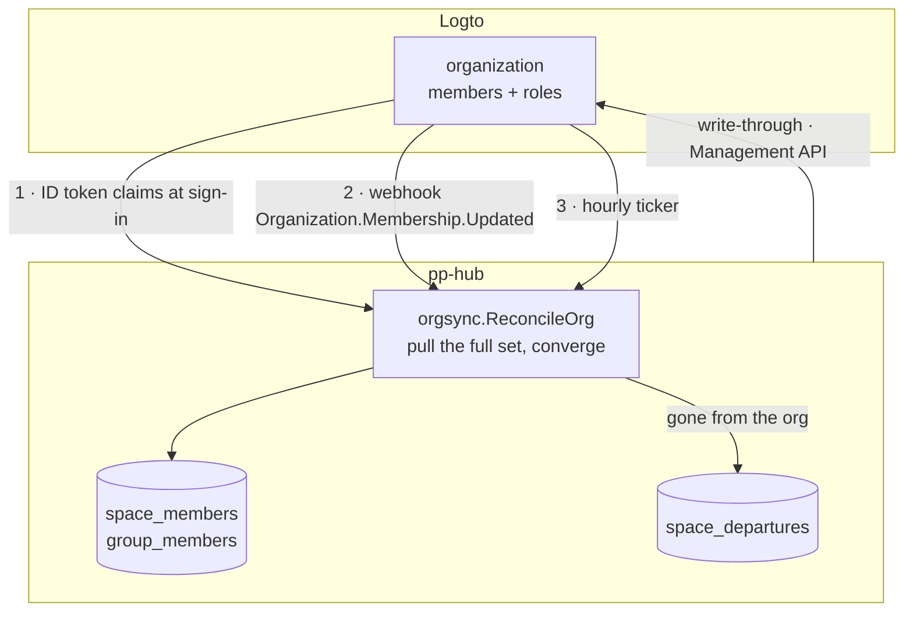

# Logto Organization Sync — Design

> **Status: implemented.** This is the design in force, delivered as
> **M33** ([milestones.md](milestones.md)). The membership model it replaced —
> local `space_invitations`, `POST /invitations/accept` and an SMTP transport
> for the invitation email — is gone; [permissions.md](permissions.md)
> describes the model this document specifies.

## The problem

Membership is defined twice. An operator creates the person in Logto so they
can sign in, then invites the same person into a space in pp-hub so they can
see anything. Two consoles, two mental models, two lists that drift apart.

The decision taken: **a Logto organization is the source of truth for who
belongs to a company.** pp-hub stops being a second place where that is
decided, and becomes a place where it is applied.

## Ownership boundary

This is the only line that matters. Everything below follows from it.

| Logto owns                       | pp-hub owns                                                                |
| :------------------------------- | :------------------------------------------------------------------------- |
| identity, email, name            | `users` (mirror), plus user-editable profile                               |
| organization                     | `spaces.idp_org_id` — one organization, one space                          |
| organization membership          | `space_members` — **a projection, never a record**                         |
| organization role `admin`        | membership of the automatic `Admin` group                                  |
| organization invitations + email | —                                                                          |
| —                                | user-created groups, grants, ownership, quota, Archive, departure teardown |

Two consequences worth stating plainly, because both are easy to get wrong:

**`space_members` stays.** It is not a leaf table. Ten SQL sites join it
directly — `activity.sql:26,48,84`, `nodes.sql:137,224,265`, `shares.sql:50`,
`groups.sql:181`, `users.sql:71`, `spaces.sql:11` (an eleventh,
`invitations.sql:56`, left with the invitation queries) — and
thirteen Go guards call through `RequireMember` / `IsSpaceMember`. Consulting an
external service per request would rewrite every one of them and destroy the
single-query scoping the codebase is built on (`reachability.go:12-16`,
`search.go:112-144`). The table remains; what changes is that no human writes
to it.

**Groups and grants are untouched.** Logto's organization template enforces one
role set across every organization and cannot express a per-space, user-created
group. The `Admin` group is the one group that maps onto an organization role;
the rest of the permission system is unaffected by this design.

## Synchronisation



**Every signal means only 'organization X changed'.** No path applies a delta.
The job re-reads `GET /api/organizations/{id}/users` and converges the local set
against it. Webhook deliveries carry `addedUserIds` / `removedUserIds`, and it
is tempting to apply them directly — but they arrive unordered, so applying them
incrementally is a correctness bug waiting for concurrency. Converging is
idempotent and order-free, and costs one API call.

**Sign-in reconciliation is the backbone**, not the optimisation. Requesting
`urn:logto:scope:organizations` and `urn:logto:scope:organization_roles` puts
`organizations` and `organization_roles` in the ID token, so a returning user's
membership is corrected with no network call at all. A lost webhook heals itself
the next time the person signs in; the hourly ticker heals the people who do
not.

### Members who have never signed in

Reconciliation pre-creates the `users` row from the Management API response,
keyed on `(oidc_iss, oidc_sub)` where `oidc_sub` is the Logto user id. For
every member, new or not, it also mirrors the IdP-owned profile fields —
avatar, phone, gender — through `users.Service.SyncIdPProfile`, the same call
sign-in makes (see [data-model.md](data-model.md#profile-fields-the-idp-owns)).
A sync failure is logged; it never fails the reconcile.

This deliberately reverses the rule at `production-readiness.md:735` — _nothing
creates an account ahead of its owner's first login_. That rule was right while
pp-hub owned identity: an account with no verified owner was a liability. It is
wrong once the IdP is authoritative, because the identity key is exact and comes
from the system that issued it. Without pre-provisioning, the People page shows
a subset of the organization and reproduces exactly the two-lists-disagreeing
problem this design exists to remove.

An email collision on `users_tenant_email_hash` is handled the way
`AdoptUserIdentity` already handles it, not as a 500.

## Leaving an organization

`RemoveMember`'s five steps split in two. Access dies immediately; destruction
waits for a human.

| Phase                          | Does                                                                                                            | Triggered by                        |
| :----------------------------- | :-------------------------------------------------------------------------------------------------------------- | :---------------------------------- |
| immediate — `RevokeMembership` | delete `group_members` for the space's groups, then the `space_members` row                                     | any sync path; idempotent           |
| deferred — `CompleteDeparture` | revoke inbound and outbound grants, climb nested ownership, move owned roots to Archive, reseat the Admin grant | a space admin, from the People page |

The split is safe because content access requires current membership of the
node's space (`permissions.md:8-9`), enforced at `drive.go:270,380,437,521,1021,1075`,
`home.go:75` and `share.go:144`. With the membership row gone, the grant rows
left standing grant nothing. Deferring the teardown therefore costs no access
control — it only postpones tidying — and the teardown is destructive enough
that an accidental click in the Logto Console must not be able to trigger it.

Deleting `group_members` cannot be deferred. `group_members` references `users`,
not `spaces`, so nothing cascades when the membership row goes; leaving it would
keep a departed colleague's group grants live. The existing comment at
`spaces.go:242-245` documents precisely this trap.

## The last admin

pp-hub can no longer refuse a membership change that has already happened. The
write path still refuses — `ErrLastAdmin` is checked before the Management API
call — but a removal performed in the Logto Console arrives as a fact.

**A space is allowed to end up with no admin.** It shows a banner saying so, and
an instance admin (`users.is_admin`) resolves it. The alternatives were both
worse: auto-promoting `spaces.owner_id` invents a privilege grant nobody
requested and breaks the rule that admin means one thing only — membership of
the `Admin` group; writing the role back into Logto puts pp-hub in a loop with
whoever is editing the Console.

## Schema

`migrations/0005_logto_orgs.sql`:

```sql
ALTER TABLE spaces ADD COLUMN idp_org_id TEXT;
CREATE UNIQUE INDEX spaces_idp_org_uniq ON spaces (idp_org_id) WHERE idp_org_id IS NOT NULL;

CREATE TABLE space_departures (
    space_id    UUID NOT NULL REFERENCES spaces(id) ON DELETE CASCADE,
    user_id     UUID NOT NULL REFERENCES users(id) ON DELETE CASCADE,
    detected_at TIMESTAMPTZ NOT NULL DEFAULT now(),
    source      TEXT NOT NULL,              -- signin | webhook | reconcile | admin
    resolved_at TIMESTAMPTZ,
    resolved_by UUID REFERENCES users(id) ON DELETE SET NULL,
    PRIMARY KEY (space_id, user_id)
);
CREATE INDEX space_departures_pending ON space_departures (space_id) WHERE resolved_at IS NULL;

DROP TABLE space_invitations;
```

`spaces.owner_id` is `NOT NULL REFERENCES users(id)`, so a space is **not**
created from a webhook — there is no user in that context to own it. A space is
created lazily on the first sign-in of an organization member; the owner is that
person when they hold the `admin` organization role, otherwise the space waits
for the first admin to sign in. No nullable owner, no placeholder account.

## Package `internal/orgsync`

```go
type Client interface {                           // Logto Management API, M2M
    OrgMembers(ctx context.Context, orgID string) ([]Member, error)
    AddMember(ctx context.Context, orgID, userID string) error
    RemoveMember(ctx context.Context, orgID, userID string) error
    SetRoles(ctx context.Context, orgID, userID string, roles []string) error
    Invite(ctx context.Context, orgID, email, role string) error
}

type Service struct{ /* … */ }

func (s *Service) ReconcileOrg(ctx context.Context, orgID string) error
func (s *Service) ReconcileUser(ctx context.Context, u store.User, c Claims) error
```

`ReconcileUser` runs from the sign-in claims and makes no outbound call.
`ReconcileOrg` is the job body and is the only thing that talks to Logto on the
read side.

The M2M token is fetched with `client_credentials` and Basic-auth credentials,
against `resource = https://{tenant}.logto.app/api` (Cloud) or
`https://default.logto.app/api` (OSS), cached in-process, refreshed ahead of
expiry and on a 401. Paginated responses are walked via the `Link` and
`Total-Number` headers.

### Configuration

```
PP_LOGTO_ENDPOINT            # Logto base URL — not the OIDC issuer, no /oidc suffix
PP_LOGTO_M2M_CLIENT_ID
PP_LOGTO_M2M_CLIENT_SECRET
PP_LOGTO_API_RESOURCE        # default https://default.logto.app/api
PP_LOGTO_WEBHOOK_KEY         # signing key for logto-signature-sha-256
PP_LOGTO_ORG_ROLE_ADMIN      # default "admin"
```

Two questions, not one, and the code keeps them apart because they gate
different things:

- **`Configured()`** — an endpoint is named, so the sign-in claims arrive and
  organizations decide who belongs to which company. This is what closes
  space creation to ordinary members.
- **`Enabled()`** — credentials too, so the Management API can be called. This
  is what the write path, the webhook worker and the hourly sweep need.

`Configured() && !Enabled()` is a supported mode, not a half-configuration:
membership converges at every sign-in with no outbound call, which is the
right state for an install before anybody has made the M2M application. The
write endpoints answer 503 and say why. Startup refuses only combinations
that cannot work at all — credentials with no endpoint, one credential
without the other, a webhook key with no credentials to act through it.

## HTTP surface

| Action          | Today                                                         | After                                                                       |
| :-------------- | :------------------------------------------------------------ | :-------------------------------------------------------------------------- |
| add a member    | `POST /spaces/{id}/members` writes locally                    | email → organization invitation; existing account → `AddMember` + reconcile |
| set admin       | `PATCH …/members/{u}/` **and** `POST …/members/{u}/set-admin` | one route, write-through `SetRoles`                                         |
| remove a member | `DELETE …/members/{u}/`, full teardown inline                 | `RemoveMember` upstream, then `RevokeMembership` + a departure row          |
| invitations     | 4 routes + `POST /invitations/accept`                         | **removed**                                                                 |
| handover queue  | —                                                             | `GET /spaces/{id}/departures`, `POST /spaces/{id}/departures/{u}/complete`  |
| webhook         | —                                                             | `POST /hooks/logto`                                                         |
| create a space  | `POST /spaces` open to anyone                                 | instance admin only while a tenant is configured                            |

**Creating a space stops being an ordinary user's action.** A space is a
company, companies come from the identity provider, and a member who can mint
one has awarded themselves the admin role the organization role was supposed
to decide — on a space nothing reconciles, so it drifts from the directory by
construction. `POST /spaces` therefore answers **403** unless the caller is an
instance admin (`users.is_admin`), who keeps the escape hatch for a deliberately
unlinked space. On an install with no Logto tenant configured the route stays
open to everyone: there, pp-hub is still the only place spaces can come from.

The decision rides on the profile as `can_create_spaces`, so the client hides
the control instead of offering a button that answers 403 — and the empty
state says "ask an administrator to add you to an organization" rather than
"create your first space", which would tell somebody the fix is theirs when it
is not.

The webhook is mounted **outside** `/api/v1`, and not for convenience:
`routes_test.go` asserts that every route under `/api/v1` carries the auth and
same-origin middlewares. Adding an unauthenticated endpoint inside that group
would mean loosening the test that protects the whole API surface.

The handler verifies an HMAC-SHA256 of the **raw** body — read before JSON
parsing — against `logto-signature-sha-256` in constant time, enqueues
`jobs(kind='org_reconcile', payload={"org_id": …})`, and returns 2xx. Logto
documents this queue-then-ack shape as the supported pattern; doing the work
inline invites a delivery timeout.

## What is deleted

A clean cutover, not a parallel path:

- `internal/mail` — its package doc stated the space invitation was the only
  message that exists, so the package went and `PP_SMTP_*` with it. **M31
  brought it back** for share notifications (and M26's alerts, configured in
  Admin › Settings by M35), so the package and the variables exist again; what
  stayed deleted is the invitation message and its template.
- the invitation half of `httpapi/space_settings.go` (~262 LOC) and
  `space_settings_test.go`'s token test.
- `space_invitations` and its three indexes.
- frontend: `routes/invite/$token.tsx` (the whole `routes/invite/` directory)
  and `components/member-picker.tsx`. The invitation hooks and endpoints went
  with them; what replaces them lives beside the space-member code it belongs
  to — `getSpaceDepartures`/`completeDeparture` in `lib/api/users.ts`,
  `useSpaceDepartures`/`useCompleteDeparture` in `lib/queries/users.ts`, and a
  `keys.departures(spaceId)` cache key where `keys.invitations` and
  `keys.userSearch` used to be. `components/no-admin-banner.tsx` is the one
  new component.
- `GET /users/search` and `users.Service.Search`. Confirmed at implementation:
  `useUserSearch` had exactly one consumer, the member picker, so
  `UserSearchResult` left `lib/api/types.ts` with it.

**This does not remove mail configuration, it moves it.** Invitation email is
now Logto's, which requires an email connector and an `OrganizationInvitation`
template there. Outgoing mail for pp-hub's own messages — share notifications
(M31) and security alerts (M26) — is configured separately, in Admin ›
Settings (M35), with `PP_SMTP_*` as the fallback.

## Failure modes

| Risk                    | Handling                                                                                                                                                                          |
| :---------------------- | :-------------------------------------------------------------------------------------------------------------------------------------------------------------------------------- |
| Logto unreachable       | mutations answer 503 with a specific message; reads are unaffected, served from the local projection. The blast radius is bounded because a Logto outage already prevents sign-in |
| webhook lost            | hourly reconcile, plus reconciliation on the next sign-in                                                                                                                         |
| replay or forgery       | HMAC over the raw body; every apply is idempotent                                                                                                                                 |
| out-of-order deliveries | no delta is ever applied — the job converges against the full set                                                                                                                 |
| Cloud rate limits       | jobs deduplicated per `org_id`; the ticker spreads work rather than bursting                                                                                                      |
| last admin removed      | space left admin-less with a banner; instance admin resolves                                                                                                                      |

## Verification

- **Unit** — HMAC verification against a fixed vector: valid, tampered, missing
  header, empty body.
- **DB-backed**, extending `permissions_db_test.go` (skipped without
  `PP_TEST_DATABASE_URL`) — convergence on add, remove and role flip; running
  reconcile twice changes nothing; the departure lifecycle, asserting that
  revocation blocks access immediately and that only `CompleteDeparture` moves
  content into Archive.
- **Client** — an `httptest` Management API covering pagination and a 401 →
  token refresh. No live Logto in the test suite.
- **Smoke, as delivered evidence** — `compose.dev.yml --profile idp`: create an
  organization, an M2M app and a webhook in the Console; sign in; confirm the
  space appears with the right members; remove the user upstream; confirm 403
  within one webhook and a pending departure row; complete the departure and
  confirm the content landed in Archive.

## Linking a space to an organization

There is no backfill tool, and deliberately so. `cmd/orgsync -backfill` was
specified — create an organization per unlinked space, push its current members
up, record `idp_org_id` — and then not built: the project is pre-production,
the number of existing spaces is small enough to count on one hand, and a
one-shot migration tool that talks to a third-party API is a liability to
maintain for the one day it would be used.

What replaces it is two facts:

- **Linking is a manual step.** Create the organization in the Console, then
  set the column once:
  `UPDATE spaces SET idp_org_id = '<org-id>' WHERE id = '<space-id>'`. The
  partial unique index refuses a second space claiming the same organization.
- **Reconciling an unlinked space is a no-op by design.** A NULL `idp_org_id`
  means "no upstream", and every sync path skips the space rather than
  converging it against nothing. This is the property that makes the absence of
  a backfill safe: turning the sync on cannot empty a space that was never
  linked. The one visible consequence is that `POST /spaces/{id}/members`
  answers **422** there, because there is no organization to add anybody to.

## Documents kept in step with this one

[permissions.md](permissions.md) — the ownership boundary in Model, the
Organization Sync section and the two-phase departure in Archive.
[data-model.md](data-model.md) — `spaces.idp_org_id`, `space_departures`, and
the corrected claim about `tenant_id`.
[deployment.md](../deployment.md) — the Logto setup checklist (M2M app,
organization template roles, email connector, webhook, consent scopes) and the
`PP_LOGTO_*` variables. [milestones.md](milestones.md) — M33, and the
supersession notes on M10, M23, M28 and M29.
[SUMMARY.md](../SUMMARY.md) — the status paragraph.

## Note on `tenant_id`

Unrelated to this design, and worth writing down because it came up while
scoping it: `tenant_id` is a dormant column, not a mechanism. It sits on the
tables the baseline `0001_init.sql` created as
`TEXT NOT NULL DEFAULT 'default'`, no INSERT ever
supplies it, and it appears in exactly three predicates — `SearchUsers`,
`ListUsers`, `CountUsers` — whose only call sites pass the literal `"default"`
(`httpapi/users.go:239,270,276`). There is no tenant middleware, no environment
variable, no request-scoped tenant, no RLS. Every table added after the
baseline — `sessions`, `security_events`, `space_departures` — carries no such
column at all. This is written up in
[data-model.md](data-model.md), whose opening line used to claim the opposite.

Organizations must not be hung off it. Activating multi-tenancy is a separate
project with its own goals; this design links an organization to a space, which
is the level the product actually models.
