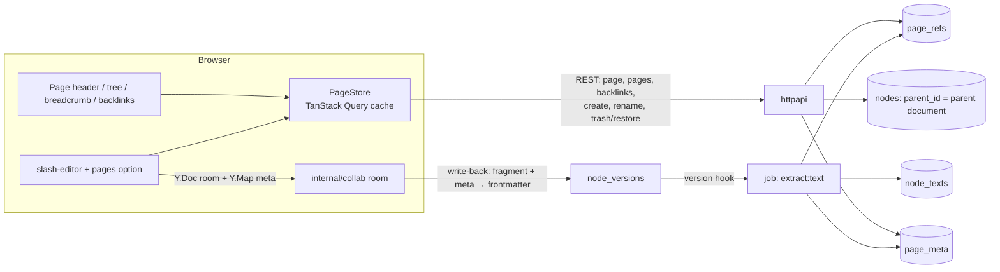

# M43 — Pages: page links and sub-pages

✅ done · part of the [delivery milestones index](../milestones.md).
The block-document design it extends is [block-documents.md](../block-documents.md#pages).

- **What asked for it.** slash-editor 0.6.0 shipped pages — a `subPage` block,
  an inline `pageLink`, `/page`, `/link to page` and page results in the `@`
  menu over a host-owned `PageStore` — and 0.7.0 shipped what pp-hub had
  rebuilt by hand (`toAttrs`, `resolveSrc`, `Mod-k`, `starterKit` options).
  Documents were a flat list in folders, and the only link between them was a
  `doc:<uuid>` mention whose label froze at insertion, so a rename left every
  chip showing the old name and nothing answered "what links here".
- **It supersedes** the M39 decision "Drive folders; no sub-pages, no page
  tree" in [block-documents.md](../block-documents.md#decisions).

This file was written as the design before the code; it now describes what
shipped. Where the build departed from the design, the departure is stated
where it applies (_was:_ …) rather than silently rewritten.

## Delivery

One milestone, four pull requests in this order:

1. **slash-editor 0.7.0** ✅. Bump; drop `linkShortcut` and `withoutUnderline`
   for the built-in `Mod-k` and `starterKit: { underline: false }`; drop the
   `retryImage`/`retryFile` overrides for `toAttrs`; drop the `attachmentUrl`
   prop threading for `resolveSrc`; add the `emoji` node (`:` picker) to the
   block set and to `internal/mdoc`
   ([Emoji](../block-documents.md#emoji)); regenerate the golden fixtures.
2. **Page links** ✅. `pageLink`, backlinks, and `doc:` mentions read as page
   links.
3. **Sub-pages** ✅. The node-tree invariant, the page API, and the editor's
   page tree, breadcrumb and header.
4. **Surfaces** ✅. Share link, recursive export and copy, MCP, search.

## Decisions

| Question                         | Decision                                                                                                                              | Rejected                                                                                                                                                                          |
| -------------------------------- | ------------------------------------------------------------------------------------------------------------------------------------- | --------------------------------------------------------------------------------------------------------------------------------------------------------------------------------- |
| Where a sub-page lives           | In the node tree: a `.md` node whose `parent_id` is its parent document                                                               | A companion folder beside the document (sharing the document would not share it; two nodes to keep in step); a logical `page_parent_id` (a second tree the resolver does not see) |
| What the Drive listing shows     | Only top-level documents, with a sub-page count; the tree lives in the editor                                                         | Documents that expand like folders in the listing and rail                                                                                                                        |
| A page's title                   | The node's name without `.md`; editing it renames the node                                                                            | A title stored in the document                                                                                                                                                    |
| A page's icon and cover          | YAML frontmatter keys `icon` and `cover` (`attachment:<hash>`), live in the room as a `Y.Map` named `meta`                            | Columns on `nodes` (not versioned, absent from a download)                                                                                                                        |
| Existing `doc:<uuid>` mentions   | `mdoc.Parse` reads them as `pageLink`; the next real edit writes the new form                                                         | Keeping both chips; a bulk rewrite of stored markdown                                                                                                                             |
| Deleting a sub-page block        | Trashes the page (`onSubPagesDetached`); undo or paste restores it (`onSubPagesAttached`)                                             | Leaving the page in place, which breeds orphans                                                                                                                                   |
| Title and tree changes by others | Query refetch on focus and staleness — not realtime. A new sub-page block still arrives at once through Yjs                           | A per-space change stream                                                                                                                                                         |
| Indexing pages                   | The existing `extract:text` job also writes `page_meta` and `page_refs`, from the same parse (_was:_ a separate `index:pages` job)    | A second job kind on the same hooks: two parses of every version, two guards to keep in step                                                                                      |
| A linked page is renamed         | The document's stored markdown keeps the old title until its next real edit; the room renders live titles but never writes on its own | A version "by" nobody whenever a linked page changes name                                                                                                                         |
| Export assets                    | `assets/` per archive directory, shared by the pages in it (_was:_ each page its own `assets/`)                                       | A private `assets/` per page (a directory per sub-page that has none of its own pages)                                                                                            |

**Not built:** databases or collection views; non-markdown sub-pages; a page
under an office file; a parent in another space; drag-and-drop re-parenting in
the page tree (the Move dialog takes a document as a destination instead);
realtime title or tree push.

## Architecture



- **The page tree is the node tree.** `fs.CanContain(parent, child)` is the
  one rule — a folder holds anything, a markdown document holds only markdown
  documents, anything else is `fs.ErrNotContainer` (400; it replaced
  `ErrNotDir`). `Mkdir`, `PutFile` (new nodes only), `Move`, `Copy` and
  `Restore` apply it, and `httpapi`'s `requireParentWrite`/`requireDestWrite`
  call it. A tus upload is a `file` child, which no file parent accepts, so an
  upload under a document is refused — even a `.md`. `Copy`'s cycle check now
  applies to every kind, since a document holds sub-pages. Ownership, grants,
  trash and purge already walk `parent_id` without looking at `kind`, so
  sharing a document shares its sub-pages and trashing it trashes them.
- **Projections for batch reads.** `preview.Extractor.Extract` returns
  `Extraction{Text, Page}`: for markdown one parse gives the text,
  `mdoc.FrontmatterMeta` and `mdoc.PageRefs`. The worker upserts `node_texts`,
  then `UpsertPageMeta` (0 rows = a superseded version, stop), then
  `DeletePageRefsForSource` + `InsertPageRefs` in one transaction; ids that are
  not UUIDs are dropped. Restore goes through the existing `Reindex`.
  `preview.BackfillPages` (`ListMarkdownWithoutPageMeta`) runs at startup
  right after `BackfillText` in the same goroutine, so versions the text
  backfill just queued are skipped as pending. **Reads are not tied to the
  current version**: a page shows its last indexed icon until the indexer
  catches up, rather than nothing; the guarded writes keep the rows from the
  newest indexed version.
- **The room carries the page's metadata.** A `Y.Map` named `meta` is seeded
  from the frontmatter's `icon` and `cover` in the same unattributed,
  loaded-not-applied transaction as the fragment; a reseed sets it the same
  way (keys missing from the new frontmatter are deleted). Write-back merges
  it into the frontmatter with `mdoc.SetFrontmatterMeta`, keeping every other
  line. Changing it is a real edit, attributed like any other.
- **Write-back writes only after an attributed edit.** The room counts
  attributed changes (`room.edits`) and the count the stored file holds
  (`room.persisted`); `persist` returns early when they are equal. Rendering
  can differ from the file without an edit — a linked page renamed since, a
  serializer that normalizes — and that difference waits for the next real
  edit. So **titles land with the next real edit**, never as a version nobody
  made (regression: `TestCollabWriteBackRendersLiveTitles`).

## Markdown

Byte for byte what slash-editor 0.7.0 serializes, held by the golden fixtures:

| Node                   | Markdown                                                                                   |
| ---------------------- | ------------------------------------------------------------------------------------------ |
| `subPage` (block)      | `<!-- slash:subPage {"pageId":"<uuid>"} -->` then `[Title](/edit/<uuid>)` on the next line |
| `pageLink` (inline)    | `<!-- slash:pageLink {"pageId":"<uuid>"} -->[Title](/edit/<uuid>)<!-- /slash:pageLink -->` |
| `emoji` (inline, name) | `:shortcode:`; a shortcode outside the dataset stays text (`12:30:45`)                     |

`mdoc.RenderWith(doc, frontmatter, RenderOptions{PageTitle, PageHref})` takes
the titles and hrefs from its caller (`Render` is `RenderWith` with none): a
title is trimmed like slash-editor's `pageTitle`, blank or unknown is
`Untitled`, and the default href is `/edit/<id>`. The room looks the titles up
in one `fs.PageTitles` query per write-back, and only when the document has
page refs. Import keeps only `pageId`, so a title gone stale in the file
changes nothing. `subPage`/`pageLink` without a `pageId` are pruned like
slash-editor's `pruneExcluded`. `mdoc.PageRefs` lists the sub-page and link ids
and `mdoc.MapPageIDs` deep-copies a tree with ids remapped (copy).

**`doc:` mentions.** `Parse` turns a `doc:<uuid>` mention into a
`pageLink{pageId}`; an empty id stays a mention. The fixtures whose
slash-editor parse holds such a mention carry `go_json` (the same JSON with the
mention rewritten) and `go_output` (slash-editor's serialization of that);
only the checks that start from Go's `Parse` use them.

**Frontmatter** is not parsed as YAML — there is no YAML library among the
direct dependencies. `frontmatter.go` is a line editor that touches only the
top-level `icon:` and `cover:` lines and leaves every other line byte for
byte. It reads plain values (a trailing comment dropped; `~` and `null` are
empty), single-quoted and double-quoted values (`\u` surrogate pairs
included); a block scalar, flow collection, alias or tag counts as unset and is
replaced whole when set. Setting a key replaces its first line and the
indented lines under it and removes duplicates; a new key goes before the
closing delimiter; CRLF is kept; a value is written plain when safe and as a
JSON string otherwise.

**Where Go deliberately differs from slash-editor** (pinned or noted in the
fixtures):

- slash-editor's parser drops 1–3 spaces between a preceding non-text token
  and a `pageLink` (`**b** <pageLink>` loses the space). Go does not copy it:
  rooms reload from stored markdown and would lose a space on every load
  (`page-link-after-mark-doc`, doc-built). Mentions already had the same quirk,
  unmirrored.
- slash-editor finds a `pageLink`'s close marker anywhere in the rest of the
  inline text, across lines; Go looks on the same line only, as for mentions.
- A `subPage` needs a blank line or the end of the file after its link line,
  as in JS; otherwise the marker is stray (lossy) and the link stays text.
- A malformed `subPage` marker makes the document lossy; a malformed
  `pageLink` marker is swallowed inline — the existing block and inline marker
  rules.
- JS pads a code span whose content starts with a slash marker; Go does not
  (mentions too), so there is no fixture for it.

## Data model (`0021_pages`)

_Was:_ `0017_pages` — 0017–0020 were taken by the time it landed.

```sql
page_meta(node_id PK → nodes ON DELETE CASCADE, node_version_id, icon, cover)
page_refs(source_id → nodes ON DELETE CASCADE, target_id /* no FK */, kind sub|link,
          node_version_id, PRIMARY KEY (source_id, target_id, kind))
page_refs_target ON page_refs(target_id)
```

`node_version_id` carries no foreign key on either table. `target_id` has none
so a link may name a page that is gone and never block its purge. Writes are
batched: `InsertPageRefs` takes the sub and link id arrays at once.

## API

| Route                                                 | What it does                                                                                                                                                                                                                                                                                                                                     |
| ----------------------------------------------------- | ------------------------------------------------------------------------------------------------------------------------------------------------------------------------------------------------------------------------------------------------------------------------------------------------------------------------------------------------ |
| `POST /api/v1/spaces/{id}/documents`                  | `parent_id` may be a markdown document; for `kind=markdown` `name` is optional, default `Untitled.md`, suffixed (`Untitled (2).md`) when taken. Office kinds still need a name and get 400 under a document                                                                                                                                      |
| `GET /api/v1/nodes/{id}/page`                         | `{page, ancestors}`: `PageMeta` (`id, parent_id, title, icon, cover, has_children, trashed`) and its document ancestors, root first. The chain stops at the first non-page or non-viewable ancestor, whose child then has `parent_id: null`, so no id leaks. A trashed page still viewable is 200 with `trashed: true` (it or anything above it) |
| `GET /api/v1/nodes/{id}/pages`                        | Live markdown children as `PageMeta[]`, by `created_at` then name. View on `{id}`; no per-row filter, since view inherits                                                                                                                                                                                                                        |
| `GET /api/v1/nodes/{id}/backlinks`                    | Live pages with a `page_refs` row naming `{id}`, de-duplicated, none with a tombstone up its chain, filtered by one batched `AccessCaps`, ordered by name; `parent_id` only when the parent is a page the caller can view                                                                                                                        |
| `PATCH /api/v1/nodes/{id}/rename`                     | Renaming is retitling; answers `{status: "ok"}`                                                                                                                                                                                                                                                                                                  |
| `DELETE /api/v1/nodes/{id}`, `POST …/restore`         | What detach and attach call. Restore now answers **200 `{node, relocated, renamed_from?}`** (_was:_ 204 — the web trash panel already expected the body)                                                                                                                                                                                         |
| `GET /s/{token}/page?node=`, `/s/{token}/pages?node=` | The same through a link, **public** (no session) like `/s/{token}/document`, read-only; the chain is cut at the link root (`parent_id: null` there), `trashed` is always false, a node outside the link or a non-page is 404                                                                                                                     |
| Drive listings                                        | A markdown row carries `child_page_count` (omitted when 0), one batched `CountChildPages` per answer: space children, `/nodes/{id}/children`, `GET /nodes/{id}`, Shared with me, Shared from outside (external), and the share link's `/children`                                                                                                |

All three `/nodes/{id}` page routes answer **404, not 403**, when the caller
cannot view, when the node is not markdown, and for an unknown id — the same
answer for each, so the routes do not confirm that a node exists. Folder-only
routes stay folder-only: `/nodes/{id}/children` and a share's `/children` and
`/download-all` refuse a document.

## Web

- `lib/collab/page-store.ts` — `createPageStore(queryClient, source)` over
  the query cache. Keys live under one root, `['pages', scope, kind, id]`
  with `scope` `node` or `share:<token>` and `kind` one of `page`, `lineage`,
  `children`, `backlinks` (_was:_ `['page', id]`), so a signed-in cache and a
  share cache never mix. `peek` reads `page` and keeps the object's identity
  until it changes; `subscribe` fires only on real changes; `search` is
  `searchNodes` narrowed to markdown; the open page's icon and cover come from
  the room's `meta`. `restore` posts only for a page the store itself saw
  trashed, so a fresh `/page` block or a paste never restores a live node, and
  trash/restore of one page are serialized. 404 and 403 from `/page` read as
  "Page not available". `useInvalidateChildren` also invalidates the `pages`
  root, so every create, rename, move, trash and restore refreshes them.
  `renameNode` returns nothing (the route answers `{status: "ok"}`).
- `lib/queries/pages.ts` holds the page query options and `toPageMeta`;
  `lib/collab/mentions.ts` offers people only, and pages join the `@` menu
  through `withPageMentions` in `nodes/mdoc-node-views.tsx` (the kit's own
  mention is turned off by `MDOC_NODE_VIEW_KIT_OPTIONS`). The `doc:` branch of
  the mention view is gone.
- `nodes/page-node-views.tsx` (sub-page block and page link chip),
  `doc-editor/page-header.tsx` (cover upload through tus `attach_to`, emoji
  icon picker, title renamed after a 600 ms pause), `doc-editor/page-tree-panel.tsx`,
  `doc-editor/page-backlinks.tsx` ("Linked from"), `components/page-trail.tsx`
  (breadcrumb) and `components/sub-page-count.tsx` (listing badge), styled
  with `packages/ui` tokens. Covers render only as `attachment:<hash>`; any
  other URL in the frontmatter is ignored, so nothing is hotlinked.
- `/edit/$nodeId` gains the page tree in the left side panel, the trail in the
  editor header (a sub-page's Back to Drive opens its root page's folder) and
  backlinks under the document; the editor remounts per page
  (`key={node.data.id}`). The share page navigates sub-pages inside the link,
  with a trail and a download that follows the page shown.

## Other surfaces

- **Export and folder zip.** `blockdoc.PrepareExport` and `PrepareZip` share
  one planner over `fs.Service.Tree`: `<Doc>.md` with sub-pages under
  `<Doc>/<Sub>.md`, recursively, names unique case-insensitively per directory
  (`-2`), the `.md` and its folder sharing a base. Attachments go in an
  `assets/` per directory, shared by the pages there (named last, so a page
  called "assets" keeps its name and attachments take `assets-2`). Each page is
  rendered with `RenderWith`: titles inside the archive from node names,
  outside ones from one `PageTitles` call; a link into the archive becomes a
  relative path escaped per segment (`../Handbook.md`), any other
  `${PP_EXTERNAL_URL}/edit/<id>`. The cover is exported and its frontmatter
  value rewritten to the relative path. A lossy document keeps its bytes, with
  attachment and `/edit/<id>` targets byte-replaced. The drive folder download
  and a share's download-all use the same planner (`fs.WalkFiles` is gone). A
  zip that fails partway now ends after the "archive incomplete" trailer
  without a central directory, so it reads as broken.
- **Copy** of a document copies its live sub-pages recursively; copy of a
  folder does the same for documents inside it. Ids are mapped old → new
  across the whole set, and only documents whose `PageRefs` point into it are
  re-rendered (`MapPageIDs` + `RenderWith`) into a new blob; the rest, and any
  whose render is the same bytes, share the original blob. A lossy document
  gets a byte-level UUID replacement instead. A document over 16 MiB, a
  missing blob or a parse error keeps the original. The whole `Copy` is now
  one transaction (it was one per file); `StampCopiedPage` uses
  `clock_timestamp()` so copied sub-pages keep their order; version hooks fire
  after commit.
- **MCP.** No routing change: `create_document` already sends `folder_id` as
  `parent_id`, and `list_folder` uses the space children listing, which under a
  document lists its sub-pages with `child_page_count`. Their descriptions now
  say both take a document id; `read_document`'s says the frontmatter holds
  `icon`/`cover` (keep it on update) and that `subPage` markers mark sub-pages.
- **Search** has no `location` field; the web joins `space_name` and
  `parent_name`. For a hit inside a page, `pageLocations` rewrites
  `parent_name` to the path through its parent pages (`Projects / Plan /
Roadmap`, titles without `.md`) with one recursive query
  (`ListPageLocations`) and one batched `AccessCaps`, stopping at the first
  ancestor the caller cannot view. Only `/search`; recent and starred are
  untouched.

## Edge cases

| Case                                                         | Behaviour                                                                                     |
| ------------------------------------------------------------ | --------------------------------------------------------------------------------------------- |
| A co-editor deletes the block but cannot delete the page     | Trash answers 403, a toast says so, the page stays in the tree                                |
| An older version of the parent is restored                   | No detach fires; sub-pages stay in the tree                                                   |
| A sub-page block is pasted into another document             | slash-editor turns it into a `pageLink`: a page has one parent                                |
| The parent is purged holding a sub-page someone else made    | `fs.Purge` lifts it to the top level, as for any foreign-owned subtree                        |
| A sub-page is shared without its parent                      | `parent_id` is `null` and `ancestors` empty; tree and breadcrumb start at the page            |
| A page is restored under a parent that can no longer hold it | `fs.Restore` relocates it to the space root with `relocated: true`, as for a trashed parent   |
| A linked page is renamed                                     | Live chips update on refetch; the stored markdown takes the new title with the next real edit |
| A pre-M43 build reads a document with page or emoji syntax   | `mdoc` flags it lossy and it opens read-only; sub-pages exist but are hidden from the listing |

## Verification

- Golden fixtures regenerated against 0.7.0: 260 fixtures and 24 comment
  cases — `subPage`/`pageLink` alone, consecutive, in lists, task and ordered
  items, callouts, quotes, tables, toggles and columns, beside comment anchors,
  with stale, escaped, trimmed, blank and unknown titles and malformed
  markers; emoji known, unknown and `12:30:45`; `doc:` mentions through
  `go_json`/`go_output`. `testdata/page_titles.json` is the title store both
  sides render with.
- Go DB tests: `TestPagesContainerRule` (naming, office/mkdir/tus under a
  document, move/copy into a document, cycles, restore and relocation),
  `TestPagesTreeAndAccess`, the share and backlink tests;
  `TestPageIndexFollowsTheCurrentVersion` and
  `TestBackfillPagesIndexesExistingDocuments`; `TestCollabMetaIsFrontmatter`,
  `TestCollabWriteBackRendersLiveTitles`, `TestCollabRestoreReseedsMeta`;
  `TestExportDocumentWithSubPages`, `TestFolderZipExportsSubPages`;
  `TestCopyPagesMapsTree`, `…PlainDocumentSharesBlob`, `…Folder`,
  `…LossyRewritesBytes`; `TestMcpSubPages`; `TestSearchSubPageLocation`.
- Vitest: `tests/page-store.test.ts` (`peek` identity, `subscribe` only on
  change, share scope apart, `meta` overlay).
- Browser smoke, end to end: `/page` creates and opens a sub-page; breadcrumb;
  a title rename reaching the parent's block; an `@` page link chip; icon and
  cover from the page header, persisted to frontmatter; "Linked from"
  backlinks; the page tree panel; delete block → trash → undo restore;
  navigation into a sub-page through a share link; export zip with
  `Handbook.md`, `Handbook/Onboarding guide.md` and the relative link
  `../Handbook.md`; the drive listing badge.
