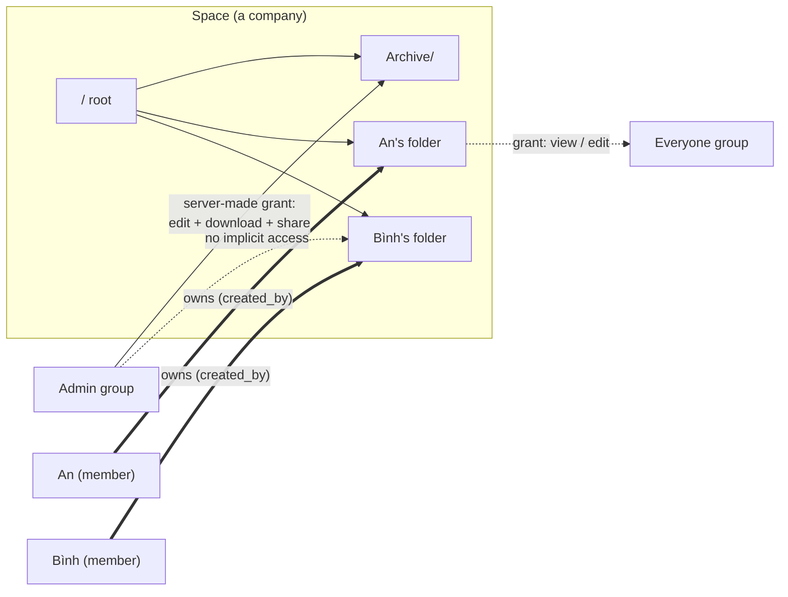
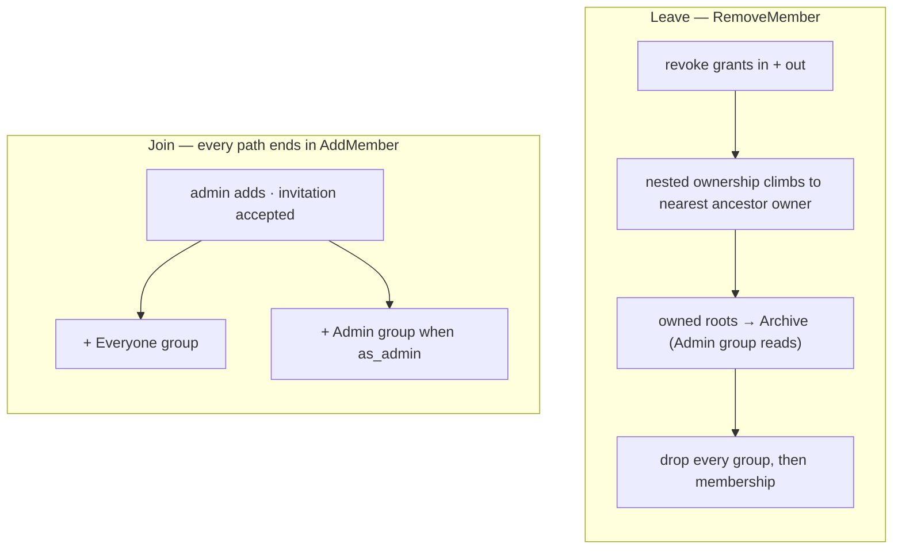

# Permissions

## Model

A space **is a company**. One instance hosts several, a person can belong to
more than one, and a space owns exactly one file tree.

Content access comes from exactly two mechanisms, both of which require the
caller to be a **current member of the node's space**:

1. **Ownership** — `nodes.created_by`. The creator of a node holds every
   capability on it and on everything beneath it. Ownership is intrinsic: it is
   not a row in `shares`, so there is nothing to revoke and self-lockout is
   impossible by construction. It is not perpetual, though — it stops granting
   anything the moment the person leaves the space.
2. **Grants** — a row in `shares` naming a user, a group, or a link token,
   carried down the subtree from whatever node it names.

There is no third mechanism. **Being an admin grants no file access at all.**
Admin is membership in the space's `Admin` group, and it buys space
administration (members, groups, settings, trash purge, the archive) — never
readership of a colleague's files.

Every item is therefore **private to its creator until they share it**.

## Groups

Every space has two automatic groups, created with the space and maintained by
`spaces.Service`:

| Group      | Flag                 | Membership                                   | Grants by itself |
| :--------- | :------------------- | :------------------------------------------- | :--------------- |
| `Everyone` | `groups.is_everyone` | every space member, maintained by the server | nothing          |
| `Admin`    | `groups.is_admin`    | the space's admins                           | nothing          |

Both are immutable through the groups API — rename, delete and hand-edited
membership are refused (`groups.ErrSystemGroupImmutable`). `Admin` membership
changes only through `POST /spaces/{id}/members/{userID}/set-admin`, because
that membership _is_ the admin role. Uniqueness is one partial index each:
`groups_everyone_uniq` and `groups_admin_uniq`, both on `(space_id)`.

Everything else is a user-created group: a named set of people that a grant can
name instead of listing individuals.

## At a Glance

## Capabilities

A grant carries a **level** plus two independent **flags**:

| Column         | Values           | Meaning                                                     |
| :------------- | :--------------- | :---------------------------------------------------------- |
| `level`        | `view` \| `edit` | `edit` allows mutation; `view` is read-side                 |
| `can_download` | boolean          | `GET /nodes/{id}/download` — the file, or a folder as a zip |
| `can_share`    | boolean          | may create further grants on the subtree                    |

Two database CHECKs hold the shape:

- `shares_edit_download_ck` — `level = 'edit'` implies `can_download`. An editor
  must be able to fetch what it edits.
- `shares_link_ck` — a link is always `level = 'view'` with `can_share = false`.
  Edit-via-link stays post-MVP, and links must not chain.

`can_download` gates _taking a copy_, not _seeing the bytes_: `GET
/nodes/{id}/content` streams the original inline under `CapView`, because
full-size viewing of a PDF or a video is reading, and a 256px thumbnail is a
stamp in a modal. Withholding `can_download` withholds the download button and
the zip, not the viewer.

`can_share` is **independent of level** in storage and on the wire: a viewer may
be allowed to pass their view on, and an editor may be denied re-sharing. Share
and grant requests therefore carry the storage model itself —
`{level, can_download, can_share}` — and `grantCapsFromBody` validates it,
normalising `edit` to imply `can_download` because the database CHECK requires
it. There is no ranked shorthand: a single word cannot say "view and pass on,
but do not download".

Resolution produces a `share.Caps` set (`view`, `download`, `share`, `edit`,
`owner`). An owner resolves to `share.CapsOwner` — all four, plus the owner
marker. A non-owner resolves to the union of their grants: level takes the
maximum, flags OR together. **Grants only widen; nothing narrows.**

### Monotonicity

`Caps.Covers` is enforced in `handleCreateShare` and `handleUpsertGrant`: you
can only hand out capabilities you hold yourself, so a download-only grantee
cannot mint an editor. A refusal is **403** carrying `share.ErrEscalation`.

## Resolution Order

For one user on one node:

0. **Member of the node's space?** — if not, the answer is nothing, whatever
   else is true. Ownership is intrinsic but not perpetual: leaving a company
   ends your reach into its tree. The `created_by` rows stay behind so the
   archive keeps an author, and rejoining restores that reach; without this
   precondition `RemoveMember` would file someone's work in the archive while
   leaving them free to read and edit it.
1. **Owner?** — the caller created this node or any ancestor → full
   capabilities, short-circuit.
2. **Grants** — the union of every live grant on the node or any ancestor,
   whether named directly or through a group the caller belongs to; expired
   rows are ignored.
3. **Link token** (no authenticated user) → `share.LinkCaps`: view, plus
   download when the link allows it. Never edit, never share.

`share.AccessCaps` answers steps 0–2 for **many nodes in one query**
(`NodeAccessCaps` in `queries/shares.sql`): one recursive CTE seeds only nodes
in spaces the caller belongs to, walks every ancestor chain, aggregates grant
flags with `BOOL_OR`, and joins `nodes.created_by` for the owner flag. A
listing therefore filters itself without a walk per row. `ListEntryPoints`
carries the same membership condition on its owned branch.

That recursive join deliberately does **not** filter `deleted_at`: filtering it
truncates the chain at the first trashed ancestor and loses the grant above it,
which is why a tombstone resolves exactly like a live node and trash needs no
weaker rule of its own.

## Where Access Is Enforced

Node-addressed routes go through `requireNodeCaps(w, r, need share.Cap)`, which
resolves the node and demands one capability:

| Capability    | Routes                                                                                           |
| :------------ | :----------------------------------------------------------------------------------------------- |
| `CapView`     | `GET /nodes/{id}`, `/children`, `/tree`, `/preview`, `/content`, versions, star                  |
| `CapDownload` | `GET /nodes/{id}/download` (file or streamed zip)                                                |
| `CapEdit`     | rename, move, copy, delete, upload-into, version restore, trash restore/purge, WOPI edit session |
| `CapShare`    | list/create/revoke shares, list/upsert/revoke group grants                                       |

Creating into a folder goes through `requireParentWrite`:

- **`parent_id` set** → `CapEdit` on that parent. A parent in another space
  answers **404, not 403**; confirming a node exists is already more than the
  caller should learn, the same rule anonymous share browsing follows.
- **`parent_id` nil (the space root)** → space membership is enough. Any member
  may create at their top level, and what they create is private to them. This
  is the M15 change: the root is no longer admin-only.

Space-level powers — member management, creating and editing groups, settings,
invitations, emptying the trash — are gated by `spaces.RequireAdmin`, i.e.
Admin-group membership. They never travel through the capability scale. There is
no role column and no role rank anymore.

Two deliberate exceptions to "administration is admin-only":

- `GET /spaces/{id}/groups` needs **membership**, not admin. Granting a group
  access to a folder you own requires its name and id, and the members panel
  already shows who is in the company. Creating, renaming, deleting a group and
  editing its membership stay admin-only.
- `POST /spaces/{id}/members/{userID}/set-admin` takes `as_admin` as a
  **required** boolean. It is decoded into a pointer so a typo like
  `{"is_admin": true}` is a **400** instead of decoding to `false` and silently
  demoting the person the caller meant to promote.

Listings cannot afford a check per row, so they narrow in one batch
(`reachability` + one `AccessCaps` call):

| Surface                              | How it narrows                                           |
| :----------------------------------- | :------------------------------------------------------- |
| `GET /spaces/{id}/children`, `/tree` | one capability check on the **parent**; see below        |
| `GET /search`                        | over-fetch `limit × searchOverfetch`, filter, then limit |
| `GET /starred`, `/recent`            | batch filter                                             |
| `GET /activity`                      | batch filter, with its own rule for purged rows          |
| `GET /spaces/{id}/trash`             | batch filter — the resolver survives tombstones          |
| `GET /shared`                        | `ListEntryPoints` with `include_owned = false`           |

**Folder listings need one check, not one per row.** Access inherits downward,
so if the caller can view the parent the whole listing is theirs. Only when the
parent is unreachable does it narrow to children they own or hold a direct grant
on (`ListGrantedChildrenWithMeta`, which matches `created_by = caller` as well
as a grant).

`GET /usage` is deliberately **not** narrowed: it is an aggregate of bytes per
MIME family, names nothing, and the rail already shows the space quota beside it.

Listings and single-node GETs carry a `caps` object per node (`attachCaps`), and
creation responses stamp `share.CapsOwner` without a query — creating a node
makes you its owner. Every node DTO therefore carries caps, so the client offers
exactly what the caller holds: the `Share` entry in the node menu follows
`node.caps.share`, not admin status.

`attachCaps` also stamps `shared` — whether the node itself carries a live
share row (`NodesWithLiveShares`, batched by id like `AccessCaps`), direct,
group or link, any grantee. This is a different question from caps: a node
reached only through an ancestor's grant is not itself shared, and a node the
owner shared out to a group is `shared: true` even though the owner holds no
grant on their own file. The folder-listing badge (`NodeIcon`'s people glyph)
reads this field directly rather than a separate "shared with me" query, so it
lights for outgoing shares too — a folder you own and shared with a group,
which is not the same as `GET /shared`'s "shared with me" list.

**One dialog answers "who can reach this".** Access is one table, so groups,
people and the public link are granted and revoked from the same `Share`
dialog on any node — a file included. Group grants were never restricted to
folders on the server (`Grant` only checks that node and group share a space,
and the resolver treats a share row on a file as an entry point like any
other); the client used to hide them behind a folder-only dialog.

Grantees are offered from the space — `GET /spaces/{id}/groups` and
`GET /spaces/{id}/members`, both member-readable — never from
`GET /users/search`. That endpoint is the invite path's tenant directory and is
scoped to accounts sharing a space with the caller, lifted only for an
instance admin: a space is a company, and the picker must not double as an
address book for all of them.

## A Member's Top Level

A member's top level is **entry points**, not the raw space root:
`ListEntryPoints` returns the topmost nodes the caller can reach, where
reachable means _owned_ (`include_owned = true`, the space-scoped home view) or
_granted_. A node sitting under another reachable node is dropped — it is found
by walking down.

"Shared with me" is the same query with `include_owned = false`, and it also
drops rows the caller owns: your own file is not something shared with you.

Personal folders are gone. There is no `personal_folders` table, no
`spaces.personal_root_id`, and no "My files" carve-out — ownership does that
job for every node, not just one mapped folder per member.

## Anonymous Link Browsing

A link resolves without a user to `share.LinkCaps`: view, plus download when
the link says so. Routes under `/s/{token}` mirror the authenticated split —
`/content` serves the file inline under view, `/node-download`, `/download` and
`/download-all` (zip) need the download flag. A view-only link that could not
preview anything would be a blank page, which is why the split matters.

Every node id an anonymous caller supplies is walked back up to the share root
before anything is served. A node outside that subtree answers **404, not
403**: confirming that a node exists but sits outside the share is itself more
than the visitor should learn. Owner names are stripped from share responses.

## Archive

Every space owns one `Archive` folder (`spaces.archive_root_id`), created with
the space. The server makes exactly one grant on it: `edit + download + share`
to the `Admin` group. That grant is the **only** place an admin can read
content they do not own, and it exists so a departure never destroys work
silently.

`RemoveMember` runs in this order:

1. **Grants die first** — inbound (direct grants naming them) and outbound
   (every grant they created, links included), while the nodes still carry their
   original owner. Their sharing decisions leave with them.
2. **Nested ownership climbs** — `TransferNestedOwnership` rewrites
   `created_by` on nodes that sit under somebody else's folder to that nearest
   ancestor's creator, so the content stays where the work is. This rewrites
   authorship; the activity feed keeps the history.
3. **Their roots move to the Archive** — every remaining node they own whose
   `parent_id` is NULL is re-parented under `archive_root_id`, with a `" (n)"`
   suffix if a live sibling already holds the name. Nothing is deleted.
4. **Group memberships and the member row go last.** `group_members` references
   `users`, not `spaces`, so nothing cascades when the `space_members` row
   goes; skipping this would leave a departed person holding live access
   through their old groups.

The archive grant is re-seated on the way out, because the departing member may
have been the row's `created_by` and step 1 deleted it.

Nothing else is needed to lock the door: with the `space_members` row gone,
resolution step 0 fails for them, so their own `created_by` rows stop granting
anything. Their work is in the archive and only the admins can read it.
Re-adding the person restores that ownership — the folder stays in the archive,
but they own it again, which is the outcome anyone would expect after a
mistaken removal or a return.

Removing the **last** admin is refused (`spaces.ErrLastAdmin` → **409**), as is
demoting them. Both guards live in `spaces.Service` so the HTTP layer cannot
drift from them.

The Archive is an ordinary folder, so admins browse, restore (move out) and
purge it with the normal drive UI. It cannot be renamed, moved or trashed —
`isArchiveRoot` refuses, or a departure would have nowhere to land.

## Member Lifecycle

Joining creates no folders: ownership begins with the first thing the member
makes. Re-adding a departed member does not un-archive their content.

## Suspension

`users.suspended_at` blocks a user without deleting their files or their
authorship of anything. It is enforced in `requireUser` on every request, so
suspending takes effect immediately rather than waiting for open sessions to
expire. The response is **403, not 401**: the credentials are valid, the account
is not, and a 401 would send the client into a pointless re-authentication loop.

An instance admin cannot revoke their own instance-admin flag or suspend
themselves; both are refused server-side.

## Invitations

An invitation names an email address; membership names an account. That gap is
the reason `space_invitations` exists rather than a nullable column on
`space_members` — the invited address may have no user row yet.

- Only `token_hash` (sha256 of a 32-byte random token) is stored; the plaintext
  is returned once at creation.
- Re-inviting the same address replaces the pending row, so only the newest
  link works.
- Accepting requires a signed-in user **whose email matches the invitation**.
- Inviting an address that already has an account skips the invitation and adds
  the member directly.
- `space_invitations.as_admin` decides whether accepting lands the person in the
  Admin group; it defaults from `spaces.default_as_admin`.

## Group Membership Invariants

Enforced in `spaces.Service`, not by the database alone:

- **Creating a space creates its `Everyone` group, its `Admin` group and its
  `Archive` root**, and puts the creator in both groups.
- **Adding a member adds them to `Everyone`** — and to `Admin` when `as_admin`.
- **Removing a member removes them from every group in that space.**
- **`Everyone` membership is always exactly space membership.** There is no API
  to edit it by hand.

## Schema (M15)

The development-phase migrations were consolidated into a single baseline,
`0001_init.sql`, so the schema reads as one document rather than fifteen
deltas. What changed relative to the M11–M14 model:

| Change                                     | Why                                                          |
| :----------------------------------------- | :----------------------------------------------------------- |
| `shares.perm` → `level`                    | ranked scalar could not express "editor who cannot re-share" |
| `shares.can_download` added                | download is a choice, not a rank step                        |
| `shares.can_share` added                   | re-sharing is a choice, independent of level                 |
| `space_members.role` dropped               | admin status is Admin-group membership                       |
| `spaces.default_role` → `default_as_admin` | role enum is gone                                            |
| `space_invitations.role` → `as_admin`      | same                                                         |
| `groups.is_admin` added                    | marks the automatic Admin group, unique per space            |
| `spaces.archive_root_id` added             | where a departure lands                                      |
| `personal_folders` dropped                 | ownership covers every node, not one folder per member       |
| `spaces.personal_root_id` dropped          | replaced by `archive_root_id`                                |

## Implementation Notes

- Resolution is one recursive query per request (`NodeAccessCaps`), batched
  across nodes. If profiling shows it hot, add a request-scoped cache first,
  then an invalidated cache keyed by `(user, node)`.
- Share tokens: only `token_hash` (sha256) is stored. Revocation is a row
  delete; `expires_at` is optional.
- WOPI access tokens encode the resolved capability at session-open time
  (`CapEdit` → rank 3 in the token's `w1` format). Changing a grant mid-session
  does not retroactively close an open editor; tokens expire.
- The invariants that live in SQL — owner inheritance, admin-cannot-read,
  promote/demote, the archive hand-off — are covered by
  `internal/spaces/permissions_db_test.go`, which needs a real Postgres
  (`PP_TEST_DATABASE_URL`) and skips loudly without one.

## Quotas

Per-space `quota_bytes` is enforced at upload (`fs.checkQuota`, **413** when a
space would go over), and `used_bytes` is recounted after size-changing
mutations. See the Quota section of [data-model.md](data-model.md).
