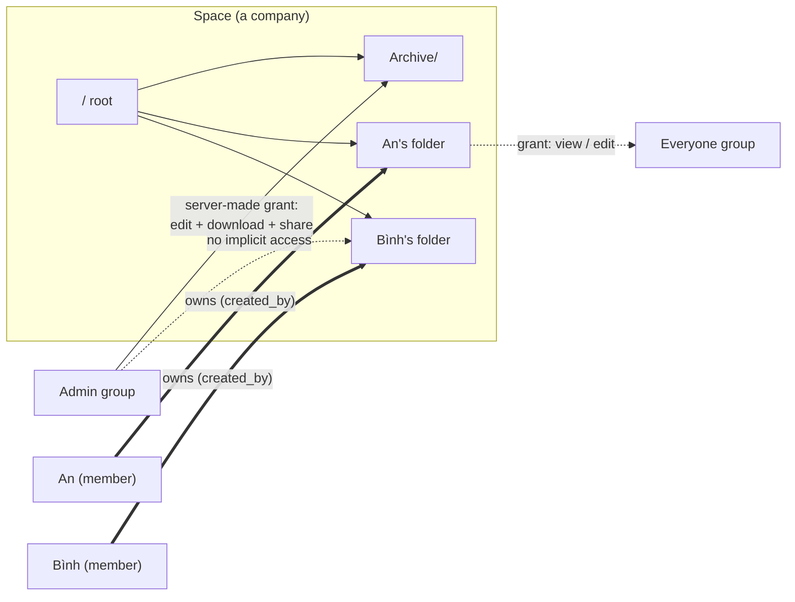
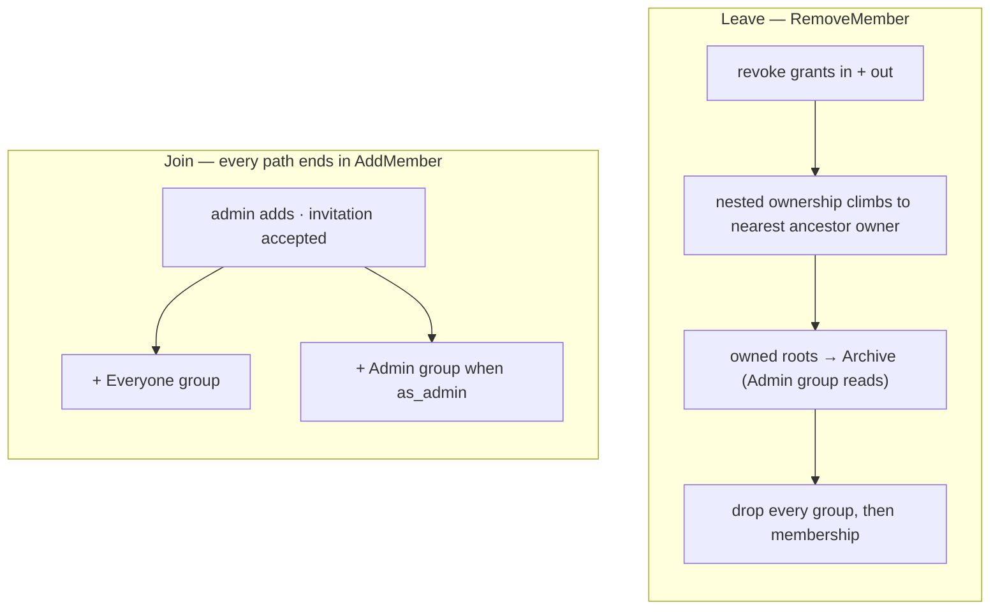

# Permissions

## Model

A space **is a company**. One instance hosts several, a person can belong to
more than one, and a space owns exactly one file tree.

Content access comes from exactly two mechanisms, both of which require the
caller to be a **current member of the node's space**:

1. **Ownership** — `nodes.created_by`. The creator of a node holds every
   capability on it and on everything beneath it. Ownership is intrinsic: it is
   not a row in `shares`, so there is nothing to revoke and self-lockout is
   impossible by construction. It is not perpetual, though — it stops granting
   anything the moment the person leaves the space.
2. **Grants** — a row in `shares` naming a user, a group, or a link token,
   carried down the subtree from whatever node it names.

There is no third mechanism. **Being an admin grants no file access at all.**
Admin is membership in the space's `Admin` group, and it buys space
administration (members, groups, settings, trash purge, the archive) — never
readership of a colleague's files.

Every item is therefore **private to its creator until they share it** — in the
personal half of the tree. A **team folder** is the other half; see
[Team Folders](#team-folders).

## Groups

Every space has two automatic groups, created with the space and maintained by
`spaces.Service`:

| Group      | Flag                 | Membership                                   | Grants by itself |
| :--------- | :------------------- | :------------------------------------------- | :--------------- |
| `Everyone` | `groups.is_everyone` | every space member, maintained by the server | nothing          |
| `Admin`    | `groups.is_admin`    | the space's admins                           | nothing          |

Both are immutable through the groups API — rename, delete and hand-edited
membership are refused (`groups.ErrSystemGroupImmutable`). `Admin` membership
changes only through `POST /spaces/{id}/members/{userID}/set-admin`, because
that membership _is_ the admin role. Uniqueness is one partial index each:
`groups_everyone_uniq` and `groups_admin_uniq`, both on `(space_id)`.

Everything else is a user-created group: a named set of people that a grant can
name instead of listing individuals.

## At a Glance

## Capabilities

A grant carries a **level** plus two independent **flags**:

| Column         | Values           | Meaning                                                     |
| :------------- | :--------------- | :---------------------------------------------------------- |
| `level`        | `view` \| `edit` | `edit` allows mutation; `view` is read-side                 |
| `can_download` | boolean          | `GET /nodes/{id}/download` — the file, or a folder as a zip |
| `can_share`    | boolean          | may create further grants on the subtree                    |

Two database CHECKs hold the shape:

- `shares_edit_download_ck` — `level = 'edit'` implies `can_download`. An editor
  must be able to fetch what it edits.
- `shares_link_ck` — a link is always `level = 'view'` with `can_share = false`.
  Edit-via-link stays post-MVP, and links must not chain.

`can_download` gates **the bytes themselves**, in every route that would hand
them over: `GET /nodes/{id}/download`, the folder zip, and
`GET /nodes/{id}/content` — the inline stream the PDF viewer, `` and
`<video>` read. Serving `/content` under `CapView`, as it once did, made the
flag a label: a reader could open the file in a tab and keep it. What a reader
without download still gets is `GET /nodes/{id}/preview?kind=thumbnail`, a
256px rasterization the preview worker _derived_ from the file, which is
view-gated and stays so. `?kind=text` is not in that category and no longer
pretends to be: it is the first 4 KiB of the source, byte for byte, which for
a note, a CSV, a config file or a key is usually the whole document, so it
takes `CapDownload` too. The client follows rather than guesses:
`PreviewBody` gates on `caps.download`, falls back to the stored thumbnail for
an image, asks for `?kind=text` only when the capability is there — requesting
it without would be a guaranteed 403 rendered as "preview not ready", which is
a lie about why — and otherwise says plainly that downloads are off for this
file. "Open in new tab" and "Download" are not offered. Drive draws the line
in the same place. The full list of byte-serving paths and what each demands
is below.

`can_download` is also what **copying** takes. `POST /nodes/{id}/copy`
authorises the source with `CapDownload` and the destination with
`requireParentWrite`, so a reader may work from somebody else's file in their
own folder — and a reader denied download cannot launder the bytes through a
copy. Requiring `CapEdit` on the source, as it once did, denied the ordinary
case while leaving the loophole open.

`can_share` is **independent of level** in storage and on the wire: a viewer may
be allowed to pass their view on, and an editor may be denied re-sharing. Share
and grant requests therefore carry the storage model itself —
`{level, can_download, can_share}` — and `grantCapsFromBody` validates it,
normalising `edit` to imply `can_download` because the database CHECK requires
it. There is no ranked shorthand: a single word cannot say "view and pass on,
but do not download".

Resolution produces a `share.Caps` set (`view`, `download`, `share`, `edit`,
`owner`). An owner resolves to `share.CapsOwner` — all four, plus the owner
marker. A non-owner resolves to the union of their grants: level takes the
maximum, flags OR together. **Grants only widen; nothing narrows.**

### Monotonicity

`Caps.Covers` is enforced in `handleCreateShare` and `handleUpsertGrant`: you
can only hand out capabilities you hold yourself, so a download-only grantee
cannot mint an editor. A refusal is **403** carrying `share.ErrEscalation`.

Monotonicity has one blind spot by construction: **an owner covers
everything**, so a member who uploads into a colleague's folder owns that file
and may share it however they like — `can_share: false` on the folder above
never reaches them. This is not a hole in `Covers`, it is what intrinsic
ownership means. The part worth controlling is publication, so that is a
space-wide switch rather than a per-grant one: `spaces.allow_public_links`
(default true). With it off, `POST /nodes/{id}/shares` with
`kind: "link"` answers **403** for everybody, owner included; direct and group
grants are unaffected.

## Resolution Order

For one user on one node:

0. **Member of the node's space?** — if not, the answer is nothing, whatever
   else is true. Ownership is intrinsic but not perpetual: leaving a company
   ends your reach into its tree. The `created_by` rows stay behind so the
   archive keeps an author, and rejoining restores that reach; without this
   precondition `RemoveMember` would file someone's work in the archive while
   leaving them free to read and edit it.
1. **Owner?** — the caller created this node or any ancestor → full
   capabilities, short-circuit.
2. **Grants** — the union of every live grant on the node or any ancestor,
   whether named directly or through a group the caller belongs to; expired
   rows are ignored.
3. **Link token** (no authenticated user) → `share.LinkCaps`: view, plus
   download when the link allows it. Never edit, never share.

`share.AccessCaps` answers steps 0–2 for **many nodes in one query**
(`NodeAccessCaps` in `queries/shares.sql`): one recursive CTE seeds only nodes
in spaces the caller belongs to, walks every ancestor chain, aggregates grant
flags with `BOOL_OR`, and joins `nodes.created_by` for the owner flag. A
listing therefore filters itself without a walk per row. `ListEntryPoints`
carries the same membership condition on its owned branch.

That recursive join deliberately does **not** filter `deleted_at`: filtering it
truncates the chain at the first trashed ancestor and loses the grant above it,
which is why a tombstone resolves exactly like a live node and trash needs no
weaker rule of its own.

## Where Access Is Enforced

Node-addressed routes go through `requireNodeCaps(w, r, need share.Cap)`, which
resolves the node and demands one capability:

| Capability    | Routes                                                                                                                            |
| :------------ | :-------------------------------------------------------------------------------------------------------------------------------- |
| `CapView`     | `GET /nodes/{id}`, `/children`, `/tree`, `/preview?kind=thumbnail`, versions, star                                                |
| `CapDownload` | `GET /nodes/{id}/download` (file or streamed zip), `/content`, `/preview?kind=text`, copy source, `POST /nodes/{id}/edit-session` |
| `CapEdit`     | rename, move, delete, upload-into, version restore, trash restore/purge, WOPI save                                                |
| `CapShare`    | list/create/revoke shares, list/upsert/revoke group grants                                                                        |

Creating into a folder goes through `requireParentWrite`:

- **`parent_id` set** → `CapEdit` on that parent. A parent in another space
  answers **404, not 403**; confirming a node exists is already more than the
  caller should learn, the same rule anonymous share browsing follows.
- **`parent_id` nil (the space root)** → space membership is enough. Any member
  may create at their top level, and what they create is private to them. This
  is the M15 change: the root is no longer admin-only.

Space-level powers — member management, creating and editing groups, settings,
invitations, emptying the trash — are gated by `spaces.RequireAdmin`, i.e.
Admin-group membership. They never travel through the capability scale. There is
no role column and no role rank anymore.

Two deliberate exceptions to "administration is admin-only":

- `GET /spaces/{id}/groups` needs **membership**, not admin. Granting a group
  access to a folder you own requires its name and id, and the members panel
  already shows who is in the company. Creating, renaming, deleting a group and
  editing its membership stay admin-only.
- `POST /spaces/{id}/members/{userID}/set-admin` takes `as_admin` as a
  **required** boolean. It is decoded into a pointer so a typo like
  `{"is_admin": true}` is a **400** instead of decoding to `false` and silently
  demoting the person the caller meant to promote.

`spaces.SetAdmin` also **refuses a non-member.** Promotion calls
`RequireMember` first, because without it an admin could seat somebody in the
space's `Admin` group who has no `space_members` row: they would pass
`IsSpaceAdmin`, and therefore every space-administration route — those check
admin status, not membership — while the People page, which lists members,
would not show them. An administrator nobody can see is worse than one nobody
wanted. The equivalent check already guarded user-created groups, and the
Admin group is the higher privilege of the two. Demotion is unaffected, except
that it still refuses to remove the last admin.

Listings cannot afford a check per row, so they narrow in one batch
(`reachability` + one `AccessCaps` call):

| Surface                              | How it narrows                                           |
| :----------------------------------- | :------------------------------------------------------- |
| `GET /spaces/{id}/children`, `/tree` | one capability check on the **parent**; see below        |
| `GET /search`                        | over-fetch `limit × searchOverfetch`, filter, then limit |
| `GET /starred`, `/recent`            | batch filter                                             |
| `GET /activity`                      | batch filter, with its own rule for purged rows          |
| `GET /spaces/{id}/trash`             | batch filter — the resolver survives tombstones          |
| `GET /shared`                        | `ListEntryPoints` with `include_owned = false`           |

**Folder listings need one check, not one per row.** Access inherits downward,
so if the caller can view the parent the whole listing is theirs. Only when the
parent is unreachable does it narrow to children they own or hold a direct grant
on (`ListGrantedChildrenWithMeta`, which matches `created_by = caller` as well
as a grant).

`GET /usage` is deliberately **not** narrowed: it is an aggregate of bytes per
MIME family, names nothing, and the rail already shows the space quota beside it.

### Handing Over the File Is a Download

One rule decides every row below: **handing over the complete file is a
download, whatever the `Content-Disposition` says.** Inline versus attachment
is a rendering hint to a browser; it is not an access-control boundary, and
treating it as one is how three separate routes ended up serving byte-identical
originals to callers who had been refused exactly that. What a view-only reader
may have is something _derived_ from the file — a rasterization — not the file
at a different `Content-Type`.

| Path                                                         | Demands                          | Why                                                                 |
| :----------------------------------------------------------- | :------------------------------- | :------------------------------------------------------------------ |
| `GET /nodes/{id}/download`                                   | `CapDownload`                    | The file, or a folder streamed as a zip                             |
| `GET /nodes/{id}/content`                                    | `CapDownload`                    | Same bytes, `inline` for the allowlisted MIME types                 |
| `GET /nodes/{id}/preview?kind=thumbnail`                     | `CapView`                        | 256px PNG the worker rendered; genuinely derived                    |
| `GET /nodes/{id}/preview?kind=text`                          | `CapDownload`                    | A verbatim 4 KiB prefix of the source — the document, not a summary |
| `GET /s/{token}/download`, `/node-download`, `/download-all` | the link's `can_download`        | Attachment, anonymous                                               |
| `GET /s/{token}/content`                                     | the link's `can_download`        | Inline, anonymous — and it is the same bytes as `/node-download`    |
| `GET /wopi/files/{id}/contents`                              | token rank ≥ 2 (= `CapDownload`) | The Document Server fetching the whole document for the editor      |
| `POST /nodes/{id}/edit-session`                              | `CapDownload`                    | Minting the token above; there is no "open without fetching"        |

Two notes on the table:

- **A machine token is not a person.** `wopi.SystemSubject` — the preview
  worker's conversion fetch — has no subject to resolve a capability for, so
  `handleWopiGetFile` skips the rank check for it. It is minted at rank 1,
  which is why that exemption is load-bearing rather than cosmetic. The token
  comes from this deployment, is scoped to one node, lasts five minutes, and
  the signing key is its authorization.
- **The accepted cost.** A reader granted view-without-download cannot open an
  office document at all — only its thumbnail, which is the first page at
  256px. There is no version of "view a `.docx` without downloading it": the
  Document Server fetches the whole file and the browser renders it, so the
  bytes leave the server either way. The old behaviour (an editor session on
  `CapView`, rank 1 sufficient for `GetFile`) was not a kinder reading of the
  grant, it was a way around it. A read-only session is now rank 2 rather than
  rank 1, because rank 1 would mint a session that cannot fetch its own
  document; rank 3 is still what `PutFile` and the lock operations demand. See
  [office-integration.md](office-integration.md).

### Every Node Carries Its Own Answer

Listings and single-node GETs carry a `caps` object per node, and creation
responses stamp `share.CapsOwner` without a query — creating a node makes you
its owner. Three paths fill it, and between them they cover every
authenticated node response:

- `attachCaps` — folder listings and `GET /shared`, one batched `AccessCaps`.
- `reachability.stamp` — the cross-space feeds (`/search`, `/recent`,
  `/starred`). These already resolved caps to filter themselves; the
  resolution is now handed to the DTO instead of being thrown away, so the
  answer costs no extra query.
- `withCaps` — creation and single-node responses, from the caps the handler
  already holds.

This matters because **two rows of one folder can differ**. A folder shared
with you `view` holds files you uploaded and own: your row resolves to
`owner`, the neighbouring one to `view`. Nothing the client could compute from
the listing would find that out.

So the client never guesses. `capsOf(node)` (`lib/api/caps.ts`) returns the
resolved set, falling back to view-only for a surface that carries none — a
floor, not an assumption, so an unstamped listing degrades to read-only rather
than offering controls that 403. Everything user-facing reads it: the node
menu, the selection bar (`commonCaps`, the intersection across a multi-select,
so "Delete 5 items" never means "delete the 3 I'm allowed to"), the details
panel and its Sharing section, the version list's Restore, the preview modal's
Download, and the editor page's chrome. `canRestructure(node)` carries the one
rule that is not a plain capability: rename and trash take `edit`, except on a
team folder's root, which takes `share` — a manager.

An action the caller does not hold is **left out, not disabled**: a greyed
`Share` invites a click and then explains nothing, and its absence matches
what the API would answer.

`attachCaps` also stamps `shared` — whether the node itself carries a live
share row (`NodesWithLiveShares`, batched by id like `AccessCaps`), direct,
group or link, any grantee. This is a different question from caps: a node
reached only through an ancestor's grant is not itself shared, and a node the
owner shared out to a group is `shared: true` even though the owner holds no
grant on their own file. The folder-listing badge (`NodeIcon`'s people glyph)
reads this field directly rather than a separate "shared with me" query, so it
lights for outgoing shares too — a folder you own and shared with a group,
which is not the same as `GET /shared`'s "shared with me" list.

**One dialog answers "who can reach this".** Access is one table, so groups,
people and the public link are granted and revoked from the same `Share`
dialog on any node — a file included. Group grants were never restricted to
folders on the server (`Grant` only checks that node and group share a space,
and the resolver treats a share row on a file as an entry point like any
other); the client used to hide them behind a folder-only dialog.

Grantees are offered from the space — `GET /spaces/{id}/groups` and
`GET /spaces/{id}/members`, both member-readable — never from
`GET /users/search`. That endpoint is the invite path's tenant directory and is
scoped to accounts sharing a space with the caller, lifted only for an
instance admin: a space is a company, and the picker must not double as an
address book for all of them.

## A Member's Top Level

A member's top level is **entry points**, not the raw space root:
`ListEntryPoints` returns the topmost nodes the caller can reach, where
reachable means _owned_ (`include_owned = true`, the space-scoped home view) or
_granted_. A node sitting under another reachable node is dropped — it is found
by walking down.

"Shared with me" is the same query with `include_owned = false`, and it also
drops rows the caller owns: your own file is not something shared with you.

The containment rule only counts **live** ancestors. When somebody trashes a
folder, `Delete` tombstones that one row and leaves the subtree live but
unreachable from above — so a file you created inside it would otherwise
vanish from your own home with no trace, and the folder owner's purge would
then take it. The ancestor walk in `ListEntryPoints` therefore stops at the
first tombstone, and your file surfaces at your top level instead. Drive draws
the same line: trashing a folder does not remove other people's access to what
is inside it.

Personal folders are gone. There is no `personal_folders` table, no
`spaces.personal_root_id`, and no "My files" carve-out — ownership does that
job for every node, not just one mapped folder per member.

## Team Folders

Ownership as described above is the right model for a member's own work and the
wrong one for shared company content. Because `created_by` cannot be revoked,
the personal half of the tree accepts three consequences: revoking a grant does
not take back what the grantee uploaded into your folder, they can always mint
a link for it, and they can move it out from under you. Drive, ownCloud and
Nextcloud all reached the same conclusion and grew a second container — the
shared drive, the project space, the team folder — where content has no
personal owner at all. `nodes.team_root_id` is ours.

|                               | Personal folder                                | Team folder                               |
| :---------------------------- | :--------------------------------------------- | :---------------------------------------- |
| Who owns the content          | its creator, forever                           | the folder                                |
| `created_by`                  | full capabilities, unconditional               | a byline; grants nothing                  |
| Revoking a grant              | leaves the grantee's uploads reachable by them | removes their access to everything inside |
| Public link on content inside | the uploader can always mint one               | only a grantee with `can_share`           |
| Moving content out            | anybody with `CapEdit` on the node             | a manager, and it becomes theirs          |
| When the creator leaves       | roots go to the Archive                        | nothing moves; managers carry on          |

`team_root_id` is NULL for personal content, the container's id for everything
inside one, and its **own id** on the container itself — so "is this a team
folder" is `team_root_id = id` and "is this team content" is
`team_root_id IS NOT NULL`. It is denormalised deliberately: the alternative is
an ancestor walk inside every resolution query, and this makes three recursive
checks column predicates. `fs` maintains it in exactly two places — inherited
from the parent by `CreateNode`, rewritten across the subtree by `Move` — and
`nodes_team_root_top_level_ck` keeps a team folder at the top level, because a
nested one would make "which container owns this" ambiguous.

What changes in the queries:

- **`NodeAccessCaps`** — the `owners` CTE ignores `created_by` when
  `team_root_id IS NOT NULL`. This one predicate is what makes a team folder a
  team folder; without it the container would behave exactly like a personal
  one.
- **`ListEntryPoints`** and **`ListGrantedChildrenWithMeta`** — the owned
  branch skips team content, so a file inside a team folder is never somebody's
  personal entry point and cannot surface at their home after their grant is
  revoked.
- **`ListChainPrincipals`** — authors inside a team folder are not principals,
  so a move's access warning does not name them.
- **`TransferNestedOwnership`** and **`ListArchiveRoots`** — both skip team
  content: there is no ownership to hand over, and a team folder must not
  follow its creator into the Archive.

There is no role enum. A **manager** is simply a grantee whose grant carries
`can_share`, which is already the capability that means "may hand out access".
Managers rename and delete the folder (`requireMovableNode`), move content out
of it (`handleMoveNode`), and appoint other managers. Everyone else with `edit`
is a contributor.

Two guards keep a team folder administrable:

- **Creation seeds the first manager.** `POST /spaces/{id}/team-folders` is
  admin-only — a team folder is company structure, which is the line
  `RequireAdmin` already draws — and the creator immediately gets an
  `edit + download + share` grant. Without it the folder would be unreachable
  the moment it existed, since nothing about it is owned.
- **Departure re-seats one.** `RemoveMember` deletes the grants the leaver
  created, which may have been the only manager grant. Any team folder left
  with no `can_share` grantee (`CountTeamManagers`) falls to the `Admin` group,
  the same custodian the Archive gets, so an admin can appoint the next
  manager.

A purge inside a team folder does **not** rescue foreign subtrees, and
`foreign_owned` is not reported for team content: the container owns everything
in it, so "items other people created" is not a category there and scattering
them across personal top levels would defeat the point.

## Destroying Other People's Work

A folder owner holds `CapEdit` on everything beneath, so they can trash and
purge a subtree that colleagues have contributed to. Three rules keep that from
being silent data loss:

1. **The trash says where the work went.** `GET /spaces/{id}/trash` returns,
   besides the tombstones the caller can reach, every tombstone that buries
   live nodes they created (`ListTrashRootsWithUserContent`). Those rows carry
   `buried_own` and `read_only: true` — an explanation, not a control. Restore
   and purge still demand `CapEdit` on the tombstone, so they answer 403.
2. **A purge rescues rather than cascades.** `fs.Purge` detaches every topmost
   node in the subtree that the purged node's owner did not create
   (`ListForeignTopmostInSubtree`) and re-parents it to its own owner's top
   level, keeping `deleted_at` so a file the colleague trashed themselves stays
   in their trash. Only then does the hard `DELETE` run, so the cascade cannot
   reach the rescued rows. The response reports how many survived, and each
   gets an activity event.
3. **The warning precedes the act.** `GET /nodes/{id}` on a folder carries
   `foreign_owned`, the number of live nodes inside it somebody else created
   (`CountForeignOwnedInSubtree`). It is deliberately absent from listings —
   one subtree walk per row — and exists so the confirm dialog can say what is
   about to happen.

Revoking a grant is the same story from the other end: it removes the grantee's
access to the node, and changes nothing about what they created inside it.
`GET /nodes/{id}/shares` carries `grantee_owned` per direct share so the dialog
can say so. A group grant has no single author to attribute, so it carries no
count.

## Moving Changes Who Can Reach It

Access is inherited, so a move rehangs a node under a different chain of
owners and grants. Both directions matter: a file moved out of a colleague's
folder leaves everyone that folder reached, and a file moved into a shared one
is handed to everyone that folder reaches.

The move is **not** blocked. Moving a file you created out of somebody else's
folder is how you take it back, and Drive documents exactly that as the way to
narrow sharing on a file inside a folder you do not own. What would be wrong is
doing it silently, so `GET /nodes/{id}/move-impact?parent=` answers the
question before the move: `{losing, gaining}`, each a list of principals —
a person, a group, or the public link.

`ListChainPrincipals` collects everyone who reaches a node by inheritance: the
creator of the node and of every ancestor, plus every live grant on that chain.
`fs.MoveImpact` takes it for three roots — the node, its current parent, the
destination — and differences them. Grants on the node itself and its own
creator travel with it, so they appear on neither list; the caller is dropped
from both, because telling somebody they are about to lose their own access
reads as a bug. The endpoint demands the same capabilities as the move
(`CapEdit` on the node, `requireParentWrite` on the destination), so it cannot
be used to probe a tree the caller cannot write to.

## Anonymous Link Browsing

A link resolves without a user to `share.LinkCaps`: view, plus download when
the link says so. Every route under `/s/{token}` that serves original bytes —
`/content` as well as `/node-download`, `/download` and `/download-all` (zip)
— requires the download flag. `/content` once served the file inline under
view on the reasoning that a view-only link needs something to show; what it
actually did was hand over a byte-identical copy of every file in the subtree,
one `?node=` at a time, which made `can_download: false` a label rather than a
rule. There is no preview endpoint under `/s/{token}` — previews are
authenticated — so a no-download link is now honestly what it is: names,
sizes and dates, and no file bytes at all. The share page says so in those
words rather than promising a preview the server will refuse, which is the
trade this fix makes and the reason it is worth stating twice.

Every node id an anonymous caller supplies is walked back up to the share root
before anything is served. A node outside that subtree answers **404, not
403**: confirming that a node exists but sits outside the share is itself more
than the visitor should learn. Owner names are stripped from share responses.

**A link is only as alive as its creator's own access.** `resolveLinkNode`
re-resolves `EffectiveCapsForNode` for `shares.created_by` on every request
and refuses the link — 404, with "whoever created it no longer shares this
file" — once that no longer holds `CapShare`. Before this, resolution was the
token hash and the expiry and nothing else, so revoking the grant that let
somebody share a folder left every link they had minted working, anonymously,
indefinitely. The model already held the opposite intent for the stronger
action: `RemoveMember` deletes the grants a departing member created so that
"their sharing decisions leave with them". Revoking one grant is the weaker
action and left the bigger hole. Re-resolving on read rather than cascading on
revoke is the same choice made for WOPI tokens — one query covers every way
access can disappear, an ancestor being moved included, instead of one cleanup
path per way. A link whose creator has left the space fails the same check,
because resolution step 0 (membership) fails for them.

## Archive

Every space owns one `Archive` folder (`spaces.archive_root_id`), created with
the space. The server makes exactly one grant on it: `edit + download + share`
to the `Admin` group. That grant is the **only** place an admin can read
content they do not own, and it exists so a departure never destroys work
silently.

`RemoveMember` runs in this order:

1. **Grants die first** — inbound (direct grants naming them) and outbound
   (every grant they created, links included), while the nodes still carry their
   original owner. Their sharing decisions leave with them.
2. **Nested ownership climbs** — `TransferNestedOwnership` rewrites
   `created_by` on nodes that sit under somebody else's folder to that nearest
   ancestor's creator, so the content stays where the work is. This rewrites
   authorship; the activity feed keeps the history.
3. **Their roots move to the Archive** — every remaining node they own whose
   `parent_id` is NULL is re-parented under `archive_root_id`, with a `" (n)"`
   suffix if a live sibling already holds the name. Nothing is deleted. The
   Archive itself is excluded from that sweep: the space creator owns it, so
   without the exclusion their departure parented the Archive under itself and
   every ancestor-walking CTE in the space looped forever. `ListArchiveRoots`
   filters it out, `nodes_no_self_parent_ck` makes the shape unrepresentable,
   and the recursive walks carry a depth-100 brake.
4. **Group memberships and the member row go last.** `group_members` references
   `users`, not `spaces`, so nothing cascades when the `space_members` row
   goes; skipping this would leave a departed person holding live access
   through their old groups.

The archive grant is re-seated on the way out, because the departing member may
have been the row's `created_by` and step 1 deleted it.

Nothing else is needed to lock the door: with the `space_members` row gone,
resolution step 0 fails for them, so their own `created_by` rows stop granting
anything. Their work is in the archive and only the admins can read it.
Re-adding the person restores ownership of what step 3 archived — the folder
stays in the archive, but they own it again, which is the outcome anyone would
expect after a mistaken removal or a return.

Step 2 is **not** reversible in the same way. A file they created inside
somebody else's folder has already had its `created_by` rewritten to that
folder's owner, and re-adding the person does not hand it back: they return
with no capabilities on it at all. Authorship of the individual versions
(`node_versions.created_by`) and the activity feed are what remain.

Removing the **last** admin is refused (`spaces.ErrLastAdmin` → **409**), as is
demoting them. Both guards live in `spaces.Service` so the HTTP layer cannot
drift from them.

The Archive is an ordinary folder, so admins browse, restore (move out) and
purge it with the normal drive UI. It cannot be renamed, moved or trashed —
`isArchiveRoot` refuses, or a departure would have nowhere to land.

## Member Lifecycle

Joining creates no folders: ownership begins with the first thing the member
makes. Re-adding a departed member does not un-archive their content.

## Suspension

`users.suspended_at` blocks a user without deleting their files or their
authorship of anything. It is enforced by the `/api/v1` auth middleware on
every request, so suspending takes effect immediately rather than waiting for
open sessions to expire. The response is **403, not 401**: the credentials are
valid, the account is not, and a 401 would send the client into a pointless
re-authentication loop.

An instance admin cannot revoke their own instance-admin flag or suspend
themselves; both are refused server-side.

## Invitations

An invitation names an email address; membership names an account. That gap is
the reason `space_invitations` exists rather than a nullable column on
`space_members` — the invited address may have no user row yet.

- Only `token_hash` (sha256 of a 32-byte random token) is stored; the plaintext
  is returned once at creation.
- Re-inviting the same address replaces the pending row, so only the newest
  link works.
- Accepting requires a signed-in user **whose email matches the invitation**.
- Inviting an address that already has an account skips the invitation and adds
  the member directly.
- `space_invitations.as_admin` decides whether accepting lands the person in the
  Admin group; it defaults from `spaces.default_as_admin`.

## Group Membership Invariants

Enforced in `spaces.Service`, not by the database alone:

- **Creating a space creates its `Everyone` group, its `Admin` group and its
  `Archive` root**, and puts the creator in both groups.
- **Adding a member adds them to `Everyone`** — and to `Admin` when `as_admin`.
- **Removing a member removes them from every group in that space.**
- **`Everyone` membership is always exactly space membership.** There is no API
  to edit it by hand.
- **No group membership without space membership.** Both `AddGroupMember`'s
  handler and `SetAdmin` call `RequireMember` before adding anyone, so a group
  — the automatic `Admin` one included — can never hold someone the space
  does not.

## Schema (M15)

The development-phase migrations were consolidated into a single baseline,
`0001_init.sql`, so the schema reads as one document rather than fifteen
deltas. What changed relative to the M11–M14 model:

| Change                                     | Why                                                          |
| :----------------------------------------- | :----------------------------------------------------------- |
| `shares.perm` → `level`                    | ranked scalar could not express "editor who cannot re-share" |
| `shares.can_download` added                | download is a choice, not a rank step                        |
| `shares.can_share` added                   | re-sharing is a choice, independent of level                 |
| `space_members.role` dropped               | admin status is Admin-group membership                       |
| `spaces.default_role` → `default_as_admin` | role enum is gone                                            |
| `space_invitations.role` → `as_admin`      | same                                                         |
| `groups.is_admin` added                    | marks the automatic Admin group, unique per space            |
| `spaces.archive_root_id` added             | where a departure lands                                      |
| `personal_folders` dropped                 | ownership covers every node, not one folder per member       |
| `spaces.personal_root_id` dropped          | replaced by `archive_root_id`                                |

## Implementation Notes

- Resolution is one recursive query per request (`NodeAccessCaps`), batched
  across nodes. If profiling shows it hot, add a request-scoped cache first,
  then an invalidated cache keyed by `(user, node)`.
- Share tokens: only `token_hash` (sha256) is stored. Revocation is a row
  delete; `expires_at` is optional.
- WOPI access tokens encode the resolved capability at session-open time
  (`CapEdit` → rank 3 in the token's `w1` format). Changing a grant mid-session
  does not retroactively close an open editor; tokens expire.
- The invariants that live in SQL — owner inheritance, admin-cannot-read,
  promote/demote, the archive hand-off — are covered by
  `internal/spaces/permissions_db_test.go`, which needs a real Postgres
  (`PP_TEST_DATABASE_URL`) and skips loudly without one.

## Quotas

Per-space `quota_bytes` is enforced at upload (`fs.checkQuota`, **413** when a
space would go over), and `used_bytes` is recounted after size-changing
mutations. See the Quota section of [data-model.md](data-model.md).
