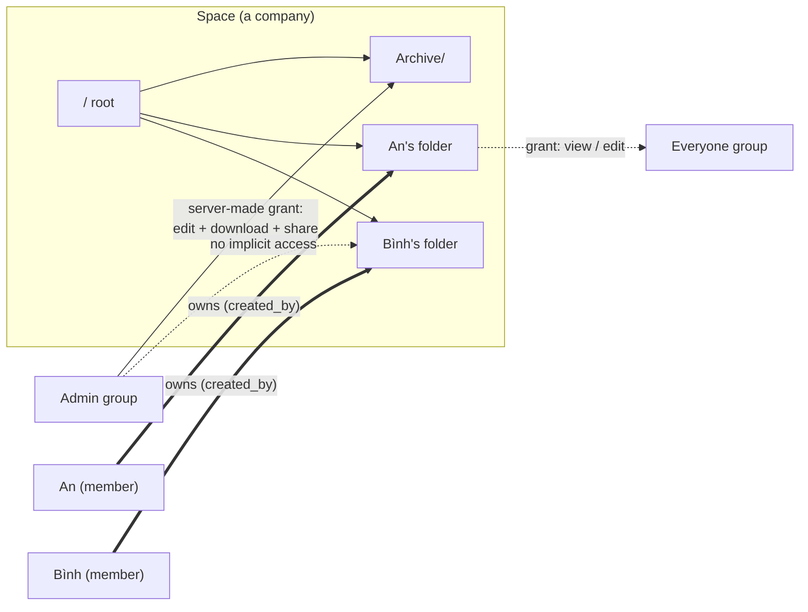
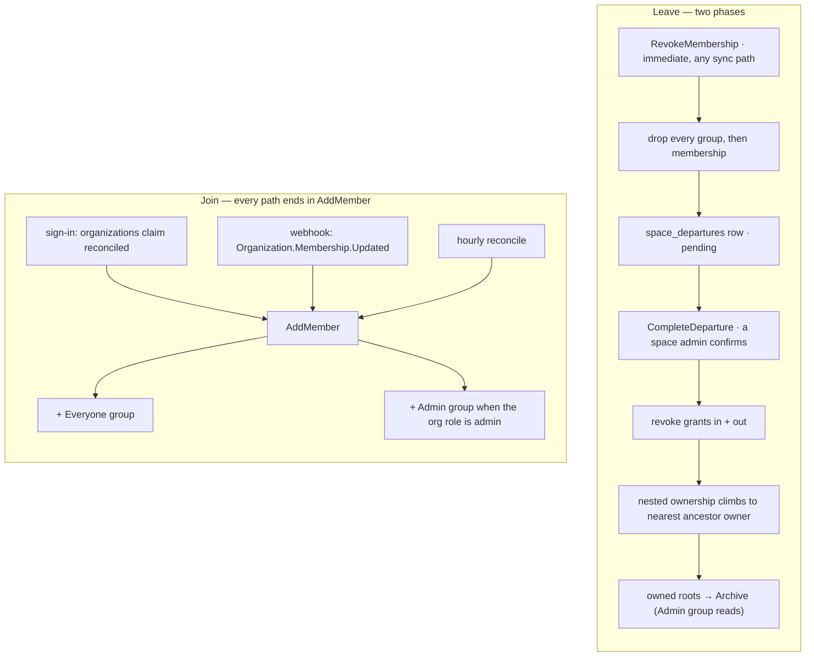

# Permissions

## Model

A space **is a company**. One instance hosts several, a person can belong to
more than one, and a space owns exactly one file tree.

Content access comes from exactly two mechanisms, both of which require the
caller to be a **current member of the node's space** — with one narrow
exception for people outside it, below:

1. **Ownership** — `nodes.created_by`. The creator of a node holds every
   capability on it and on everything beneath it. Ownership is intrinsic: it is
   not a row in `shares`, so there is nothing to revoke and self-lockout is
   impossible by construction. It is not perpetual, though — it stops granting
   anything the moment the person leaves the space.
2. **Grants** — a row in `shares` naming a user, a group, or a link token,
   carried down the subtree from whatever node it names.

**External grants (M42).** A direct share flagged `is_external` reaches
somebody who is not a member of the node's space, and it is the only thing that
does: no group grant and no ownership counts for a non-member, and an external
grant counts only while `external_sharing_enabled` (instance) and
`spaces.external_sharing` (space) are both on and the space is not archived. It
never carries `can_share`. See [Outside the Space](#outside-the-space).

There is no other mechanism. **Being an admin grants no file access at all.**
Admin is membership in the space's `Admin` group, and it buys space
administration (members, groups, settings, trash purge, the archive) — never
readership of a colleague's files.

Every item is therefore **private to its creator until they share it** — in the
personal half of the tree. A **team folder** is the other half; see
[Team Folders](#team-folders).

**The ownership boundary.** Who belongs to the company is not pp-hub's
decision: a space mirrors a Logto organization, and `space_members` is a
projection of that organization's member list. Logto owns identity and
membership; pp-hub owns everything built on top of it — user-created groups,
grants, ownership, quota, the Archive and the departure teardown. Admin is the
one crossing point: the organization role `admin` maps onto membership of the
automatic `Admin` group, and nothing else about the permission system reaches
upstream. See [Organization Sync](#organization-sync) and
[logto-org-sync.md](logto-org-sync.md).

A consequence worth stating in the model rather than the details: **a space is
allowed to have no admin at all.** Membership can be edited in the Logto
Console, so the last admin's removal can arrive as a fact pp-hub cannot refuse.
The space shows a banner saying so and an instance admin (`users.is_admin`)
resolves it; pp-hub does not auto-promote anybody, because admin means exactly
one thing — membership of the `Admin` group — and inventing a grant nobody
asked for would break that.

## Groups

Every space has two automatic groups, created with the space and maintained by
`spaces.Service`:

| Group      | Flag                 | Membership                                   | Grants by itself |
| :--------- | :------------------- | :------------------------------------------- | :--------------- |
| `Everyone` | `groups.is_everyone` | every space member, maintained by the server | nothing          |
| `Admin`    | `groups.is_admin`    | the space's admins                           | nothing          |

Both are immutable through the groups API — rename, delete and hand-edited
membership are refused (`groups.ErrSystemGroupImmutable`). `Admin` membership
changes only through `POST /spaces/{id}/members/{userID}/set-admin`, because
that membership _is_ the admin role. Uniqueness is one partial index each:
`groups_everyone_uniq` and `groups_admin_uniq`, both on `(space_id)`.

Everything else is a user-created group: a named set of people that a grant can
name instead of listing individuals.

## At a Glance

## Capabilities

A grant carries a **level** plus two independent **flags**:

| Column         | Values           | Meaning                                                       |
| :------------- | :--------------- | :------------------------------------------------------------ |
| `level`        | `view` \| `edit` | `edit` allows mutation; `view` is reading the file            |
| `can_download` | boolean          | save a copy: `GET /nodes/{id}/download`, or a folder as a zip |
| `can_share`    | boolean          | may create further grants on the subtree                      |

Two database CHECKs hold the shape:

- `shares_edit_download_ck` — `level = 'edit'` implies `can_download`. An editor
  must be able to fetch what it edits.
- `shares_link_ck` — a link is always `level = 'view'` with `can_share = false`.
  Edit-via-link stays post-MVP, and links must not chain.

**View reads; download saves.** A viewer may open the file and see it — the
inline stream (`GET /nodes/{id}/content`), a block document's tree
(`/document`), its attachments, the text preview, and the content search — and
`can_download` is what adds the routes that hand a copy over deliberately:
`/download`, the folder zip, `/export`, and copy-as-source. The honest limit is
that a render is still the file's bytes: a browser viewing a PDF or an image
can save it, so `can_download` is the difference between "save" being offered
and being worked around. It is a UX distinction that the UI keeps consistent,
not an encryption boundary, and nothing here tries to make the bytes
unsaveable by deriving a separate render.

The UI offers the folder zip as **Download as .zip** (row menu, selection bar, "Shared with me") whenever the folder's own caps include download.

`can_download` also gates **copying**. `POST /nodes/{id}/copy` authorises the
source with `CapDownload` and the destination with `requireParentWrite`, so a
reader may work from somebody else's file in their own folder — a copy is a
lasting one, which is more than a look. Copy needs both rights because it
creates a node of the caller's own.

`can_share` is **independent of level** in storage and on the wire: a viewer may
be allowed to pass their view on, and an editor may be denied re-sharing. Share
and grant requests therefore carry the storage model itself —
`{level, can_download, can_share}` — and `grantCapsFromBody` validates it,
normalising `edit` to imply `can_download` because the database CHECK requires
it. There is no ranked shorthand: a single word cannot say "view and pass on,
but do not download".

Resolution produces a `share.Caps` set (`view`, `download`, `share`, `edit`,
`owner`). An owner resolves to `share.CapsOwner` — all four, plus the owner
marker. A non-owner resolves to the union of their grants: level takes the
maximum, flags OR together. **Grants only widen; nothing narrows.**

### Monotonicity

`Caps.Covers` is enforced in `handleCreateShare` and `handleUpsertGrant`: you
can only hand out capabilities you hold yourself, so a download-only grantee
cannot mint an editor. A refusal is **403** carrying `share.ErrEscalation`.

The same bound applies to **changing or removing** a grant. Replacing a direct
or group grant (re-sharing is an upsert) and revoking any share row —
direct, group or link — demand that the caller's caps cover the grant being
touched; otherwise **403** ("that grant is wider than your own access").
Without it a viewer allowed to re-share could strip an editor the owner
appointed. An owner covers everything, so owners are unaffected.

There is **one direct grant per (node, person)** (`shares_direct_uniq`, the
twin of `shares_group_uniq`). `POST /nodes/{id}/shares` with
`kind: "direct"` names the grantee by `user_id` and upserts: **201** for a new
grant, **200** for a change — which is how a grant is narrowed. It used to
stack a second row that resolution OR-ed with the first, so the wider one
always won. The grantee is looked up by id rather than address, and "no such
account" and "not in this space" are one **422**, so the endpoint cannot tell
a member of one company which addresses have accounts in another.

Grants do **not** chain back to their creator. If A lets B re-share and B
shares with C, revoking B leaves C's grant standing — Drive behaves the same,
and the grant is a decision about the node, not about B. The exception is the
public link, below, which re-checks its creator on every request because it
is anonymous and forwardable. A departure removes every grant the leaver
created, links included.

Monotonicity has one blind spot by construction: **an owner covers
everything**, so a member who uploads into a colleague's folder owns that file
and may share it however they like — `can_share: false` on the folder above
never reaches them. This is not a hole in `Covers`, it is what intrinsic
ownership means. The part worth controlling is publication, so that is a
space-wide switch rather than a per-grant one: `spaces.allow_public_links`
(default true). With it off, `POST /nodes/{id}/shares` with
`kind: "link"` answers **403** for everybody, owner included; direct and group
grants are unaffected.

## Resolution Order

For one user on one node:

0. **Member of the node's space?** — if not, the answer is nothing, whatever
   else is true. Ownership is intrinsic but not perpetual: leaving a company
   ends your reach into its tree. The `created_by` rows stay behind so the
   archive keeps an author, and rejoining restores that reach; without this
   precondition a departure would file someone's work in the archive while
   leaving them free to read and edit it.
1. **Owner?** — the caller created this node or any ancestor → full
   capabilities, short-circuit.
2. **Grants** — the union of every live grant on the node or any ancestor,
   whether named directly or through a group the caller belongs to; expired
   rows are ignored.
3. **Link token** (no authenticated user) → `share.LinkCaps`: view, plus
   download when the link allows it. Never edit, never share.

`share.AccessCaps` answers steps 0–2 for **many nodes in one query**
(`NodeAccessCaps` in `queries/shares.sql`): one recursive CTE seeds only nodes
in spaces the caller belongs to, walks every ancestor chain, aggregates grant
flags with `BOOL_OR`, and joins `nodes.created_by` for the owner flag. A
listing therefore filters itself without a walk per row. `ListEntryPoints`
carries the same membership condition on **both** branches, owned and
granted: a departed member whose departure is still pending keeps their
direct grant rows until an admin confirms, and without the condition on the
granted branch "Shared with me" kept listing their names, sizes and owners.

That recursive join deliberately does **not** filter `deleted_at`: filtering it
truncates the chain at the first trashed ancestor and loses the grant above it,
which is why a tombstone resolves exactly like a live node and trash needs no
weaker rule of its own.

## Where Access Is Enforced

Node-addressed routes go through `requireNodeCaps(w, r, need share.Cap)`, which
resolves the node and demands one capability:

| Capability    | Routes                                                                                                                                                                                                                                                                                                                                  |
| :------------ | :-------------------------------------------------------------------------------------------------------------------------------------------------------------------------------------------------------------------------------------------------------------------------------------------------------------------------------------- |
| `CapView`     | `GET /nodes/{id}`, `/children`, `/tree`, `/preview?kind=thumbnail`, versions, star, `/content`, `/preview?kind=text`, `/document`, `/attachments/{hash}`, `/relative` and `/relative/meta` (on the document, then the rules below), `/comments` and `POST /nodes/{id}/comment-threads`, `POST /nodes/{id}/edit-session`, content search |
| `CapDownload` | `GET /nodes/{id}/download` (file or streamed zip), `/export`, copy source, `GET /nodes/{id}/collab`                                                                                                                                                                                                                                     |
| `CapEdit`     | rename, move (plus [the move rules](#moving-changes-who-can-reach-it)), delete, upload-into, version restore, trash restore/purge, WOPI save, tus upload with `attach_to`, `POST /nodes/{id}/unfurl`, `POST /nodes/{id}/relative/embed` (plus the caller's own `CapDownload` on the file)                                               |
| `CapShare`    | list/create/revoke shares, list/upsert/revoke group grants, `GET /nodes/{id}/inherited-access` — each change also bounded by [Monotonicity](#monotonicity)                                                                                                                                                                              |

Creating into a folder goes through `requireParentWrite`:

- **`parent_id` set** → `CapEdit` on that parent. A parent in another space
  answers **404, not 403**; confirming a node exists is already more than the
  caller should learn, the same rule anonymous share browsing follows.
- **`parent_id` nil (the space root)** → space membership is enough. Any member
  may create at their top level, and what they create is private to them. This
  is the M15 change: the root is no longer admin-only.

An upload (tus, M30) is authorized this way when it is created: membership
plus `requireParentWrite` for a new file, or `CapEdit` on the file for a
replacement (`node_id`), which also refuses a file open in the editor with
**423**. The same check runs again when the last chunk commits — access can
be revoked, and an editor opened, while the bytes are still arriving — and
the upload itself is visible only to the account that created it.

Space-level powers — member management, creating and editing groups, settings,
the departure queue, emptying the trash — are gated by `spaces.RequireAdmin`,
i.e. Admin-group membership. They never travel through the capability scale.
There is no role column and no role rank anymore.

Group membership is the one place administration touches file access: every
grant a group holds follows its members. Two rules keep that from becoming a
back door. An admin **may not add themselves** to a group that already holds a
grant (**403** — another admin has to), because otherwise "admin grants no file
access" was one click from false. And every group change — create, rename,
delete, member added or removed — is a `security_events` row
(`group_created`, `group_updated`, `group_deleted`, `group_member_added`,
`group_member_removed`).

Two deliberate exceptions to "administration is admin-only":

- `GET /spaces/{id}/groups` needs **membership**, not admin. Granting a group
  access to a folder you own requires its name and id, and the members panel
  already shows who is in the company. Creating, renaming, deleting a group and
  editing its membership stay admin-only.
- `POST /spaces/{id}/members/{userID}/set-admin` takes `as_admin` as a
  **required** boolean. It is decoded into a pointer so a typo like
  `{"is_admin": true}` is a **400** instead of decoding to `false` and silently
  demoting the person the caller meant to promote.

`spaces.SetAdmin` also **refuses a non-member.** Promotion calls
`RequireMember` first, because without it an admin could seat somebody in the
space's `Admin` group who has no `space_members` row: they would pass
`IsSpaceAdmin`, and therefore every space-administration route — those check
admin status, not membership — while the People page, which lists members,
would not show them. An administrator nobody can see is worse than one nobody
wanted. The equivalent check already guarded user-created groups, and the
Admin group is the higher privilege of the two. Demotion is unaffected, except
that it still refuses to remove the last admin.

Listings cannot afford a check per row, so they narrow in one batch
(`reachability` + one `AccessCaps` call):

| Surface                              | How it narrows                                           |
| :----------------------------------- | :------------------------------------------------------- |
| `GET /spaces/{id}/children`, `/tree` | one capability check on the **parent**; see below        |
| `GET /search`                        | over-fetch `limit × searchOverfetch`, filter, then limit |
| `GET /starred`, `/recent`            | batch filter                                             |
| `GET /activity`                      | batch filter, with its own rule for purged rows          |
| `GET /spaces/{id}/trash`             | batch filter — the resolver survives tombstones          |
| `GET /shared`                        | `ListEntryPoints` with `include_owned = false`           |

**Folder listings need one check, not one per row.** Access inherits downward,
so if the caller can view the parent the whole listing is theirs. Only when the
parent is unreachable does it narrow to children they own or hold a direct grant
on (`ListGrantedChildrenWithMeta`, which matches `created_by = caller` as well
as a grant).

`GET /usage` is deliberately **not** narrowed: it is an aggregate of bytes per
MIME family, names nothing, and the rail already shows the space quota beside it.

### Reading Is View; Saving Is Download

One rule decides every row below: **reading the file is view, and taking a
copy away is download.** View opens the file — the inline stream the browser
renders, the block document's tree, its attachments, the text preview. Download
adds the routes that deliberately hand the bytes over: the file as an
attachment, the folder as a zip, the export, a copy whose source is authorised
with it.

The honest limit: a render is still the file's bytes. A browser showing a PDF
or an image can be told to save it, so `can_download` is the difference between
offering a save and not — not a wall around the bytes. Deriving a separate
render to make them unsaveable is a different design and is not this one.

| Path                                                                          | Demands                                                                         | Why                                                                 |
| :---------------------------------------------------------------------------- | :------------------------------------------------------------------------------ | :------------------------------------------------------------------ |
| `GET /nodes/{id}/download`                                                    | `CapDownload`                                                                   | The file, or a folder streamed as a zip                             |
| `GET /nodes/{id}/content`                                                     | `CapView`                                                                       | The same bytes, `inline` for the allowlisted MIME types             |
| `GET /nodes/{id}/preview?kind=thumbnail`                                      | `CapView`                                                                       | 256px PNG the worker rendered; genuinely derived                    |
| `GET /nodes/{id}/preview?kind=text`                                           | `CapView`                                                                       | A 4 KiB prefix of the source — a read, like the file itself         |
| `GET /s/{token}/content`, `/document`, `/attachments/{hash}`, `/edit-session` | the link (always view)                                                          | Inline render, anonymous                                            |
| `GET /s/{token}/download`, `/node-download`, `/download-all`                  | the link's `can_download`                                                       | Attachment, anonymous                                               |
| `GET /wopi/files/{id}/contents`                                               | token rank ≥ 1 (= `CapView`)                                                    | The Document Server fetching the document to render it in view mode |
| `POST /nodes/{id}/edit-session`                                               | `CapView`                                                                       | Minting a read-only or edit session for OnlyOffice                  |
| `GET /nodes/{id}/collab`, `GET /collab/{room}`                                | `CapDownload`                                                                   | A block document's room: sync hands the whole document over         |
| `GET /nodes/{id}/attachments/{hash}`                                          | `CapView` on the document                                                       | An image, video or file dropped into a block document               |
| `GET /nodes/{id}/relative?path=`                                              | `CapView` on the document, then the file's own access or the document's reach   | A file beside a block document, named by a relative path            |
| `GET /s/{token}/relative?node=&path=`                                         | the link covers the document, then the link on the file or the document's reach | The same, anonymous                                                 |
| `GET /nodes/{id}/document`                                                    | `CapView`                                                                       | A block document's whole tree, for the read-only view               |
| `GET /nodes/{id}/export`                                                      | `CapDownload`                                                                   | The markdown and every attachment as a zip; audited as a download   |
| `GET /nodes/{id}/page`, `/pages`, `/backlinks`                                | `CapView`, else 404                                                             | Page metadata for the tree, breadcrumb and "Linked from" (M43)      |
| `GET /s/{token}/page`, `/pages`                                               | the link (always view)                                                          | The same through a link, anonymous; chain cut at the link root      |

Six notes on the table:

- **A machine token is not a person.** `wopi.SystemSubject` — the preview
  worker's conversion fetch — has no subject to resolve a capability for, so
  `handleWopiGetFile` skips the rank check for it. It is minted at rank 1,
  which is why that exemption is load-bearing rather than cosmetic. The token
  comes from this deployment, is scoped to one node, lasts five minutes, and
  the signing key is its authorization.
- **Office documents in view mode.** View opens office documents (`.docx`, `.xlsx`,
  `.pptx`, etc.) in OnlyOffice read-only mode (`/view`). `POST /nodes/{id}/edit-session`
  takes `CapView` and mints rank 1 (or rank 2 if `CapDownload`). `GetFile` allows rank ≥ 1
  so OnlyOffice can fetch the file bytes to display the document, while `CheckFileInfo`
  disables print and export (`DisablePrint`, `DisableExport`, `DisableCopy`) when rank < 2,
  and `PutFile` / lock ops require rank 3 (`CapEdit`). The same read-only view is
  provided to public links through `GET /s/{token}/edit-session`. See
  [office-integration.md](office-integration.md).
- **Block documents (M39).** The collaboration socket is authorized by the
  room itself, not `requireNodeCaps`: `Authorize` demands `CapDownload` and
  makes the connection read-only without `CapEdit` — ygo then drops that
  peer's updates and awareness. The decision is not made once: every 60 s the
  room re-resolves each peer's session (idle expiry, the 90-day cap,
  suspension) and capabilities and closes the socket of anyone whose answer
  changed, so a revoked peer is refused on reconnect and a downgraded one
  returns read-only. Attachments follow their document, not a grant of their
  own: uploading one (`attach_to`) takes `CapEdit` on the document, checked at
  creation and again at commit, and reading one takes `CapView` on it; a
  hash the document does not hold is 404 even if another document holds it.
  See [block-documents.md](block-documents.md).
- **A document's reach (relative references).** A block document that names
  a file beside it by a relative path (``) shows it to its
  readers on the document's behalf, the one place a grant on one node lets
  bytes of another out. It is bounded twice: the file must lie under the
  document's nearest folder ancestor, and the author of the version being
  read must be able to download it — so an editor handed a single document
  cannot name its neighbours to read them, and a document at the top of a
  space reaches nothing. Otherwise the reader's own access applies (view for
  an image or video shown in place, download for anything else); a link
  counts as view on what it covers. Opening what a relative link names
  (`/relative/meta`) and embedding a file as an attachment (`/relative/embed`)
  never use the reach. Every refusal is 404. See
  [block-documents.md](block-documents.md#relative-references).
- **Comments and notifications (M29).** Taking part in a document's
  discussion takes `CapView` on it — reading threads, opening one,
  replying — because whoever can read the document can read every word it
  annotates. Routes addressed by thread or comment id resolve the
  document first and check the same capability. Beyond that, editing a
  comment is its author's alone; deleting one is its author's or `CapEdit`'s;
  resolving or reopening a thread is its opener's or `CapEdit`'s. Nobody is
  notified about a document they cannot currently view, and the
  notification list and unread count drop items whose document the reader can
  no longer view, so a revoked grant stops the excerpts too. The stream
  re-checks its session every 60 s. **Unfurl** takes `CapEdit`: it stores an
  attachment on the document.
- **Extension nodes (M44–M46).** An extension never decides access: its routes
  sit behind `Guard`, which resolves `share.EffectiveCapsForNode` of the node
  and applies the capability the route names (kanban: `CapView` reads and
  subscribes, `CapEdit` writes). A node of an extension that is off — for the
  instance or for its space — answers 403 whatever the caller may do to it.
  Comments on a card take `CapView` like a document's. An assignee must be
  someone who could open the board, and a card's link to a drive file shows its
  name only to a viewer who can open that file (`Host.Resolve`); the writer
  must be able to open it too. A long-lived stream asks the same question every
  minute (`Host.Allowed`) and ends when the answer changes. See
  [extensions.md](extensions.md).

### Every Node Carries Its Own Answer

Listings and single-node GETs carry a `caps` object per node, and creation
responses stamp `share.CapsOwner` without a query — creating a node makes you
its owner. Three paths fill it, and between them they cover every
authenticated node response:

- `attachCaps` — folder listings and `GET /shared`, one batched `AccessCaps`.
  A folder listing uses `share.ChildAccessCaps` instead: every child of one
  folder inherits exactly that folder's ancestor chain, so it resolves the
  parent once with `AccessCaps` and ORs in each child's own grants and
  ownership (`NodeOwnAccessCaps`, no walk). The result equals `AccessCaps` on
  the children.
- `reachability.stamp` — the cross-space feeds (`/search`, `/recent`,
  `/starred`). These already resolved caps to filter themselves; the
  resolution is now handed to the DTO instead of being thrown away, so the
  answer costs no extra query.
- `withCaps` — creation and single-node responses, from the caps the handler
  already holds.

This matters because **two rows of one folder can differ**. A folder shared
with you `view` holds files you uploaded and own: your row resolves to
`owner`, the neighbouring one to `view`. Nothing the client could compute from
the listing would find that out.

So the client never guesses. `capsOf(node)` (`lib/api/caps.ts`) returns the
resolved set, falling back to view-only for a surface that carries none — a
floor, not an assumption, so an unstamped listing degrades to read-only rather
than offering controls that 403. Everything user-facing reads it: the node
menu, the selection bar (`commonCaps`, the intersection across a multi-select,
so "Delete 5 items" never means "delete the 3 I'm allowed to"), the details
panel and its Sharing section, the version list's Restore, the preview modal's
Download, and the editor page's chrome. `canRestructure(node)` carries the one
rule that is not a plain capability: rename and trash take `edit`, except on a
team folder's root, which takes `share` — a manager.

An action the caller does not hold is **left out, not disabled**: a greyed
`Share` invites a click and then explains nothing, and its absence matches
what the API would answer.

`attachCaps` also stamps `shared` — whether the node itself carries a live
share row (`NodesWithLiveShares`, batched by id like `AccessCaps`), direct,
group or link, any grantee. This is a different question from caps: a node
reached only through an ancestor's grant is not itself shared, and a node the
owner shared out to a group is `shared: true` even though the owner holds no
grant on their own file. The folder-listing badge (`NodeIcon`'s people glyph)
reads this field directly rather than a separate "shared with me" query, so it
lights for outgoing shares too — a folder you own and shared with a group,
which is not the same as `GET /shared`'s "shared with me" list.

**One dialog answers "who can reach this".** Access is one table, so groups,
people and the public link are granted and revoked from the same `Share`
dialog on any node — a file included. Group grants were never restricted to
folders on the server (`Grant` only checks that node and group share a space,
and the resolver treats a share row on a file as an entry point like any
other); the client used to hide them behind a folder-only dialog.

The dialog lists **everyone** who reaches the node, not only the rows on it:
`GET /nodes/{id}/inherited-access` returns owners of the node or any folder
above, and live grants on those folders, each with the folder it comes from
(`ListInheritedAccess`, one row per principal, nearest folder kept, flags
OR-ed as resolution does). Those rows are read-only in the dialog — they are
changed on the folder they come from. A control the caller does not hold is
left out: levels and flags beyond the caller's caps, and edit/revoke on a grant
wider than theirs.

The dialog's footer has **Copy link**: the absolute `/open/<id>` address
(`nodeLink`, `lib/open-file.ts`), the same one share mails carry. It grants
nothing — it opens the item for an account that already reaches it and shows
the no-access page to anyone else — which is what separates it from the public
link, whose secret is shown once.

Grantees are offered from the space — `GET /spaces/{id}/groups` and
`GET /spaces/{id}/members`, both member-readable — and from nowhere else.
There is no tenant-wide user directory to search: `GET /users/search` existed
only to serve the invite path and went with it. A space is a company, and the
picker must not double as an address book for all of them; the one way a person
arrives in a space is the organization they belong to upstream.

## A Member's Top Level

A member's top level is **entry points**, not the raw space root:
`ListEntryPoints` returns the topmost nodes the caller can reach, where
reachable means _owned_ (`include_owned = true`, the space-scoped home view) or
_granted_. A node sitting under another reachable node is dropped — it is found
by walking down.

The web home view lists what the caller **owns, plus team folders** they hold a
grant on. Anything else somebody shared — a file from inside a colleague's
folder, say — is **not** at the root of the grantee's drive: its folder is the
colleague's, so it lives under "Shared with me". WebDAV passes
`include_granted` and keeps every reachable entry in a space's root, since it
has no per-space "Shared with me" to send the client to.

"Shared with me" is the same query with `include_owned = false`, and it also
drops rows the caller owns: your own file is not something shared with you.

The containment rule only counts **live** ancestors. When somebody trashes a
folder, `Delete` tombstones that one row and leaves the subtree live but
unreachable from above — so a file you created inside it would otherwise
vanish from your own home with no trace, and the folder owner's purge would
then take it. The ancestor walk in `ListEntryPoints` therefore stops at the
first tombstone, and your file surfaces at your top level instead. Drive draws
the same line: trashing a folder does not remove other people's access to what
is inside it.

The exception is a tombstone the caller owns: the owned-parent prune ignores
`deleted_at`, so what you put in a folder you then trash goes into the trash
with it and returns on restore, instead of spilling onto your home.

Personal folders are gone. There is no `personal_folders` table, no
`spaces.personal_root_id`, and no "My files" carve-out — ownership does that
job for every node, not just one mapped folder per member.

## Team Folders

Ownership as described above is the right model for a member's own work and the
wrong one for shared company content. Because `created_by` cannot be revoked,
the personal half of the tree accepts three consequences: revoking a grant does
not take back what the grantee uploaded into your folder, they can always mint
a link for it, and they can move it out from under you. Drive, ownCloud and
Nextcloud all reached the same conclusion and grew a second container — the
shared drive, the project space, the team folder — where content has no
personal owner at all. `nodes.team_root_id` is ours.

|                               | Personal folder                                                                                                               | Team folder                                            |
| :---------------------------- | :---------------------------------------------------------------------------------------------------------------------------- | :----------------------------------------------------- |
| Who owns the content          | its creator, forever                                                                                                          | the folder                                             |
| `created_by`                  | full capabilities, unconditional                                                                                              | a byline; grants nothing                               |
| Revoking a grant              | leaves the grantee's uploads reachable by them                                                                                | removes their access to everything inside              |
| Public link on content inside | the uploader can always mint one                                                                                              | only a grantee with `can_share`                        |
| Moving content out            | its owner; others need `CapShare`, and never into more access than they hold (see [Moving](#moving-changes-who-can-reach-it)) | a manager, and it becomes theirs                       |
| Moving personal content in    | —                                                                                                                             | only whoever created it and everything live beneath it |
| When the creator leaves       | roots go to the Archive                                                                                                       | nothing moves; managers carry on                       |

`team_root_id` is NULL for personal content, the container's id for everything
inside one, and its **own id** on the container itself — so "is this a team
folder" is `team_root_id = id` and "is this team content" is
`team_root_id IS NOT NULL`. It is denormalised deliberately: the alternative is
an ancestor walk inside every resolution query, and this makes three recursive
checks column predicates. `fs` maintains it in exactly two places — inherited
from the parent by `CreateNode`, rewritten across the subtree by `Move` — and
`nodes_team_root_top_level_ck` keeps a team folder at the top level, because a
nested one would make "which container owns this" ambiguous.

What changes in the queries:

- **`NodeAccessCaps`** — the `owners` CTE ignores `created_by` when
  `team_root_id IS NOT NULL`. This one predicate is what makes a team folder a
  team folder; without it the container would behave exactly like a personal
  one.
- **`ListEntryPoints`** and **`ListGrantedChildrenWithMeta`** — the owned
  branch skips team content, so a file inside a team folder is never somebody's
  personal entry point and cannot surface at their home after their grant is
  revoked.
- **`ListChainPrincipals`** — authors inside a team folder are not principals,
  so a move's access warning does not name them.
- **`TransferNestedOwnership`** and **`ListArchiveRoots`** — both skip team
  content: there is no ownership to hand over, and a team folder must not
  follow its creator into the Archive.

There is no role enum. A **manager** is simply a grantee whose grant carries
`can_share`, which is already the capability that means "may hand out access".
Managers rename and delete the folder (`requireMovableNode`), move content out
of it (`handleMoveNode`), and appoint other managers. Everyone else with `edit`
is a contributor.

Three guards keep a team folder administrable:

- **Creation seeds the first manager.** `POST /spaces/{id}/team-folders` is
  admin-only — a team folder is company structure, which is the line
  `RequireAdmin` already draws — and the creator immediately gets an
  `edit + download + share` grant, written by `fs.CreateTeamFolder` in the
  same transaction as the folder. Without it the folder would be unreachable
  the moment it existed, since nothing about it is owned.
- **The last manager stays.** Revoking, or re-granting without `can_share`,
  the only live `can_share` grant on a team folder answers **409**
  (`keepsTeamManager`, counting with `CountTeamManagers`). Somebody else must
  be appointed first.
- **Departure re-seats one.** `CompleteDeparture` deletes the grants the leaver
  created, which may have been the only manager grant. Any team folder left
  with no `can_share` grantee (`CountTeamManagers`) falls to the `Admin` group,
  the same custodian the Archive gets, so an admin can appoint the next
  manager.

A purge inside a team folder does **not** rescue foreign subtrees, and
`foreign_owned` is not reported for team content: the container owns everything
in it, so "items other people created" is not a category there and scattering
them across personal top levels would defeat the point.

## Destroying Other People's Work

A folder owner holds `CapEdit` on everything beneath, so they can trash and
purge a subtree that colleagues have contributed to. Three rules keep that from
being silent data loss:

1. **The trash says where the work went.** `GET /spaces/{id}/trash` returns,
   besides the tombstones the caller can reach, every tombstone that buries
   live nodes they created (`ListTrashRootsWithUserContent`). Those rows carry
   `buried_own` and `read_only: true` — an explanation, not a control. Restore
   and purge still demand `CapEdit` on the tombstone, so they answer 403.
2. **A purge rescues rather than cascades.** `fs.Purge` detaches every topmost
   node in the subtree that the purged node's owner did not create
   (`ListForeignTopmostInSubtree`) and re-parents it to its own owner's top
   level, keeping `deleted_at` so a file the colleague trashed themselves stays
   in their trash. Only then does the hard `DELETE` run, so the cascade cannot
   reach the rescued rows. The response reports how many survived, and each
   gets an activity event.
3. **The warning precedes the act.** `GET /nodes/{id}` on a folder carries
   `foreign_owned`, the number of live nodes inside it somebody else created
   (`CountForeignOwnedInSubtree`). It is deliberately absent from listings —
   one subtree walk per row — and exists so the confirm dialog can say what is
   about to happen.

Revoking a grant is the same story from the other end: it removes the grantee's
access to the node, and changes nothing about what they created inside it.
`GET /nodes/{id}/shares` carries `grantee_owned` per direct share so the dialog
can say so. A group grant has no single author to attribute, so it carries no
count.

## Moving Changes Who Can Reach It

Access is inherited, so a move rehangs a node under a different chain of
owners and grants. Both directions matter: a file moved out of a colleague's
folder leaves everyone that folder reached, and a file moved into a shared one
is handed to everyone that folder reaches.

Moving is not blanket-blocked: moving a file you created out of somebody
else's folder is how you take it back, and Drive documents exactly that as the
way to narrow sharing on a file inside a folder you do not own. But in this
model where a node hangs **is** who reaches it — ownership included — so
`authorizeMove` bounds every move beyond write access at both ends:

1. **Out of a team folder** (to personal space or another team folder) takes
   `CapShare` — a manager — and the subtree becomes the mover's.
2. **Into a team folder from personal space** takes being the node's creator
   with no live content by anyone else beneath it. Inside a team folder
   `created_by` grants nothing, so the move would take the work away from
   whoever made it; Drive asks the same of a move into a shared drive.
3. **A non-owner moving personal content** may not land it anywhere that would
   give them more than they hold on it now (`Caps.Contains` against their caps
   on the destination). Ownership inherits down the tree, so dropping someone
   else's file into a folder you own used to make you its owner — an editor
   denied re-sharing came out with every capability, public links included.
   And without `CapShare` they may not change who reaches it at all: any
   non-empty move impact is refused, the rule Drive applies to an editor
   moving out of a shared folder. Reorganising within the same shared folder
   changes nobody's access and stays open to editors.

Owners move their own work freely. Every refusal is **403** with the reason.

`GET /nodes/{id}/move-impact?parent=` answers the question before the move:
`{losing, gaining}`, each a list of principals — a person, a group, or the
public link — and applies the same rules first, so a move the server would
refuse is refused before the confirm dialog promises it.

`ListChainPrincipals` collects everyone who reaches a node by inheritance: the
creator of the node and of every ancestor, plus every live grant on that chain.
`fs.MoveImpact` takes it for three roots — the node, its current parent, the
destination — and differences them. Grants on the node itself and its own
creator travel with it, so they appear on neither list; the caller is dropped
from both, because telling somebody they are about to lose their own access
reads as a bug. The endpoint demands the same capabilities as the move, so it
cannot be used to probe a tree the caller cannot write to.

`fs.Move` writes the reparent, the subtree's `team_root_id` and (leaving a
team) the new author in **one transaction**, so no reader ever sees personal
content still marked as a team's.

## Sub-pages

A sub-page (M43, [block-documents.md](block-documents.md#pages)) is a `.md`
node whose `parent_id` is its parent document, so it inherits through that
document exactly as a file inherits through its folder: ownership and grants
up the chain, trash with the parent, a foreign-owned sub-page lifted to its
owner's top level when the parent is purged. Sharing a document shares its
sub-pages; nothing about pages needed a new rule in the resolver.

- **The page routes answer 404, not 403.** `GET /nodes/{id}/page`, `/pages`
  and `/backlinks` need view on the node and answer 404 alike when it is
  missing, not markdown, or not viewable, so they do not confirm that a page
  exists. `/pages` filters nothing per row: view on the parent inherits to
  every child. `/backlinks` filters its sources with one batched
  `AccessCaps`.
- **`parent_id: null` stops a leak.** The ancestor chain in `/page` stops at
  the first ancestor the caller cannot view (or that is not a page), and the
  topmost page shown then has `parent_id: null`; a sub-page shared without its
  parent has no ancestors at all, and its tree and breadcrumb start at it. A
  backlink carries `parent_id` only when the parent is a page the caller can
  view. Search's `parent_name` path through parent pages stops the same way.
- **Through a link** `GET /s/{token}/page?node=` and `/pages?node=` are public,
  like `/s/{token}/document`; the chain is cut at the link's root, so the root
  has `parent_id: null`, and a node outside the link is 404. The share page
  navigates into sub-pages the link covers.
- **Writing.** Creating a sub-page is `POST /spaces/{id}/documents` with a
  document as `parent_id`, which needs edit on that document like a folder.
  Deleting a sub-page block trashes the page with the deleter's own rights; a
  co-editor who cannot trash it gets a 403 and the page stays.

## Anonymous Link Browsing

A link resolves without a user to `share.LinkCaps`: view, plus download when
the link says so. View is the whole point of a link — it opens what the link
covers: `/content` renders a file inline, `/document` a markdown document's
tree, `/attachments/{hash}` its images, and the page draws a PDF, an image, a
video or a text file from those bytes. The download flag adds only the routes
that hand a copy over deliberately — `/node-download`, `/download` and
`/download-all` (zip) — and the page offers no save button without it.

The line is not a wall and the docs should not pretend it is: a streamed render
is the file's bytes, so a visitor who can view a PDF can also save it from the
browser. What `can_download: false` means is that saving is not _offered_ —
there is no Download button, no zip, and no exported bundle. An earlier version
of this code resolved that tension by refusing `/content` too, which made a
link without download useless for its purpose: it could only list names, sizes
and dates. The token is also short now — sixteen base62 characters — so the
URL is one a person can read back over a call.

Every node id an anonymous caller supplies is walked back up to the share root
before anything is served. A node outside that subtree answers **404, not
403**: confirming that a node exists but sits outside the share is itself more
than the visitor should learn. Owner names are stripped from share responses,
and `shared_by` on the landing page is the sharer's display name or IdP name
only — never an email address, which on a forwardable anonymous link would be
a company directory entry handed to whoever the link reaches.

**A link is only as alive as its creator's own access.** `resolveLinkNode`
re-resolves `EffectiveCapsForNode` for `shares.created_by` on every request
and refuses the link — 404, with "whoever created it no longer shares this
file" — once that no longer holds `CapShare`. Before this, resolution was the
token hash and the expiry and nothing else, so revoking the grant that let
somebody share a folder left every link they had minted working, anonymously,
indefinitely. The model already held the opposite intent for the stronger
action: `CompleteDeparture` deletes the grants a departing member created so
that "their sharing decisions leave with them". Revoking one grant is the weaker
action and left the bigger hole. Re-resolving on read rather than cascading on
revoke is the same choice made for WOPI tokens — one query covers every way
access can disappear, an ancestor being moved included, instead of one cleanup
path per way. A link whose creator has left the space fails the same check,
because resolution step 0 (membership) fails for them.

Nor is a link ever **wider** than its creator's access today. Monotonicity is
checked when a link is minted; a creator since narrowed to view-without-download
must not keep handing out the bytes anonymously, so `resolveLinkNode` clears the
link's download flag whenever the creator no longer holds `CapDownload`.
Every download route reads the flag through `LinkCaps`, so the clamp reaches all
of them, and `GET /s/{token}` reports `can_download: false`.

## Archive

Every space owns one `Archive` folder (`spaces.archive_root_id`), created with
the space. The server makes exactly one grant on it: `edit + download + share`
to the `Admin` group. That grant is the **only** place an admin can read
content they do not own, and it exists so a departure never destroys work
silently.

Departure runs in **two phases**, and they are deliberately separated in time.
Losing access is not the same event as having your work tidied away.

**Immediately, on whichever sync path noticed — `RevokeMembership`.** Delete
the person's rows in every `group_members` for the space's groups, then the
`space_members` row itself. That is all of it, and it is enough to lock the
door: with the membership row gone, resolution step 0 fails for them, so their
grants _and_ their own `created_by` rows stop granting anything. The
`group_members` half cannot be deferred — `group_members` references `users`,
not `spaces`, so nothing cascades when the membership row goes, and leaving
those rows standing would keep a departed colleague's group grants live. The
whole step is idempotent, because more than one sync path may run it.

**Later, once a space admin confirms it — `CompleteDeparture`.** This is the
destructive half, and it runs in this order:

1. **Grants die first** — inbound (direct grants naming them) and outbound
   (every grant they created, links included), while the nodes still carry their
   original owner. Their sharing decisions leave with them.
2. **Nested ownership climbs** — `TransferNestedOwnership` rewrites
   `created_by` on nodes that sit under somebody else's folder to that nearest
   ancestor's creator, so the content stays where the work is. This rewrites
   authorship; the activity feed keeps the history.
3. **Their roots move to the Archive** — every remaining node they own whose
   `parent_id` is NULL is re-parented under `archive_root_id`, with a `" (n)"`
   suffix if a live sibling already holds the name. Nothing is deleted. The
   Archive itself is excluded from that sweep: the space creator owns it, so
   without the exclusion their departure parented the Archive under itself and
   every ancestor-walking CTE in the space looped forever. `ListArchiveRoots`
   filters it out, `nodes_no_self_parent_ck` makes the shape unrepresentable,
   and the recursive walks carry a depth-100 brake.

The archive grant is re-seated on the way out, because the departing member may
have been the row's `created_by` and step 1 deleted it.

**The split costs no access control**, which is what makes it safe: content
access requires _current_ membership of the node's space, so the grant rows
phase two deletes are already granting nothing. What deferral buys is that the
irreversible part is never triggered by somebody editing the Logto Console. A
pending departure is a row in `space_departures`, surfaced as a queue on the
People page (`GET /spaces/{id}/departures`), and
`POST /spaces/{id}/departures/{userID}/complete` is the admin's confirmation.
Until that call, nothing has been destroyed: putting the person back in the
organization restores them exactly as they were.

After a completed departure, re-adding the person restores ownership of what
step 3 archived — the folder stays in the archive, but they own it again, which
is the outcome anyone would expect after a mistaken removal or a return.

Step 2 is **not** reversible in the same way. A file they created inside
somebody else's folder has already had its `created_by` rewritten to that
folder's owner, and re-adding the person does not hand it back: they return
with no capabilities on it at all. Authorship of the individual versions
(`node_versions.created_by`) and the activity feed are what remain.

Removing or demoting the **last** admin is still refused on pp-hub's own write
path (`spaces.ErrLastAdmin` → **409**), checked before the Management API call,
and both guards live in `spaces.Service` so the HTTP layer cannot drift from
them. A removal performed upstream in the Logto Console is not a request and
cannot be refused — it arrives as a fact, and the space is left admin-less with
a banner. See [the ownership boundary](#model).

The Archive is an ordinary folder, so admins browse, restore (move out) and
purge it with the normal drive UI. It cannot be renamed, moved or trashed —
`isArchiveRoot` refuses, or a departure would have nowhere to land.

## Member Lifecycle

There is no fourth way in and no local invitation: all three join paths are the
same reconciler converging the space against its organization, so an admin
adding a member adds them upstream and waits for that to come back. Joining
creates no folders — ownership begins with the first thing the member makes.
Re-adding a departed member does not un-archive content a completed departure
already moved.

## Suspension

`users.suspended_at` blocks a user without deleting their files or their
authorship of anything. It is enforced by the `/api/v1` auth middleware on
every request, so suspending takes effect immediately rather than waiting for
open sessions to expire. The response is **403, not 401**: the credentials are
valid, the account is not, and a 401 would send the client into a pointless
re-authentication loop.

An instance admin cannot revoke their own instance-admin flag or suspend
themselves; both are refused server-side.

**Logto decides suspension (M38).** The admin console's Suspend/Reinstate
writes `PATCH /api/users/{id}/is-suspended` upstream first, then applies the
local half; the other direction arrives by the `User.SuspensionStatus.Updated`
webhook and the hourly account sweep, which set `suspended_at` and end every
session. An account Logto no longer has is suspended the same way — never
deleted, because it owns files and history — and each organization it was in
is reconciled at once so its memberships become departures. Only an account
issued by some other provider keeps a local-only suspension.

## Outside the Space

M42 ([personal-spaces.md](personal-spaces.md)) lets a node be shared by email
with somebody outside its space. Everything that follows from it is narrow on
purpose:

- **Who may.** Whoever holds `CapShare`, through `POST /nodes/{id}/shares` with
  `email`, gated by `allowExternal`: the instance switch, the space switch,
  `mcp_external_shares` for an agent, and no `can_share` for the outsider. A
  user id outside the space stays a 422. The covering rule applies as to any
  grant.
- **What it opens.** The node's subtree at the grant's level, read through
  node-addressed routes only (`/nodes/{id}/…`, WOPI, collab). Every
  space-addressed route still gates on membership, so an outsider never lists a
  space's top level, its members or its groups. Creating inside a shared folder
  takes edit on that folder (`requireParentWrite`); what they create is reached
  through the grant, not owned.
- **What it never opens.** Group grants, ownership, re-sharing, a team folder's
  management.
- **Ending it.** Revoking the row; either switch off (the row stays, so on again
  restores it); archiving a personal space; the share's maker leaving the
  space — it resolves only while they are a member. Joining the space turns a
  person's external grants there into ordinary ones, and leaving takes every
  grant they hold, as for any member.
- **Invitations.** An address with no account — or whose account never had it
  verified — gets a `pending_shares` row, turned into a grant (external, or
  ordinary for a member) only at a sign-in with that address verified, and only
  if its inviter still could make it.
- **What they can learn.** `GET /nodes/{id}/people`, the breadcrumb and the
  parent names in search, Starred and Recent stop at the topmost node the
  outsider can open: never the roster, nor who holds or what is called anything
  above their share.
- **Guests (M49).** With `guest_access` on, an address that holds a view
  invitation, or a guest who holds a grant, can prove the address with an
  emailed code and open it with no account ([guest-access.md](guest-access.md)).
  A guest is a `users` row of `kind = 'guest'` holding the same external direct
  grant — the resolver is unchanged — at **view** only (an edit share to one is
  422; an edit invitation is not adopted at a guest verification). Comments take
  `CapView`, so a guest comments on what they can open. Their session is
  confined by an allowlist in the `authenticated` middleware, not by the
  resolver: every route not listed answers 403, and `guest_access` or
  `external_sharing_enabled` off ends every guest session at once.

## Agents (MCP)

An AI agent connected over MCP (M41, [agent-access.md](agent-access.md)) acts
**as its person, with exactly that person's capabilities** — nothing new is
granted and nothing is resolved differently. Each tool is a few calls to the
REST API dispatched in process with the person's session, so every capability
check, audit row and notification is the web client's own.

Four switches and suspension are checked by `mcpBearer` **on every request**,
not when the connector is added, so turning one off takes effect at once:

- **`mcp_enabled`** (instance, Admin › Settings, default off) — off, `/mcp/`
  and its discovery metadata answer 404.
- **`users.settings.agents_enabled`** (per person, Settings › Security; unset
  means allowed) — off, 403.
- **`users.suspended_at`** — 403, as on `/api/v1`.
- **`mcp_public_links`** (instance, default off) — creating a public link
  through an agent needs this _and_ the space's `allow_public_links`; one
  person's agent should not be able to publish a document to the internet
  unless the instance has decided it may.
- **`mcp_tokens`** (instance, default on) — off, personal access tokens can be
  neither minted nor presented (403).

A personal access token is a credential the person manages, never their
agent: its routes, like the session routes, are mounted only on the network's
`/api/v1` and not on the agent router, so no tool can mint one. It carries no
capability of its own — it is its creator, as an OAuth token is.

A token whose identity has no pp-hub account answers 403 ("sign in to pp-hub
once…"); the MCP path never creates an account.

Three routes exist only on the in-process agent router: `GET /nodes/{id}/text`
takes `CapView` (reading is view), `GET /nodes/{id}/file` takes `CapDownload`
(it hands the bytes over, like `/download`) and `PUT /nodes/{id}/text` takes `CapEdit`.
`add_comment` with a quote anchors the thread by writing the document, so it
needs edit; without a quote it opens a thread like a reviewer, on view.

Every `security_events` row recorded under an agent request carries
`detail.via = "mcp"` and `detail.client_id`, and read dedup keys an agent's
read apart from its person's (`actor|agent:<client_id>`), so the log can tell
what a person did from what their agent did.

## Organization Sync

A space mirrors one Logto organization (`spaces.idp_org_id`, unique where
non-NULL). **`space_members` is a projection, not a record**: the only writer
is `orgsync`'s reconciler, which re-reads the organization's member list and
converges the local set against it. No human writes that table, and nothing in
pp-hub decides membership.

- **Three signals, one behaviour.** A returning user's `organizations` and
  `organization_roles` ID-token claims, an `Organization.*` webhook, and an
  hourly ticker all mean the same thing — "this organization changed" — and
  all run the same convergence, which also mirrors the organization's name.
  No path applies a delta: webhook payloads arrive unordered, so applying
  `addedUserIds`/`removedUserIds` incrementally would be a correctness bug,
  while converging is idempotent and order-free.
- **Admin is the organization role `admin`**, mapped onto membership of the
  automatic `Admin` group (`PP_LOGTO_ORG_ROLE_ADMIN` names the role). It is
  still the same one fact it has always been; what changed is who decides it.
  `POST /spaces/{id}/members/{userID}/set-admin` writes through to the
  Management API and lets the reconciler apply the result.
- **There is no local invitation.** `POST /spaces/{id}/members` takes an
  `{"email", "as_admin"}` pair. An address that already has an upstream account
  is added to the organization and reconciled — **201** `{"status":"added"}`;
  an address that does not gets an organization invitation sent by Logto's own
  email connector — **202** `{"status":"invited"}`. A space with no
  `idp_org_id` answers **422**, an unreachable Logto **503**, a refusal from
  Logto **502**, and an existing
  member **409**. There is no token for pp-hub to mint, store or redeem, and no
  acceptance route: Logto leaves accepting to the application, and pp-hub does
  it at sign-in (M38) — every live invitation made out to the **verified** email
  claim is accepted with the person's Logto user id and merged into the token's
  organization claims before they are reconciled. The email's `{{link}}` is
  `{PP_EXTERNAL_URL}/auth/login?login_hint=<address>`.
- **Creating a space is an instance admin's action, and it writes through.**
  A space is a company, so the identity provider decides which companies
  exist. `POST /spaces` answers **403** for anybody but an instance admin
  (`users.is_admin`): minting one would have awarded an ordinary member the
  `Admin` group on it, which is exactly the authority the organization role
  was supposed to decide. For an instance admin it creates the Logto
  organization first, seats them in it with the admin role, then mirrors it
  as a space — there is no way to create a space that mirrors nothing. The
  profile carries `can_create_spaces` so the client hides the control rather
  than offering a 403.
- **Renaming a space renames the organization.** `PATCH /spaces/{id}` with a
  new name writes it to Logto first; a rename in the Console arrives with the
  next reconcile.
- **Deletion does not travel.** Deleting a space keeps its organization in
  Logto and records it in `detached_orgs`, so the members' next sign-in does
  not recreate the space; an organization deleted in Logto unlinks its space
  (`idp_org_id = NULL`) and leaves members and content where they are.
- **An unlinked space is linked by an instance admin.** A space created before
  the sync, or whose organization was deleted, gets one through
  `GET /spaces/{id}/link-preview` and `POST /spaces/{id}/link` (**202**): the
  members this Logto tenant issued are pushed into a new organization with
  their current role, and the rest — who have no Logto account — become
  departures, which the request must acknowledge with `confirm_stranded`
  (**409** otherwise).
- **Members who have never signed in still exist.** Reconciliation pre-creates
  the `users` row from the Management API response, keyed on
  `(oidc_iss, oidc_sub)`, so the People page shows the organization rather than
  the subset of it that has logged in at least once.
- **Removal is immediate; teardown is confirmed.** See
  [Archive](#archive) — the projection loses the row the moment the change is
  seen, and `space_departures` holds the destructive half until an admin asks
  for it.
- **The space DTO carries the two facts a client needs to say any of this.**
  `idp_org_id` is absent when the space is unlinked, which is how the People
  pane knows to disable Invite and show the unlinked alert (with **Link to
  Logto** for an instance admin); `admin_count` is how many
  people are in the `Admin` group, and `0` is what raises the no-administrator
  banner. Both ride on `GET /spaces`, `POST /spaces` and
  `PATCH /spaces/{id}` — no extra round trip for a banner that has to render on
  every surface.

The full design, including the failure modes and the reasoning behind each
choice, is [logto-org-sync.md](logto-org-sync.md).

## Group Membership Invariants

Enforced in `spaces.Service`, not by the database alone:

- **Creating a space creates its `Everyone` group, its `Admin` group and its
  `Archive` root**, and puts the creator in both groups.
- **Adding a member adds them to `Everyone`** — and to `Admin` when they hold
  the organization's `admin` role.
- **Removing a member removes them from every group in that space.**
- **`Everyone` membership is always exactly space membership.** There is no API
  to edit it by hand.
- **No group membership without space membership.** Both `AddGroupMember`'s
  handler and `SetAdmin` call `RequireMember` before adding anyone, so a group
  — the automatic `Admin` one included — can never hold someone the space
  does not.

## Schema (M15)

The development-phase migrations were consolidated into a single baseline,
`0001_init.sql`, so the schema reads as one document rather than fifteen
deltas. What changed relative to the model M11 left behind:

| Change                                     | Why                                                          |
| :----------------------------------------- | :----------------------------------------------------------- |
| `shares.perm` → `level`                    | ranked scalar could not express "editor who cannot re-share" |
| `shares.can_download` added                | download is a choice, not a rank step                        |
| `shares.can_share` added                   | re-sharing is a choice, independent of level                 |
| `space_members.role` dropped               | admin status is Admin-group membership                       |
| `spaces.default_role` → `default_as_admin` | role enum is gone                                            |
| `groups.is_admin` added                    | marks the automatic Admin group, unique per space            |
| `spaces.archive_root_id` added             | where a departure lands                                      |
| `personal_folders` dropped                 | ownership covers every node, not one folder per member       |
| `spaces.personal_root_id` dropped          | replaced by `archive_root_id`                                |

Since then, `0009_direct_share_uniq.sql` added `shares_direct_uniq` — one
direct grant per (node, person) — folding existing duplicates into the oldest
row (widest level and flags, latest expiry, no expiry winning; lapsed
duplicates dropped rather than revived).

## Implementation Notes

- Resolution is one recursive query per request (`NodeAccessCaps`), batched
  across nodes. If profiling shows it hot, add a request-scoped cache first,
  then an invalidated cache keyed by `(user, node)`.
- Share tokens: only `token_hash` (sha256) is stored. Revocation is a row
  delete; `expires_at` is optional.
- WOPI access tokens carry the capability resolved at session-open time as a
  ceiling; `wopiClaims` re-resolves on every WOPI call and clamps to what the
  caller holds now. See [office-integration.md](office-integration.md).
- Operations that write more than one row that access depends on run in one
  transaction through `store.Queries.InTx`: `fs.Move`, `fs.CreateTeamFolder`
  (folder + first manager grant), `fs.Purge`, `spaces.Create`,
  `spaces.AddMember`, `spaces.RevokeMembership` and
  `spaces.CompleteDeparture`. `InTx` on queries already inside a transaction
  opens a savepoint, which is how the rename-on-collision retries survive a
  unique violation inside a larger unit of work.
- The invariants that live in SQL — owner inheritance, admin-cannot-read,
  promote/demote, the archive hand-off, the departed-member listing — are
  covered by `internal/spaces/permissions_db_test.go`; the handler-level
  rules — move bounds, grant-change bounds, the last team manager, the link
  download clamp, admin self-add — by `internal/httpapi/sharing_db_test.go`.
  Both need a real Postgres (`PP_TEST_DATABASE_URL`) and skip loudly
  without one.

## Quotas

Per-space `quota_bytes` is enforced at upload (`fs.EnsureRoom`, **413** when a
space would go over) — since M30 twice: against the declared length plus
what other in-flight uploads have promised when the upload is created, and
against the measured size once the bytes land. `used_bytes` counts every
stored version, trash included, and is kept current by triggers on
`node_versions`, `node_attachments` and `nodes`. See the Quota section of
[data-model.md](data-model.md).
