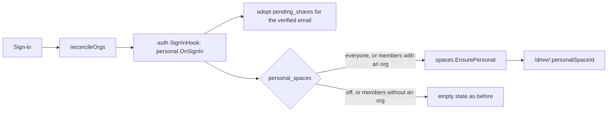

# Personal Spaces and External Sharing

**Status: shipped (M42).** Off by default: an instance turns it on in
Admin › Settings › Personal use.

## Problem

pp-hub served only people who already belonged to a Logto organization.
Somebody who signed in without one landed on the empty state ("ask an
administrator to add you to an organization"), and nothing they held could
reach anyone outside their own company: a direct grant to a non-member was
refused with 422 "share a link instead", and the resolver gated every path on
space membership.

Google Drive serves both audiences from one account model: a personal drive for
anyone, organizations for companies, and sharing by email that crosses the
line. This brings the same shape to pp-hub without giving up the M15
invariants: ownership is intrinsic but ends with membership, grants only widen,
and admin is never readership.

## Goals

- Every account may have exactly one **personal space** ("My Drive"), beside
  the organization spaces it belongs to — one account, many spaces, switched in
  the existing space switcher.
- **Share by email with anyone**: an account in another space, or an address
  with no account yet.
- The instance administrator decides whether any of it is on, so the same build
  serves a company's self-host and a public SaaS instance.

## Non-goals

- Billing, plans, upgrades. Personal quota is a default number only.
- Moving or copying content between spaces.
- External grants to groups, and re-sharing by an external grantee
  (`can_share` is always false on an external grant). Opening a share without
  an account is [guest-access.md](guest-access.md) (M49).
- A second identity provider. Logto stays the only one.

## Decisions

| Question                    | Chosen                                                    | Rejected                                                                                                                                                                                                                                                      |
| :-------------------------- | :-------------------------------------------------------- | :------------------------------------------------------------------------------------------------------------------------------------------------------------------------------------------------------------------------------------------------------------ |
| What a personal space is    | A local space, `kind = 'personal'`, no Logto organization | One Logto organization per person — organizations multiply with users, every ID token carries one more org scope, the Console fills with one-person "companies". Letting anyone create organizations — a Notion-style workspace, not a drive, same org growth |
| How sharing crosses spaces  | **External grant**: a direct share flagged `is_external`  | Guest membership in `space_members` — fails open: every check that reads "is a member" (member list, `users/search`, activity, mentions, the Logto reconcile) admits the guest unless patched one by one                                                      |
| One switch or three         | `personal_spaces = off \| members \| everyone`            | A boolean: Logto email sign-up is already open for invitees, so "on" would hand storage to anyone on the internet who finds a company's instance                                                                                                              |
| An account deleted in Logto | Personal space archived; an instance admin purges         | Automatic purge after N days                                                                                                                                                                                                                                  |

The external grant is chosen for how it fails: a surface that has not learned
about it refuses the outsider rather than exposing anything.

## Configuration

All keys live in `system_config` (`internal/sysconfig`) and default to the
previous behaviour, so upgrading an instance changes nothing.

| Key                            | Type                             | Default | Effect                                                                                                                                                               |
| :----------------------------- | :------------------------------- | :------ | :------------------------------------------------------------------------------------------------------------------------------------------------------------------- |
| `personal_spaces`              | `off` \| `members` \| `everyone` | `off`   | `members`: an account gets a personal space once it belongs to at least one organization (company self-host). `everyone`: every Logto account gets one (public SaaS) |
| `default_personal_quota_bytes` | number                           | `0`     | `quota_bytes` of a new personal space. `UpdateMany` refuses `everyone` while it is 0, and resetting it is refused while `everyone` is set                            |
| `external_sharing_enabled`     | boolean                          | `false` | Instance-wide gate on external grants and invitations; read by the resolver through `share.Service.SetExternalSharing`                                               |
| `mcp_external_shares`          | boolean                          | `false` | Lets an agent create external grants and invitations — same reasoning as `mcp_public_links`: the grant a prompt-injected document would aim for                      |

Per space, `spaces.external_sharing` (admin-editable on an organization space
through `PATCH /spaces/{id}`, default `false`, audited as `settings_updated`;
always `true` on a personal space) says whether its content may be granted to
people outside it. `/users/me` carries `external_sharing_enabled` and
`personal_space_id` so the client knows what to offer.

Setting `personal_spaces` back to `off` stops provisioning only. Existing
personal spaces stay reachable; nothing is deleted.

## Flow

`internal/personal` is the sign-in hook (`auth.Service.SetSignInHook`, wired in
`cmd/server`). It runs after membership is reconciled and outside the
`organizations`-claim early return, so it works for an account with no
organization at all. `GET /spaces` and `GET /users/me` call the same
`Provision`, which catches sessions that began before the instance turned
personal spaces on.

## Data Model

`migrations/0019_personal_spaces.sql`:

- `spaces.kind` (`org` | `personal`, check `spaces_kind_ck`),
  `spaces.external_sharing`, `spaces_personal_unlinked_ck` (a personal space
  can never carry an `idp_org_id`) and `spaces_personal_owner_uniq` (one per
  owner).
- `shares.is_external` with `shares_external_direct_ck` (direct only, never
  `can_share`) and `shares_external_by_creator` for the rate limit.
- `pending_shares(node_id, email_norm, level, can_download, created_by,
expires_at)`, unique per `(node_id, email_norm)`; `email_norm` is checked to
  be lower-cased and trimmed.

`tenant_id` stays `'default'` — this is not multi-tenant routing.

## Personal Space

- **Provisioning.** `spaces.EnsurePersonal` creates the space (named after the
  owner, owner as only member and admin, `external_sharing = true`,
  `quota_bytes` from `default_personal_quota_bytes`) with its `Everyone` and
  `Admin` groups — membership and admin status are read through them
  everywhere — but no Archive, because nobody can depart from it. Concurrent
  sign-ins are settled by the unique index (`ON CONFLICT DO NOTHING`, then read
  the winner).
- **Outside org sync.** Every org-sync selector already skipped unlinked
  spaces (`GetSpaceByOrgID`, `ListLinkedSpaces`, the `IdpOrgID.Valid` checks in
  `ReconcileUser` and `accountGone`); `linkTarget` refuses a personal space
  before Logto is called.
- **Refused routes (409, `spaces.ErrPersonal`).** Member writes, set-admin,
  group writes, departures, team folders, link and link-preview, and
  `DELETE /spaces/{id}` (`requireOrgSpaceAdmin`, `requireOrgSpace`,
  `refusePersonal`). `PATCH /spaces/{id}` on a personal space refuses a change
  to slug, default role, quota or external sharing; re-sending a field
  unchanged is fine.
- **Listing.** `ListMySpaces` puts the personal space first and hides an
  archived one.
- **Account deleted in Logto.** `accountGone` archives the personal space
  (`ArchivePersonalSpace`): it leaves every listing and the resolver stops
  honouring external grants into it. An instance admin lists and purges
  archived personal spaces (`GET /admin/personal-spaces`,
  `DELETE /admin/personal-spaces/{id}`, only an archived personal one, audited
  as `settings_updated`).
- **UI.** The switcher, settings band and page titles read "My Drive" for a
  personal space; Settings shows only General for it (slug, default role and
  quota hidden). `/drive` lands on the last space, else the personal space,
  else the first.

## Resolver

`NodeAccessCaps` computes membership per requested node instead of gating the
seed on it:

- **Member of the node's space** — unchanged: direct and group grants on the
  node or an ancestor, plus ownership.
- **Not a member** — only direct shares with `is_external = true`, and only
  while `spaces.external_sharing`, `@external_enabled` (the instance switch)
  hold, the space is not archived, and the share's maker is still a member of
  the space — a departed member's outside grants stop at the departure, not at
  an admin's handover. No group grants, and **no ownership**: somebody who
  left a company still reaches nothing they created there, and an outsider who
  added a file through an external edit grant reaches it through the grant
  alone. Joining a space clears `is_external` on the newcomer's grants there
  (`ClearExternalGrantsOnJoin`), so leaving again cannot fall back to the
  outsider path.

Switching either flag off cuts external access at once; the rows stay, and
switching it back on restores them. Every caller — WOPI, collab rooms and
recheck, notifications, previews, listings — goes through
`EffectiveCapsForNode`/`AccessCaps` and needed no change.

## Sharing API

`POST /nodes/{id}/shares` takes `{ "kind": "direct", "email": "…" }` beside
`user_id` (`shareByEmail` in `httpapi/share.go`):

| The address belongs to       | Result                                                                                        |
| :--------------------------- | :-------------------------------------------------------------------------------------------- |
| a member of the node's space | an ordinary direct grant, as by user id                                                       |
| an account outside the space | `201`/`200`, a direct grant with `is_external = true`; the mail links to `/open/{id}`         |
| no account                   | `202`, a `pending_shares` row (`PendingShare` + `mail_sent`) and an invitation mail (en / vi) |

- `allowExternal` refuses (403) when the instance or the space has external
  sharing off, when an agent asks without `mcp_external_shares`, or when the
  request asks for `can_share` on an outsider.
- `edit` is allowed; external grantees co-edit in OnlyOffice and the block
  editor. A team folder can never get an outside manager (no `can_share`).
- The `user_id` path stays members-only (422 for anyone else), so it is still
  no oracle. By email, an exact match does reveal that an account exists —
  accepted, as in Drive, behind the switches and the budget.
- **Only verified addresses name accounts.** `users.email_verified`
  (migration `0020`) records whether the identity provider vouched for the
  address — at sign-in, adoption, and from Logto's `primaryEmail` in the
  account sweep. `GetUserByEmailNorm` matches verified addresses only; an
  account that merely claimed an address gets an invitation sent to it like
  anybody else, so it cannot collect what was meant for the real owner.
- **Budget.** `share.InvitationsPerDay` (50) new external grants plus
  invitations per sender in any 24 hours, 429 past it, counted from the
  append-only `invitation_log` — revoking does not refund it. Changing an
  existing grant or invitation does not count, but takes covering it, as for
  grants (403 `errGrantWider`).
- **Invitation mail.** At most `InvitationMailsPerAddressPerDay` (3) per
  address from everybody together; past it the invitation is still recorded
  but `mail_sent` is false. The subject carries no sender-chosen text, and in
  the body the sender's name and the file name are clipped to 80 characters
  with anything link-like replaced (`notify.untrusted`).
- **Adoption.** At sign-in with a verified email, `share.AdoptPending` takes
  every invitation for that address and honours one only if its inviter could
  still make it now — a member of the node's space, not suspended, holding
  share covering it; a grant becomes external unless the account is a member,
  and a grant the person already holds is kept. Each adoption is a
  `pending_share_adopted` event.
- **Listing and revoking.** `GET /nodes/{id}/pending-shares`,
  `DELETE /nodes/{id}/pending-shares/{pendingID}` (CapShare, the covering rule
  of a grant; `pending_share_revoked`). Creation is `pending_share_created`;
  `share_created` carries `detail.external`.

## Outsider Routes

An outsider has no space route of their own into the node's space, so the
client browses through node-addressed routes:

| Route                        | Gate | What                                                                                                                                                                                |
| :--------------------------- | :--- | :---------------------------------------------------------------------------------------------------------------------------------------------------------------------------------- |
| `GET /shared?scope=external` | —    | Entry points reached by external grants in spaces the caller is not in; `space_name` is the owner's name and address for a personal space, whose name its owner can set to anything |
| `GET /nodes/{id}/children`   | view | A folder's listing by its id                                                                                                                                                        |
| `GET /nodes/{id}/path`       | view | Breadcrumb from the topmost ancestor the caller can open down to the node                                                                                                           |
| `GET /nodes/{id}/people`     | view | Mention candidates: the roster for a member, plus direct grantees and creators on the part of the chain the caller can open — nothing above an outsider's share                     |

Creating inside a shared folder (mkdir, documents, tus uploads) is gated by
`requireParentWrite` alone — membership at a space's top level, edit on a
folder — so an outsider with an external edit grant can add to it; the bytes
count against the host space's quota. Purging a folder does not rescue an
outsider's content to the top level, where nobody could reach it; it follows
the purge. Search widens its candidates to the subtrees under the caller's
external grants only — never a whole foreign space, because its `LIMIT` runs
before the access filter and hidden rows competing for the window would let an
outsider count what a company holds. Starred and Recent include spaces where
the caller holds an external grant. All three stay filtered by
`reachableRows`, and blank `parent_name` where the caller cannot open the
parent (`hideParents`).

The web client adds `/drive/shared` ("Shared from outside", also reachable from
the rail and from the empty state), and `/open/{nodeId}`, which every external
mail links to: it lands on the space route for a member, `/drive/shared` for an
outsider, and the editor for an editable file.

## Risks

1. **The resolver is the gate on every node-addressed route.** Dropping the
   membership seed must not reopen what M15 closed; the negative tests below
   hold it.
2. **Invitation spam** under `everyone` — the per-sender budget and the
   per-address mail cap bound it per account and per victim; nothing bounds
   the total across many throwaway accounts beyond Logto's own sign-up
   controls.
3. **Account existence** is revealed by exact email — accepted.
4. **Storage abuse** under `everyone` — a personal quota is required first.

## Verification

- `internal/spaces/external_db_test.go`: an external grant reaches its subtree
  at its level and nothing beside it; an ordinary grant does not reach a
  non-member; a non-member owns nothing, even what they created; a group grant
  never reaches a non-member; both switches cut and restore; a member keeps
  access with the switches off; `EnsurePersonal` is idempotent, unlinkable and
  unique; adoption happens once, drops expired invitations and a departed
  inviter's; an external grant ends with its maker's membership; joining
  clears the external flag.
- `internal/httpapi/external_share_db_test.go`: sharing by email across the
  three cases and every refusal; an unverified account is not matched; the
  budget survives revoking; re-inviting takes covering; the outsider routes
  (children, path, external listing, people) and the space listing staying
  members-only; nothing above an outsider's share is named in people or
  search; every refused administration route on a personal space.
- `internal/notify/messages_test.go`: an invitation's subject carries no
  sender text and its body no sender link.
