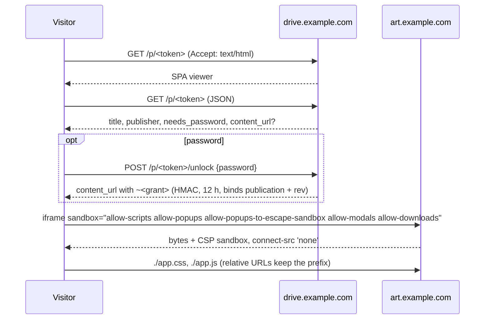

# Publishing (M50)

A file `.html` or a folder in the drive becomes a public mini web site: a
stable URL that anyone with the link opens in a browser, scripts included.
It is what an AI chat's "artifact" link is, for a team's own drive. A person
publishes from the Share area of a node; an agent publishes over MCP.

## The constraint that decides the shape

The SPA and the API share one origin, and the session cookie is host-only
([deployment.md](../deployment.md#the-one-constraint-that-shapes-everything)).
HTML that a member uploaded, served from that origin, is stored XSS: its script
runs as whoever opens it and can call `/api/v1` with their session. So
published bytes are never served as an ordinary page of `PP_EXTERNAL_URL`:
they are served by a separate artifact router in the same `server` process,
and every response there carries a sandboxing CSP whose `sandbox` directive
gives the page an opaque origin. Where that router answers depends on
`PP_ARTIFACT_URL`, which is optional:

| Origin                                                   | What it serves                                                                       | Cookies             |
| -------------------------------------------------------- | ------------------------------------------------------------------------------------ | ------------------- |
| `PP_EXTERNAL_URL` (`drive.example.com`)                  | `/p/<token>` — the viewer page (SPA): title, publisher, password form, an `<iframe>` | not needed          |
| `PP_EXTERNAL_URL`, `PP_ARTIFACT_URL` unset (the default) | `/a/<token>/[~<grant>/]<path>` — the snapshot's bytes, `GET`/`HEAD` only             | none read, none set |
| `PP_ARTIFACT_URL` set (`art.example.com`, the hardening) | `/<token>/[~<grant>/]<path>` — the snapshot's bytes, `GET`/`HEAD` only               | none read, none set |

The artifact router (`httpapi/artifact.go`) is selected by the main router's
first middleware, before anything else — no `/api`, `/auth`, `/mcp`, `/dav`,
`/s`, no SPA, no session middleware, none of the main site's security headers.
Unset, it is selected by the path prefix `/a` (`publish.SamePath`, stripped
with `http.StripPrefix`); set, by `Host`, and then `/a/` on the main host is a
plain 404 like any unmatched path (`/a` is in `apiPrefixes`). The model it
serves from (snapshots, tokens, grants, liveness) is `internal/publish`.
`TestArtifactHostServesNothingElse` holds both directions of the separate
host; `TestPublishOnTheAppOrigin` covers the `/a/` mode.

**The tradeoff.** On the app's origin, the CSP `sandbox` header is the only
thing keeping a published script away from the viewer's session. A response
that reaches the browser without it — a proxy that strips or overrides CSP, a
browser that ignores the CSP `sandbox` directive — runs the page as whoever
opens it, with their cookie. On a separate origin the same failure gets a page
with no session to use. The default is fine for a team that trusts its
publishers; set `PP_ARTIFACT_URL`, ideally on its own registrable domain,
before letting untrusted people publish. `GET /api/v1/users/me` reports
`publishing_isolated` (true only with `PP_ARTIFACT_URL`), and Admin › Settings
› Sharing › Publishing shows a warning ("Published sites share this address")
while it is false.

The diagram shows the separate host; in the default mode `A` is
`drive.example.com/a/`.



## Snapshot and republish

Publishing takes a **snapshot**: the source's file tree becomes a manifest of
`path → blob_hash` rows. The bytes are already in the CAS, so nothing is
copied. Editing the source changes nothing public until the person presses
**Republish**, which replaces the manifest and bumps `rev`; the URL stays.

- A file source publishes one file, which must be `.html`/`.htm` (422
  otherwise); its name is the entry.
- A folder source publishes every live file beneath it, with paths relative to
  the folder. Only folders are descended — a block document's sub-pages are
  not part of the site. Nodes with no bytes (extension nodes such as a kanban
  board) are skipped. The entry is `index.html` at the root, or a path the
  publisher picks; a folder with neither cannot be published (422).
- A block document (`.md`) is a file like any other here: its markdown is served
  as `text/markdown`, not rendered.
- Limits: `PP_MAX_PUBLICATION_BYTES` (default 50 MiB) over the whole snapshot and
  2000 files; 413 above either. A snapshot the space's quota has no room for
  (counting what a republish releases) is 413 too.

A source has at most one publication. The publication outlives the source's
edits and trashing — it is a snapshot — but a **purged** source deletes it.

## Data

Migration `0030_publications.sql`:

```
publications(id, tenant_id, space_id,
             node_id,                  -- the source; UNIQUE; ON DELETE CASCADE
             title,                    -- the source's name at publish time
             entry_path,
             token_hash,               -- sha256 of the token; UNIQUE; the lookup
             token_sealed,             -- AES-GCM under DeriveKey("publication-token-v1"); shown again in the dialog
             rev, published_at,
             password_hash,            -- NULL = no password; PBKDF2-SHA256 (stdlib crypto/pbkdf2)
             expires_at,               -- NULL = never
             created_by, created_at)
publication_files(publication_id, path, blob_hash, size, mime,
                  PRIMARY KEY (publication_id, path))   -- ON DELETE CASCADE
```

- **The token is sealed, not only hashed.** A share link's token is shown once
  (`share.CreateLink`); a published URL is meant to be handed out again, so the
  dialog shows it whenever the publisher opens it. Lookup is still by hash. A
  database dump yields the URLs of content that is public by intent;
  password-protected publications stay behind their password.
- **Blob references are counted.** Triggers on `publication_files` keep
  `blobs.ref_count` like versions do, so GC never collects a blob a publication
  still serves, even after the source is purged
  ([storage.md](storage.md#garbage-collection)). Unpublish is a `DELETE`; the
  triggers release the blobs and the sweep reclaims the bytes.
- **Quota.** A snapshot's bytes count against the space's `used_bytes`, as every
  stored version does since M30.

## Who may publish, and when it stops serving

Publishing and republishing need what creating a public link that allows
downloads needs on the source (`share.CreateLink`'s checks: share and
download on the node, the space's `allow_public_links`), plus the instance's
`artifacts_enabled`. Reading the
publication, changing its settings and unpublishing need the same, or being
the publication's creator — who can do so even with the source in the trash.

Every request re-checks, on the publication's row: not expired, the instance
switch on, the space's `allow_public_links` on and the space not archived, and
the creator still a member of the space. Any of them failing is a 404 on both
origins — the same answer as a token that never existed.

## The artifact router

`GET`/`HEAD /<token>/<path>` and `/<token>/~<grant>/<path>` (under `/a` on the
app's origin):

- **Paths.** Percent-decoded once, cleaned, and refused (404) if they escape
  the root (`..`, a backslash, a NUL, an empty segment such as `//`). `/<token>`
  redirects (302) to `/<token>/`, and a folder named without its slash to the
  folder, with a relative `Location` (`<last-segment>/`) so it works under the
  prefix; a path ending in `/` serves its `index.html`. A miss serves the
  snapshot's `404.html` with status 404 if there is one.
- **Password.** A publication with a password answers 404 to a path without a
  grant. The grant is `base64url(pub_id | rev | exp | HMAC)` under
  `DeriveKey("publication-grant-v1")`, valid 12 h and only for that `rev`, so a
  republish ends every grant. It lives in the path, not a cookie, because a
  sandboxed frame has an opaque origin and relative URLs keep the prefix.
- **Caching.** `ETag` is the blob hash; `Cache-Control: private, no-cache`, so a
  revalidation is a 304 and an unpublish takes effect on the next request.
  Range requests are served; text types are gzipped.
- **Headers, on every response:**

  ```
  Content-Security-Policy: sandbox allow-scripts allow-popups allow-popups-to-escape-sandbox allow-modals allow-downloads;
    default-src 'none'; script-src <ART> 'unsafe-inline' 'unsafe-eval' <CDN>;
    style-src <ART> 'unsafe-inline' <CDN>; img-src <ART> data: blob: <CDN>;
    font-src <ART> data: <CDN>; media-src <ART> data: blob:;
    connect-src 'none'; form-action 'none'; base-uri <ART>; frame-src 'none';
    frame-ancestors <PP_EXTERNAL_URL>
  X-Content-Type-Options: nosniff
  Referrer-Policy: no-referrer
  ```

  `<ART>` is `PP_ARTIFACT_URL`, or `${PP_EXTERNAL_URL}/a/` when it is unset
  (the trailing slash makes the path source cover the prefix), named
  explicitly rather than `'self'`, so the policy does not depend on how a
  browser reads `'self'` in an opaque-origin document. `<CDN>` is the admin's
  allowlist. The `sandbox` directive in the header means a visitor who opens
  an artifact URL directly, outside the viewer, still gets an opaque origin.

- **Logging.** The access log redacts the token and the grant, as it does for
  `/s/` (`/a/REDACTED/~REDACTED/…` on the app's origin). A per-IP limit sits in
  front, like `/s/`.

## The viewer

`/p/<token>` on the main origin is told apart like `/s/<token>`: `Accept:
text/html` is the SPA, anything else the API.

| Route                    | Answer                                                                                                                                     |
| ------------------------ | ------------------------------------------------------------------------------------------------------------------------------------------ |
| `GET /p/{token}`         | `{title, entry_path, rev, published_at, published_by, expires_at, needs_password, content_url?}` — `content_url` when there is no password |
| `POST /p/{token}/unlock` | `{password}` → `{content_url}` (with the grant); **422** for a wrong password — the client reads 401 as "session gone"                     |

`/p/` is anonymous, outside `/api/v1`, behind its own per-IP limit, and `unlock`
has a tighter one. The page is `apps/web/src/routes/p/$token.tsx`: a thin bar
(`BrandMark`, title, "Published by X · user content"), the password form when
needed, and the frame filling the rest. The main CSP's `frame-src` names
`PP_ARTIFACT_URL` when it is set; in the default mode `'self'` already covers
the frame.

## Managing a publication

| Route                                   | What it does                                                                                            |
| --------------------------------------- | ------------------------------------------------------------------------------------------------------- |
| `GET /api/v1/nodes/{id}/publication`    | The node's publication, or 404                                                                          |
| `POST /api/v1/nodes/{id}/publication`   | Publish or republish: take a snapshot. Body `{entry_path?, password?, expires_at?}` as for PATCH        |
| `PATCH /api/v1/nodes/{id}/publication`  | Settings only, no snapshot. `password`: string sets, `null` clears, absent keeps; `expires_at` likewise |
| `DELETE /api/v1/nodes/{id}/publication` | Unpublish                                                                                               |

A publication is `{id, node_id, url, title, entry_path, rev, published_at,
expires_at, has_password, file_count, total_bytes, stale, published_by}`.
`stale` is true when a file in the source changed after `published_at`.
Publishing, republishing, settings changes and unpublishing are audited
(`publication_created`, `publication_updated`, `publication_deleted`).

**Web.** `Publish…` in `nodeActions()` for an `.html`/`.htm` file and for a
folder, shown only when the instance offers publishing. It opens a better-modal
dialog: the entry (a select when the folder has no `index.html`), a password
switch, an expiry (never, 1, 7, 30 days), the URL with Copy and Open, and
Republish / Unpublish once published, with a "changed since published" note
when `stale`.

## Settings

| Setting                    | Where                      | Default                                                                                                                          |
| -------------------------- | -------------------------- | -------------------------------------------------------------------------------------------------------------------------------- |
| `PP_ARTIFACT_URL`          | env (`server`)             | unset — published bytes are served under `/a/` on `PP_EXTERNAL_URL` (sandbox CSP only)                                           |
| `PP_MAX_PUBLICATION_BYTES` | env (`server`)             | 50 MiB                                                                                                                           |
| `artifacts_enabled`        | Admin › Settings › Sharing | off — the only switch publishing needs                                                                                           |
| `artifact_cdn_allowlist`   | Admin › Settings › Sharing | `https://cdnjs.cloudflare.com https://cdn.jsdelivr.net https://unpkg.com https://fonts.googleapis.com https://fonts.gstatic.com` |

`PP_ARTIFACT_URL` is the recommended hardening for production. When set it
must be a different host from `PP_EXTERNAL_URL` (the server refuses to start
otherwise), and `https://` whenever `PP_EXTERNAL_URL` is. Another registrable
domain (`example-usercontent.com`) is better than a subdomain, but a subdomain
is safe too: nothing on the artifact host reads or sets cookies, and the
session cookie is host-only.

## Agents

`publish_artifact` and `unpublish_artifact` in `internal/agenttools`, offered
only when `artifacts_enabled` and `mcp_public_links` are both on — publishing is
a public link with scripts.

- `publish_artifact(space_id, folder_id?, name, files: [{path, content,
encoding?: "utf8" | "base64"}], entry_path?, password?, expires_in_days?)`
  writes the files into a folder `name` in the drive (created, or updated in
  place when it exists and was published before — files the call no longer
  names go to the trash), then publishes it, and returns the publication with
  its URL. At most 8 MiB in total (`maxAgentFileBytes`).
- `unpublish_artifact(node_id)`.

This is the first agent tool that writes files that are not markdown; it does
so only into the folder it publishes, through an agent-only route
(`PUT /nodes/{id}/site-files`, `httpapi/agent_publish.go`) that refuses a
folder which holds files and is not a publication's source.

## Risks that remain

- **Same origin by default.** Without `PP_ARTIFACT_URL`, published pages live
  on the app's origin and only the CSP `sandbox` header keeps their scripts
  away from a visitor's session. A proxy that strips or overrides CSP, or a
  browser that ignores its `sandbox` directive, turns a publication into
  stored XSS. A separate origin bounds that failure; set it before untrusted
  people publish.
- **Phishing.** Arbitrary HTML is reachable from the company's domain family
  (its very origin, by default). The viewer always shows who published it and
  that it is user content, and `form-action 'none'` with `connect-src 'none'`
  leaves a page no way to post what a visitor types — but `allow-popups` lets
  it open any URL with data in the query string.
- **CDNs are a channel.** A request to an allowlisted CDN can carry data in its
  URL. That is the price of letting most generated HTML run; an admin who will
  not pay it empties the allowlist.
- **No content scanning**, as for every upload
  ([milestones.md](milestones.md#named-but-unscheduled)).

## Not in it

Rendering markdown as pages, uploading a `.zip` to publish, custom domains,
SPA fallback routing, embedding an artifact in third-party sites, view counts,
publishing to members only or to guests, a list of a space's publications.
