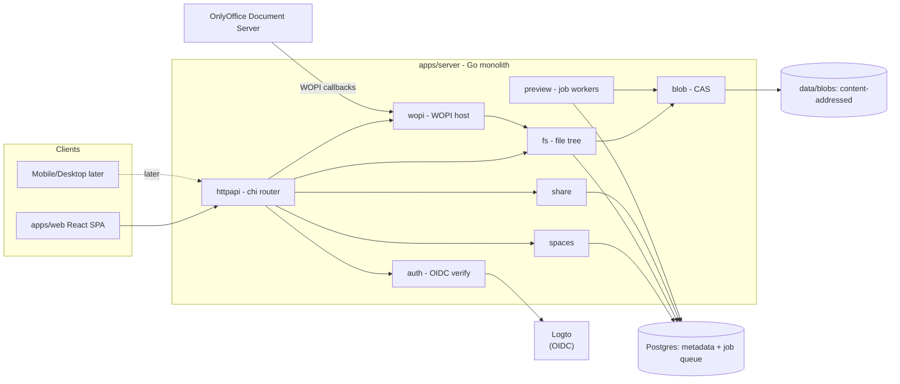

# System Design

## Chosen Architecture: Modular Monolith (Approach A)

A single Go binary with strict internal module boundaries communicating through interfaces. Background jobs (previews, thumbnails, quota, blob GC) run against a Postgres job table — in-process by default, with the media renderers split into an optional `cmd/worker` that shares the same table.

Rationale:

- Self-host all-in-one requires one deployable unit, minimal ops burden.
- Avoids the ocis failure mode (many microservices before the product exists).
- Scale path is preserved: the blob interface swaps local disk → S3 (implemented; SeaweedFS ships in the compose files); any module can be extracted into a service when a real reason appears.

Alternatives considered and rejected:

- **Fork/strip ocis**: inherits CS3/REVA debt and a forced microservices topology; contradicts "minimal".
- **Monolith + separate worker from day one**: adds a deploy unit and job contract before preview workload justifies it. Can be split later without architectural change — and was, once PDF/video rendering arrived. The trigger was not load but blast radius: `pdftoppm` and `ffmpeg` parse hostile input in memory-unsafe code and should not sit beside the master secret and the connection pool. `ClaimJobs` filtering on capability is what kept the split optional rather than mandatory. See [preview-pipeline.md](preview-pipeline.md).

## Component Map

## Key Data Flows

### Upload

Since M30 a user's upload is a tus 1.0.0 upload; the multipart endpoints are
gone. Each request stays short, so no proxy's request timeout or body cap
bounds the size of a file.

1. Client `POST /api/v1/uploads` with `Upload-Length` and `Upload-Metadata` (a new file under a folder, or `node_id` to replace an existing file). The server checks the upload cap, write access (and the editor lock for a replacement), and the quota against used bytes + bytes other in-flight uploads have promised + the declared length, then records an `uploads` row and an empty staging file under `<PP_BLOB_ROOT>/.uploads`.
2. Client sends `PATCH` chunks at `Upload-Offset`, sized from measured throughput. Each chunk is fsynced before the row's offset advances; an interrupted chunk keeps what arrived, and the client `HEAD`s to learn where to resume.
3. The chunk that completes the upload commits before its response: access and lock are re-checked, `blob.Store.Ingest` hashes the staging file (blake3) and renames it to `data/blobs/<2hex>/<hash>` (S3: puts the object, then removes the file), `fs.EnsureRoom` checks the measured size, then `fs` creates the node if it is new, adds `node_version(blob_hash, size, mime)`, bumps `nodes.current_version_id`, prunes versions beyond the retention count and recounts `used_bytes`. A 204 at full length means the file is in place.
4. The blob store claims the hash (a `blobs` row, pinned against GC) before it installs or deduplicates the bytes, and the node, version and current-version pointer commit in one transaction; the version row's trigger counts the reference. A crash or a refusal (quota) between the claim and that commit leaves an unreferenced row that GC reclaims once the claim lapses. An upload idle for 24 hours is swept with its staging file.

WOPI `PutFile` is the other writer: it streams its body through `blob.Put` (temp file → hash → rename) under `limitBody`, then follows step 3 from the quota check on.

### OnlyOffice edit (WOPI)

1. Website requests an edit session → server returns the OnlyOffice 9.x action URL (`/hosting/wopi/{type}/edit?WOPISrc=…`) + HMAC-signed WOPI access token (TTL ~10h; carries `user_id`, `node_id`, `perm`); the SPA POSTs a form with `access_token`/`access_token_ttl` into the editor iframe.
2. OnlyOffice calls `CheckFileInfo` → `BaseFileName, Size, OwnerId, UserId, UserCanWrite, Version, SupportsUpdate, SupportsLocks`.
3. `GetFile` streams the blob of `current_version_id`.
4. Co-editing happens inside OnlyOffice (same `FileId` = same session).
5. `PutFile` writes a new blob + new version. A stale `Version` yields 409; OnlyOffice re-merges.

### Share resolution

- Effective capabilities = ownership (`nodes.created_by` on the node or any ancestor → everything) OR the union of every grant reachable on the node or an ancestor, direct or through a group. Grants only widen; space membership by itself grants nothing.
- Link shares resolve without a user and allow read paths only (view, plus download when the link says so).

## Multi-Tenancy Posture

Every table carries `tenant_id` (single value `'default'` in MVP). No tenant routing exists yet; the column prevents a painful migration later.

## Sync & Marketplace Readiness (post-MVP)

- **Desktop/mobile sync**: the CAS blob interface hides chunking. A later rollsum-based chunk layer under `blob.Put` plus `chunkExists/chunkPut` endpoints enables delta sync without changing callers.
- **Marketplace/plugins**: designed as compile-time extensions behind a public `extsdk`, switched on per instance and per space — see [extensions.md](extensions.md) (M44–M46, kanban first).

## Deployment

Compose files in `deploy/compose/` (see `docs/codebase/directory-structure.md`): server, postgres, onlyoffice, Logto (self-hosted option, + its own database; Logto Cloud is the default dev IdP). Persistent state: `data/blobs` volume + postgres volume. Backup = `pg_dump` + rsync of `data/blobs`.
