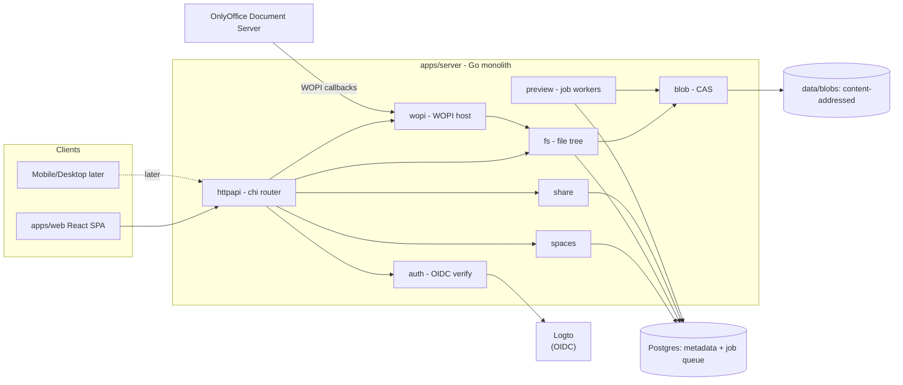

# System Design

## Chosen Architecture: Modular Monolith (Approach A)

A single Go binary with strict internal module boundaries communicating through interfaces. Background jobs (previews, thumbnails, quota, blob GC) run in-process against a Postgres job table.

Rationale:

- Self-host all-in-one requires one deployable unit, minimal ops burden.
- Avoids the ocis failure mode (many microservices before the product exists).
- Scale path is preserved: the blob interface swaps local disk → S3/MinIO; any module can be extracted into a service when a real reason appears.

Alternatives considered and rejected:

- **Fork/strip ocis**: inherits CS3/REVA debt and a forced microservices topology; contradicts "minimal".
- **Monolith + separate worker from day one**: adds a deploy unit and job contract before preview workload justifies it. Can be split later without architectural change.

## Component Map

## Key Data Flows

### Upload

1. Client `POST` multipart or tus resumable session.
2. `blob.Put` streams to a temp file, computes blake3, atomically renames to `data/blobs/<2hex>/<hash>`.
3. `fs` commits `node_version(blob_hash, size, mime)` and bumps `nodes.current_version_id` in one transaction.
4. Crash between steps leaves an orphan blob with `ref_count=0` → reaped by GC after a grace period.

### OnlyOffice edit (WOPI)

1. Website requests an edit session → server returns the OnlyOffice 9.x action URL (`/hosting/wopi/{type}/edit?WOPISrc=…`) + HMAC-signed WOPI access token (TTL ~10h; carries `user_id`, `node_id`, `perm`); the SPA POSTs a form with `access_token`/`access_token_ttl` into the editor iframe.
2. OnlyOffice calls `CheckFileInfo` → `BaseFileName, Size, OwnerId, UserId, UserCanWrite, Version, SupportsUpdate, SupportsLocks`.
3. `GetFile` streams the blob of `current_version_id`.
4. Co-editing happens inside OnlyOffice (same `FileId` = same session).
5. `PutFile` writes a new blob + new version. A stale `Version` yields 409; OnlyOffice re-merges.

### Share resolution

- Effective permission = space role (base), widened by the nearest direct share on the node or an ancestor. Shares never narrow.
- Link shares resolve without a user and allow read paths (view/download) only.

## Multi-Tenancy Posture

Every table carries `tenant_id` (single value `'default'` in MVP). No tenant routing exists yet; the column prevents a painful migration later.

## Sync & Marketplace Readiness (post-MVP)

- **Desktop/mobile sync**: the CAS blob interface hides chunking. A later rollsum-based chunk layer under `blob.Put` plus `chunkExists/chunkPut` endpoints enables delta sync without changing callers.
- **Marketplace/plugins**: modules already depend on interfaces, not concrete types — a plugin runtime can register new route providers and job kinds later.

## Deployment

Compose files in `deploy/compose/` (see `docs/codebase/directory-structure.md`): server, postgres, onlyoffice, Logto (self-hosted option, + its own database; Logto Cloud is the default dev IdP). Persistent state: `data/blobs` volume + postgres volume. Backup = `pg_dump` + rsync of `data/blobs`.
