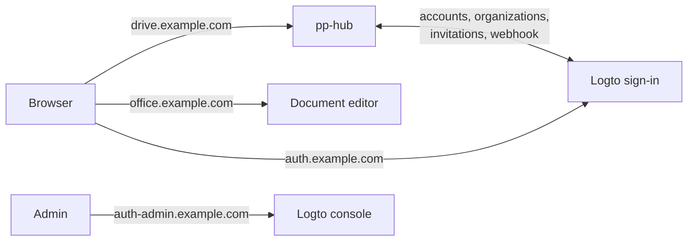

# Self-hosting pp-hub

This guide takes a server with Docker to a working pp-hub: people sign in,
spaces exist, invitations arrive by email. It takes about 30 minutes, most of
it waiting for DNS and the first image pull.

Two scripts do the fiddly parts:

| Script                           | What it does                                                                                             |
| -------------------------------- | -------------------------------------------------------------------------------------------------------- |
| `deploy/pp-generate.sh`          | Writes both compose stacks and their environments with fresh secrets, plus an HTTPS reverse-proxy config |
| `deploy/logto/pp-logto-setup.sh` | Configures Logto for pp-hub — apps, roles, email, sign-up, webhook — and fills in pp-hub's settings      |

Want the reasons behind each setting? [deployment.md](deployment.md) is the
reference; this page is the path.

## What you are setting up



Two Docker Compose stacks:

- **logto** — sign-in, accounts, and the list of who belongs to which company.
  Every pp-hub space is a Logto _organization_.
- **pp-hub** — the app itself, its database, the document editor and the
  preview worker.

Neither publishes a port on its own. Something in front has to terminate
HTTPS and route four domains to them — a reverse proxy on the same host (the
generator writes a ready [Caddy](https://caddyserver.com) config), or the
domain settings of a platform such as Dokploy, Coolify or Portainer, where the
two compose files paste in as they are.

## Before you start

- A Linux server with Docker and Compose, reachable from the internet.
- **Four DNS names** pointing at it, e.g.:

  | Name                     | For                 | Service → port    |
  | ------------------------ | ------------------- | ----------------- |
  | `drive.example.com`      | pp-hub              | `web` → 80        |
  | `office.example.com`     | document editor     | `onlyoffice` → 80 |
  | `auth.example.com`       | sign-in             | `logto` → 3001    |
  | `auth-admin.example.com` | Logto admin console | `logto` → 3002    |

- **An SMTP account** (your mail provider, SendGrid, Mailgun, SES…). Logto
  sends sign-up codes and invitations through it; without it nobody new can
  join.
- This repository, with `sh`, `openssl`, `curl` and `jq` wherever you run the
  scripts — the server or your own machine.
- Access to the images at `ghcr.io/pp-techs/pp-hub` — a GitHub token with
  `read:packages`, unless the packages are public.

## 1. Generate the files

```sh
PP_DOMAIN=drive.example.com \
OFFICE_DOMAIN=office.example.com \
AUTH_DOMAIN=auth.example.com \
AUTH_ADMIN_DOMAIN=auth-admin.example.com \
PP_ADMIN_EMAIL=you@example.com \
PP_IMAGE_TAG=0.9.0 \
./deploy/pp-generate.sh
```

This writes `deploy/out/` (git-ignored):

| File                                 | What it is                                                   |
| ------------------------------------ | ------------------------------------------------------------ |
| `logto.compose.yml`, `logto.env`     | The Logto stack                                              |
| `pphub.compose.yml`, `pphub.env`     | The pp-hub stack                                             |
| `logto.ports.yml`, `pphub.ports.yml` | Publish the services on `127.0.0.1` for a proxy on this host |
| `Caddyfile`                          | That proxy, with automatic HTTPS for all four domains        |
| `NEXT-STEPS.md`                      | These same steps, with your domains filled in                |

`PP_ADMIN_EMAIL` becomes pp-hub's first instance administrator — the person
who can create spaces. The script refuses to overwrite an existing output,
because the passwords in it belong to a running database once you deploy.

## 2. Start Logto

From `deploy/out/`:

```sh
docker compose -p logto -f logto.compose.yml -f logto.ports.yml --env-file logto.env up -d
caddy run --config Caddyfile        # or install Caddy as a service with this file
```

Using a platform instead? Create a compose app from `logto.compose.yml` with
`logto.env` as its environment, and route the two Logto domains as in the
table above; skip the ports file and Caddy.

The first start takes about a minute while Logto prepares its database;
`https://auth.example.com/api/status` answers when it is up. Then, in the
Logto console at `https://auth-admin.example.com`:

1. Create the admin account (the first visit asks for it).
2. **Applications → Create application → Machine-to-machine**, name it
   `bootstrap`. On its **Roles** tab, assign **Logto Management API access**.
   Copy the **App ID** and **App secret**.

That is the only thing clicked by hand. The next step uses this app to
configure everything else.

## 3. Configure Logto for pp-hub

```sh
export LOGTO_ENDPOINT=https://auth.example.com
export LOGTO_BOOTSTRAP_CLIENT_ID=<App ID>
export LOGTO_BOOTSTRAP_CLIENT_SECRET=<App secret>
export PP_EXTERNAL_URL=https://drive.example.com
export SMTP_HOST=smtp.example.com SMTP_PORT=587
export SMTP_USER=<user> SMTP_PASS=<password>
export SMTP_FROM='pp-hub <noreply@example.com>'
export PP_ENV_FILE=deploy/out/pphub.env
./deploy/logto/pp-logto-setup.sh
```

It creates, or brings back in line if they already exist:

- the **pp-hub** sign-in application, with `https://drive.example.com/auth/callback`
  as its redirect URI;
- a **pp-hub server** machine-to-machine application, which pp-hub uses to
  manage organizations, members and accounts;
- the organization roles **admin** and **member**;
- an **SMTP** email connector with pp-hub's emails: sign-up, sign-in and
  password-reset codes, and the invitation email with its sign-in link;
- **email sign-up with verification** — invited people create their own
  account with the address they were invited on;
- a **webhook** to `https://drive.example.com/hooks/logto`, so changes made in
  Logto reach pp-hub within seconds;
- a **pp-hub MCP** API resource for `https://drive.example.com/mcp/`, and
  **client ID metadata documents** switched on, so AI agents can sign in
  (see the optional step after first sign-in).

and writes the resulting IDs, secrets and webhook key into `pphub.env`. It is
safe to run again — after changing the SMTP password, say. You can delete the
`bootstrap` application afterwards.

Port 465 means TLS from the start and is detected automatically; any other
port is upgraded with STARTTLS. Set `SMTP_SECURE=true` to force the former.

## 4. Start pp-hub

Unless the packages are public, log in to the registry first:
`docker login ghcr.io` with a token that has `read:packages`. Then, from
`deploy/out/`:

```sh
docker compose -p pphub -f pphub.compose.yml -f pphub.ports.yml --env-file pphub.env up -d
```

Caddy from step 2 already routes the two pp-hub domains. On a platform: a
second compose app from `pphub.compose.yml` with the filled-in `pphub.env`,
the two pp-hub domains routed as in the table, and a registry credential for
`ghcr.io` if the images are private.

The server refuses to start if a required value is missing and names it in
its log, so a typo shows up here rather than later.

## 5. First sign-in

1. Open `https://drive.example.com` → **Create account** with the
   `PP_ADMIN_EMAIL` address, and enter the code that arrives by email.
2. You are the instance administrator. **Create a space** from the space
   switcher — this also creates its organization in Logto.
3. Open the space's **Settings → Members → Invite people** and add an email
   address. Someone without an account gets an invitation email; they create
   their account with that address and land in the space.

Access to files comes from groups, not from membership: add people to a group
and share folders with it (**Settings → Groups**, then **Share** on a folder).

**Optional: let people connect AI agents.** pp-hub can be added to Claude or
ChatGPT as a custom connector (MCP), and the agent then works with exactly
the person's own access. If Logto was configured before this feature (M41),
re-run `pp-logto-setup.sh` once — it is idempotent — so it registers the
`pp-hub MCP` API resource and turns on client ID metadata documents. Then
switch on **Admin → Settings → Agent access (MCP)**. Each person copies the
connector URL from **Settings → Security → AI agents** into Claude or
ChatGPT. Both services and Logto must be reachable from the internet; see
[deployment.md](deployment.md#agent-access-mcp). For a client configured from
a file — Claude Code or Cursor through `.mcp.json`, a CI job — a person can
instead create a **personal token** in the same place (at most 90 days) and
put it in an `Authorization: Bearer` header; administrators can turn personal
tokens off on the same settings card.

**Optional: mount the drive over WebDAV.** Switch on **Admin → Settings →
WebDAV**; each person then creates a WebDAV token in **Settings → Security →
Mount as a drive** and mounts `https://drive.example.com/dav/` in rclone,
Finder or Explorer — for example so a coding agent on their laptop can work on
the files. The generated `Caddyfile` needs no change; another proxy must not
cap or buffer request bodies on `/dav` and needs long timeouts, see
[deployment.md](deployment.md#webdav-dav).

**Optional: personal spaces and sharing outside a space.** In **Admin →
Settings → Personal use**, _Personal spaces_ gives each account a "My Drive"
beside its organization spaces: **Members of an organization** for a company
instance (Logto's email sign-up stays open for invitees, so **Everyone** would
let anybody who finds the instance store files), **Everyone** for a public one,
which requires a personal quota first. _Allow sharing outside a space_ lets
people share by email with someone outside a space, or with an address that has
no account yet (an invitation mail, so configure SMTP); each organization's
admins still switch it on for their space in **Settings → General**. Personal
spaces of accounts deleted in Logto are listed on the same card for purging.
See [personal-spaces.md](architecture/personal-spaces.md).

## Day two

**Upgrading pp-hub.** Change `PP_IMAGE_TAG` in `pphub.env` and run the same
`up -d`. Database migrations run on start. Rolling back is changing it back.

**Upgrading Logto.** Change `LOGTO_IMAGE_TAG` in `logto.env` and run its
`up -d`; its schema is migrated on start. Re-run `pp-logto-setup.sh`
afterwards to confirm the configuration still applies.

**People and companies are managed in two places, deliberately.** Invite,
remove, promote and suspend from pp-hub and the change goes to Logto first.
Do the same in the Logto console and pp-hub follows within seconds (webhook)
or at the latest within an hour (sweep). A space created before it was linked
to Logto shows **Link to Logto** on its People pane.

**Backups.** `deploy/backup/pp-backup.sh` covers pp-hub (see
[deployment.md](deployment.md#operational-notes)). Logto's database is
separate — back up its `logto_pg_data` volume, or `pg_dump` the `logto-db`
service, on the same schedule.

## When something is off

| Symptom                                                           | Likely cause                                                                                                                                                                                                    |
| ----------------------------------------------------------------- | --------------------------------------------------------------------------------------------------------------------------------------------------------------------------------------------------------------- |
| pp-hub server restarts, log says `PP_LOGTO_… are required`        | `pphub.env` was used before the setup script filled it in                                                                                                                                                       |
| Sign-in bounces back to `/login?error=…`                          | `PP_EXTERNAL_URL` does not match the domain in the browser, or the Logto redirect URI does — re-run the setup script with the right `PP_EXTERNAL_URL`                                                           |
| Every save answers 403 `cross-origin request refused`             | Same: `PP_EXTERNAL_URL` must be exactly the address people type, `https://` included                                                                                                                            |
| Invite answers 502 `connector.invalid_config` or no email arrives | SMTP settings; re-run the setup script with corrected `SMTP_*`, then send a test from the Logto console (**Connectors → SMTP**)                                                                                 |
| Changes in the Logto console take up to an hour to show           | The webhook is not delivered. Logto refuses private or special-use addresses, so `drive.example.com` must resolve to a public IP from the Logto container. Delivery logs: Logto console → **Webhooks → pp-hub** |
| Image pull fails with `denied`                                    | Not logged in to `ghcr.io`, or the platform has no registry credential for it                                                                                                                                   |
| Uploads fail on a proxy other than Caddy                          | Its request-body limit is below 64 MiB, the largest upload chunk; see [deployment.md](deployment.md#a-reverse-proxy-on-the-same-host)                                                                           |
| Claude or ChatGPT says it couldn't reach the MCP server           | **Agent access** is off in Admin → Settings (both `/mcp/` and `/.well-known/oauth-protected-resource` then answer 404), or the proxy in front does not pass those two paths to pp-hub                           |
| Connecting an agent fails at the Logto sign-in                    | CIMD is not enabled — re-run the setup script and read its warnings (a 422 means one of the `SSRF_*` variables is set on Logto) — or Logto is not reachable from the internet, or cannot fetch outbound HTTPS   |
| The agent gets 403 `sign in to pp-hub once…`                      | That person has a Logto account but has never signed in to pp-hub; one sign-in in the browser creates their account                                                                                             |

## Using Logto Cloud instead

Skip step 2. Create a tenant at [cloud.logto.io](https://cloud.logto.io),
create the `bootstrap` machine-to-machine app there the same way, then run
step 3 with `LOGTO_ENDPOINT=https://<tenant-id>.logto.app` and
`LOGTO_API_RESOURCE=https://<tenant-id>.logto.app/api`. The setup script
writes the tenant's address into `PP_OIDC_ISSUER` and `PP_LOGTO_ENDPOINT`;
start only the pp-hub stack, and drop the two Logto domains from the
`Caddyfile`.
